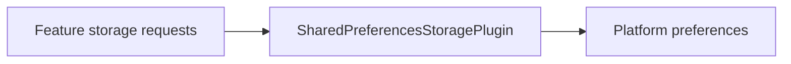

# Preferences Storage Plugin

`SharedPreferencesStoragePlugin` implements the `StoragePlugin` contract on the
platform's preferences store: NSUserDefaults on iOS and macOS,
SharedPreferences on Android, and localStorage on the web. It needs no
entitlements or signing.



[Browse every public declaration and member](/api/vyuh-plugin-storage-shared-preferences).

<PubBadge package="vyuh_plugin_storage_shared_preferences" />

## When to use it

Choose it for small, non-sensitive preferences such as a chosen theme mode, a
dismissed hint or the last opened tab. Values are stored as strings: `write`
stores `value.toString()` and `read` returns that string. Use
[Hive storage](hive-storage) for larger or structured data, and
[secure storage](secure-storage) for secrets.

## Usage

```dart
import 'package:vyuh_core/vyuh_core.dart' as vc;
import 'package:vyuh_plugin_storage_shared_preferences/shared_preferences_storage_plugin.dart';

void main() {
  vc.runApp(
    plugins: vc.PluginDescriptor(storage: SharedPreferencesStoragePlugin()),
    features: () => [/* your features */],
  );
}
```

Features read and write through the shared contract, so they don't depend on
which storage the app chose:

```dart
await vyuh.storage.write('theme.mode', 'dark');
final mode = await vyuh.storage.read('theme.mode');
```
