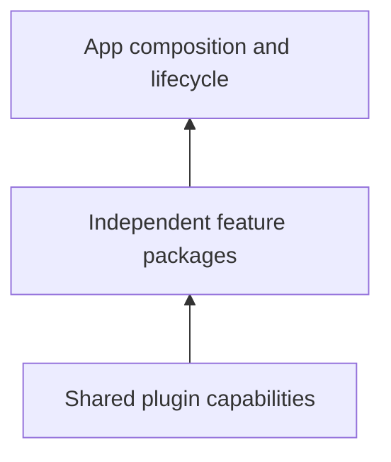

# Vyuh Core

Compose product slices with `FeatureDescriptor`, choose capability implementations with `PluginDescriptor`, and launch through `runApp`.

<PubBadge package="vyuh_core" />

## Composition

Each descriptor has a unique name and a title. Everything else is optional:

- routes
- `init` and `dispose` hooks
- dependencies on other features
- extension contributions
- app-level `events` handlers and `redirects`

The app supplies the selected descriptors. The runtime starts each feature's hooks, assembles its routes, and stops everything again on dispose or restart.

Use [the quick start](/intro/get-started) for a complete first app and [feature descriptors](/guides/feature-descriptors) for ownership and dependencies.

## Shared capabilities

Plugins expose network, storage, secure storage, auth, navigation, DI, events, analytics, environment, and telemetry contracts. The app selects implementations; features consume their contracts.

Unspecified named slots use `PluginDescriptor.system` defaults. Custom capabilities go in `others` and are retrieved through `vyuh.getPlugin<T>()`. Read [using plugins](/guides/using-plugins) and [custom plugins](/guides/custom-plugins).

## Events, redirects and failures

- **Events.** The platform emits typed lifecycle events: started, feature loaded or failed, ready, init failed, route failure. Features declare handlers for them and for each other's events. See [events](/guides/events).
- **Redirects.** Features add redirects that compose into one chain and re-run when their events or listenables fire. See [feature redirects](/guides/routes-and-navigation#feature-redirects).
- **Failures.** Every failure is a `VyuhFailure`, reported once and shown with a way out: Try again, Back, Go home or Restart. See [errors and recovery](/guides/errors-and-recovery).

## Theme and strings

`PlatformWidgetBuilder.theme` takes a `VyuhTheme`, which every framework screen uses, in light and dark. `VyuhThemeExtension` tokens restyle them. `PlatformWidgetBuilder.strings` takes a `VyuhStrings` with every user-facing string, for translation. See [theming](/guides/theming).

## Lifecycle and lazy loading

Preloaded plugins initialize before the main platform stage. The remaining plugins initialize concurrently, then features initialize after their declared prerequisites. Feature cleanup always runs before shared plugin cleanup, on dispose and on restart.

Lazy descriptors postpone loading and activation until needed. Concurrent requests share activation, and a loader must return a matching feature name. Read [startup and lifecycle](/concepts/runtime-lifecycle).

## Complete API

[Browse every public declaration and directly declared member](/api/vyuh-core). The source-derived reference includes exact constructors, optional parameters, base contracts, and lifecycle helpers.
