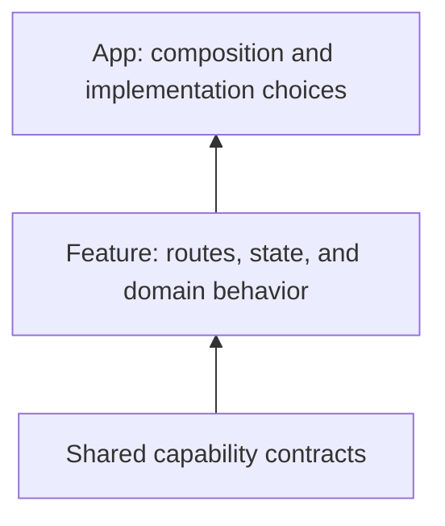

# Best practices

Start with one feature that delivers a complete user journey. Add boundaries where they help ownership and reuse, then compose more features as the product grows.

## Give each feature a clear owner

Keep its screens, state, models, and routes together. Export deliberate contracts rather than internal stores. Reserve distinct route prefixes and feature names.

## Share capabilities instead of duplicating adapters

Use the network, storage, auth, telemetry, event, and DI contracts. Add a custom plugin only when the existing contracts cannot represent the capability. Select vendor implementations in the app.

## Declare initialization dependencies

Independent features initialize concurrently. Use `FeatureDescriptor.dependencies` when one feature reads a service owned by another. Await initialization and cleanup; unawaited work can race with the next lifecycle.

## Own state at the right lifetime

Widget-local state belongs in widgets. Feature-wide services can be registered in DI with explicit cleanup. Avoid global stores for state that should reset when a screen closes.

## Make failures recoverable

Distinguish an empty result from a transport failure. Check response status before deserialization, report diagnostics through telemetry, and give users an action they can take. A feature flag is a rollout mechanism; enforce authorization in the backend.

## Measure before optimizing

Measure startup separately from useful-screen readiness. Use lazy features for rarely visited areas, observers around the smallest changing subtree, and caching for expensive repeated work. Choose an explicit TTL and invalidation policy.

## Test the contract

Exercise dependency ordering, failed startup, concurrent cache calls, disposal, and navigation with full query parameters. Test business behavior in its feature package and capability implementations independently.

Read [performance and correctness](/concepts/performance), [lifecycle](/concepts/runtime-lifecycle), and [feature APIs](/api/vyuh-core#featuredescriptor).
