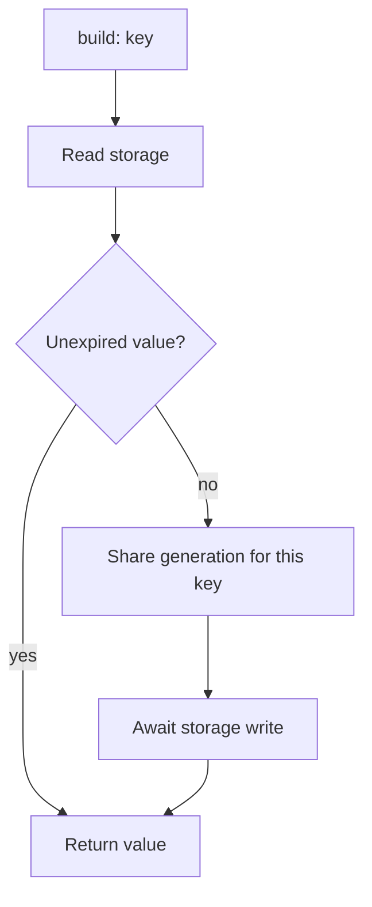

# Caching

`Cache<V>` wraps a `CacheStorage<V>` implementation with a configured TTL. Use it to reuse an expensive result while it remains valid. It is independent of the content system.

<PubBadge package="vyuh_cache" />



## Use the cache

```dart
import 'package:vyuh_cache/vyuh_cache.dart';

Future<void> main() async {
  final cache = Cache<String>(CacheConfig(
    storage: MemoryCacheStorage<String>(),
    ttl: const Duration(minutes: 5),
  ));
  final greeting = await cache.build(
    'greeting',
    generateValue: () async => 'Hello, Vyuh.',
  );
  print(greeting);
  await cache.remove('greeting');
}
```

## Choose an operation

| Operation | Behavior |
| --- | --- |
| `get` | Return an unexpired value, or null |
| `has` | Check whether an unexpired entry exists |
| `build` | Retrieve or generate; concurrent misses share generation |
| `set` | Store a value with the configured TTL |
| `remove` | Delete one key |
| `clear` | Clear stored entries |

Storage failure during `build` does not discard a freshly generated value. Generator failures propagate so callers can handle them and retry. `get` and explicit storage operations expose storage failures to callers.

Memory storage removes expired entries when accessed. Set `MemoryCacheStorage<String>(maxEntries: 500)` to bound it with least recently used eviction; omitting the limit keeps the existing unbounded policy. `remove`, `clear`, and explicit `set` prevent older generators from writing back into the cache. Existing callers can still receive the generated result: invalidation does not cancel the underlying operation.

See [all cache declarations](/api/vyuh-cache) and [performance and correctness](/concepts/performance).
