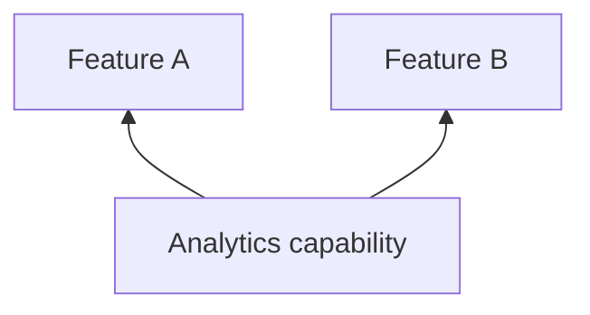

# Analytics

## Why this capability exists

Product events need consistent meaning across features. A shared capability keeps event names and identity handling independent of a particular analytics backend.



## When to use it

Agree on event names and parameters across teams. Configure providers centrally and respect your App’s consent and data collection policies.

## Use it from a feature

The following fragment runs after plugin initialization, for example inside a feature’s initialization hook or a ready screen.

```dart
import 'package:vyuh_core/vyuh_core.dart';

await vyuh.analytics.reportEvent('catalog.opened', params: {'source': 'navigation'});
```

## Choose the implementation

Configure the `analytics` named slot in `PluginDescriptor` at App startup. Features depend on `AnalyticsPlugin`; the App supplies an implementation or provider configuration. Use named slots for system capabilities rather than adding them to `others`.

The default uses a no-op provider. AnalyticsPlugin forwards calls to its providers; navigation observers come from those providers.

## Related contracts

See [AnalyticsPlugin API](/api/vyuh-core#analyticsplugin) and [plugin lifecycle](/guides/using-plugins#understand-lifecycle-and-providers).
