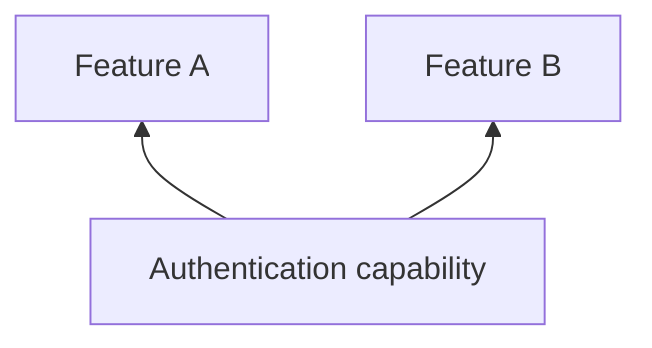

# Authentication

## Why this capability exists

Account, checkout, and profile features need a consistent view of identity. One authentication capability gives them the same session rather than separate sign-in state.



## When to use it

Select an adapter supporting your required sign-in methods. Backend authorization must still enforce access; hiding a route is not an authorization boundary.

## Use it from a feature

The following fragment runs after plugin initialization, for example inside a feature’s initialization hook or a ready screen.

```dart
import 'package:vyuh_core/vyuh_core.dart';

final user = vyuh.auth.currentUser;
```

## Choose the implementation

Configure the `auth` named slot in `PluginDescriptor` at App startup. Features depend on `AuthPlugin`; the App supplies an implementation or provider configuration. Use named slots for system capabilities rather than adding them to `others`.

The default UnknownAuthPlugin reports an unknown user and empty tokens. It does not implement a working sign-in service.

## Related contracts

See [AuthPlugin API](/api/vyuh-core#authplugin) and [plugin lifecycle](/guides/using-plugins#understand-lifecycle-and-providers).
