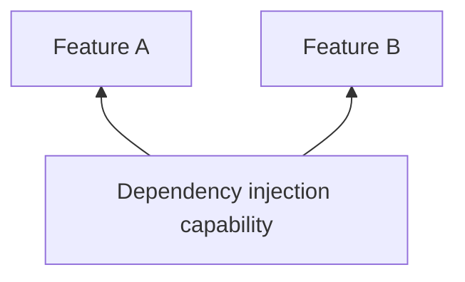

# Dependency injection

## Why this capability exists

Feature services need a clear owner and lifetime. A shared container lets features register services once and obtain them through a consistent contract.



## When to use it

Register feature-owned services during initialization and clean up resources in disposal. Declare feature dependencies when initialization requires another feature’s services.

## Use it from a feature

The following fragment runs after plugin initialization, for example inside a feature’s initialization hook or a ready screen.

```dart
import 'package:vyuh_core/vyuh_core.dart';

// Register this feature’s service during initialization.
vyuh.di.register<String>('catalog', name: 'catalog.label');
final label = vyuh.di.get<String>(name: 'catalog.label');
```

## Choose the implementation

Configure the `di` named slot in `PluginDescriptor` at App startup. Features depend on `DIPlugin`; the App supplies an implementation or provider configuration. Use named slots for system capabilities rather than adding them to `others`.

The default is GetItDIPlugin. Plugin startup itself has no dependency graph; descriptor order does not establish ordering between plugins.

## Related contracts

See [DIPlugin API](/api/vyuh-core#diplugin) and [plugin lifecycle](/guides/using-plugins#understand-lifecycle-and-providers).
