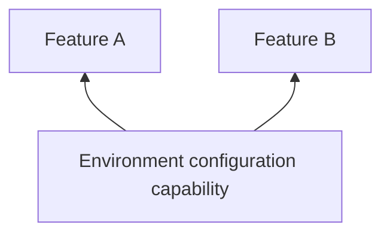

# Environment configuration

## Why this capability exists

Features need configuration such as API endpoints without hard-coding deployment choices. A shared environment contract lets the same package run in different Apps and environments.



## When to use it

Validate required configuration early. Treat client configuration as public information; never ship server secrets in a Flutter bundle.

## Use it from a feature

The following fragment runs after plugin initialization, for example inside a feature’s initialization hook or a ready screen.

```dart
import 'package:vyuh_core/vyuh_core.dart';

final endpoint = vyuh.env.maybeGet("API_URL");
```

## Choose the implementation

Configure the `env` named slot in `PluginDescriptor` at App startup. Features depend on `EnvPlugin`; the App supplies an implementation or provider configuration. Use named slots for system capabilities rather than adding them to `others`.

The default NoOpEnvPlugin has no configured environment. Use a configured implementation and explicit fallbacks for optional settings.

## Related contracts

See [EnvPlugin API](/api/vyuh-core#envplugin) and [plugin lifecycle](/guides/using-plugins#understand-lifecycle-and-providers).
