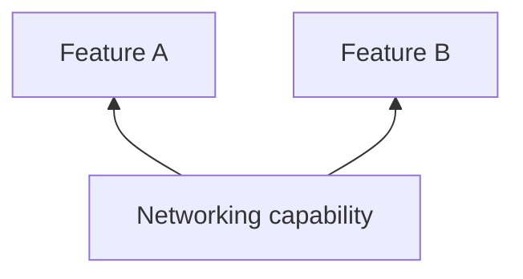

# Networking

## Why this capability exists

Features often talk to the same backend. A shared HTTP contract keeps transport choices out of feature packages and lets the App configure one client.



## When to use it

Use it for API requests and reusable service classes. Handle status codes and decode responses in the owning service; the contract does not promise automatic retries or interceptors.

## Use it from a feature

The following fragment runs after plugin initialization, for example inside a feature’s initialization hook or a ready screen.

```dart
import 'package:vyuh_core/vyuh_core.dart';

final response = await vyuh.network.get(Uri.parse("https://example.com/status"));
if (response.statusCode != 200) {
  throw StateError("Unable to load status");
}
```

## Choose the implementation

Configure the `network` named slot in `PluginDescriptor` at App startup. Features depend on `NetworkPlugin`; the App supplies an implementation or provider configuration. Use named slots for system capabilities rather than adding them to `others`.

HttpNetworkPlugin supplies the default HTTP client. Platform transport details belong to the implementation.

## Related contracts

See [NetworkPlugin API](/api/vyuh-core#networkplugin) and [plugin lifecycle](/guides/using-plugins#understand-lifecycle-and-providers).
