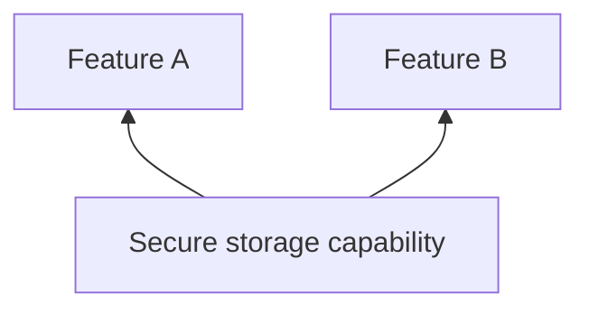

# Secure storage

## Why this capability exists

Credentials need a different storage policy from display preferences. A separate capability lets the App select platform protection while features share a small interface.



## When to use it

Use a suitable platform adapter for sensitive values. Decide how logout clears retained credentials and which platforms your adapter supports.

## Use it from a feature

The following fragment runs after plugin initialization, for example inside a feature’s initialization hook or a ready screen.

```dart
import 'package:vyuh_core/vyuh_core.dart';

final storage = vyuh.getPlugin<SecureStoragePlugin>()!;
await storage.delete("account.session");
```

## Choose the implementation

Configure the `secureStorage` named slot in `PluginDescriptor` at App startup. Features depend on `SecureStoragePlugin`; the App supplies an implementation or provider configuration. Use named slots for system capabilities rather than adding them to `others`.

The default InMemorySecureStoragePlugin neither encrypts nor persists values. The word secure describes the contract; protection is supplied by the selected adapter.

## Related contracts

See [SecureStoragePlugin API](/api/vyuh-core#securestorageplugin) and [plugin lifecycle](/guides/using-plugins#understand-lifecycle-and-providers).
