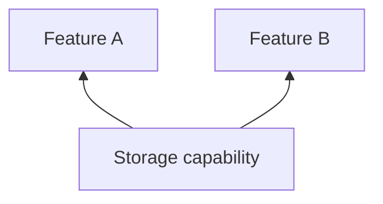

# Storage

## Why this capability exists

Preferences and local state should survive feature refactors. A shared key-value contract allows the App to choose persistence without coupling each feature to a database library.



## When to use it

Namespace keys by feature. Await writes and handle missing values. Choose an adapter whose supported value types and persistence match your product.

## Use it from a feature

The following fragment runs after plugin initialization, for example inside a feature’s initialization hook or a ready screen.

```dart
import 'package:vyuh_core/vyuh_core.dart';

final storage = vyuh.getPlugin<StoragePlugin>()!;
await storage.write("account.displayName", "Asha");
final name = await storage.read("account.displayName");
```

## Choose the implementation

Configure the `storage` named slot in `PluginDescriptor` at App startup. Features depend on `StoragePlugin`; the App supplies an implementation or provider configuration. Use named slots for system capabilities rather than adding them to `others`.

The default InMemoryStoragePlugin loses values when its process ends. Hive and shared-preferences adapters are separate packages.

## Related contracts

See [StoragePlugin API](/api/vyuh-core#storageplugin) and [plugin lifecycle](/guides/using-plugins#understand-lifecycle-and-providers).
