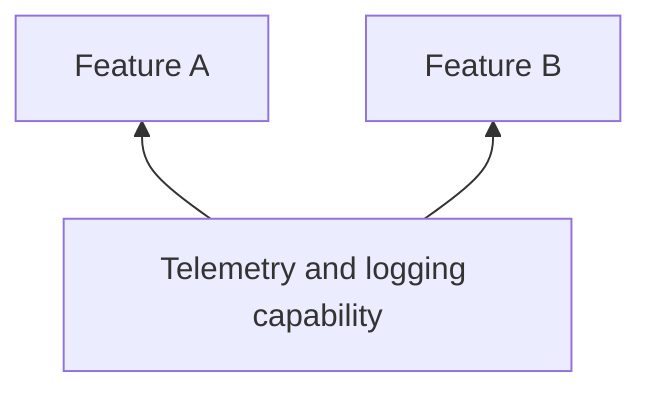

# Telemetry and logging

## Why this capability exists

Failures cross feature boundaries. Shared diagnostics help connect startup, network operations, and feature behavior in one operational view.



## When to use it

Choose providers for logs, traces, and errors. Keep sensitive values out of diagnostic payloads and decide what failures the App should surface to users.

## Use it from a feature

The following fragment runs after plugin initialization, for example inside a feature’s initialization hook or a ready screen.

```dart
import 'package:vyuh_core/vyuh_core.dart';

await vyuh.telemetry.reportMessage('Catalog initialized');
```

## Choose the implementation

Configure the `telemetry` named slot in `PluginDescriptor` at App startup. Features depend on `TelemetryPlugin`; the App supplies an implementation or provider configuration. Use named slots for system capabilities rather than adding them to `others`.

The default uses a no-op provider. TelemetryPlugin aggregates configured providers; configuring it does not guarantee an external monitoring service receives events.

## Related contracts

See [TelemetryPlugin API](/api/vyuh-core#telemetryplugin) and [plugin lifecycle](/guides/using-plugins#understand-lifecycle-and-providers).
