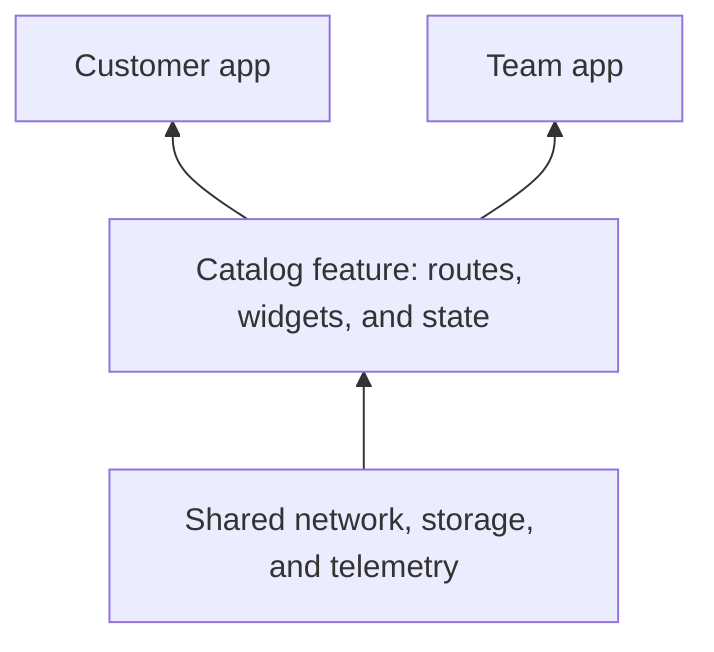

# Creating a feature

A feature is a portable product slice: its screens, domain logic, state, and routes travel together. The app chooses the features to include and the plugin implementations they share.



## Create a Flutter package

```bash
flutter create --template=package feature_catalog
cd feature_catalog
flutter pub add vyuh_core go_router
```

Put the descriptor and its public exports in `lib/feature_catalog.dart`. Keep implementation details under `lib/src/`.

```dart
import 'package:material_ui/material_ui.dart';
import 'package:go_router/go_router.dart';
import 'package:vyuh_core/vyuh_core.dart' as vyuh;

final feature = vyuh.FeatureDescriptor(
  name: 'catalog',
  title: 'Catalog',
  routes: () => [
    GoRoute(
      path: '/catalog',
      builder: (_, _) => const CatalogScreen(),
    ),
  ],
);

class CatalogScreen extends StatelessWidget {
  const CatalogScreen({super.key});

  @override
  Widget build(BuildContext context) => const Scaffold(
    body: Center(child: Text('Your catalog')),
  );
}
```

`name`, `title`, and `routes` are required. Return an empty list for a feature that contributes services without screens. Reserve a unique route prefix so the package can compose alongside other features.

## Compose it into an app

Add the feature package to the app’s dependencies, then select it at startup:

```dart
import 'package:feature_catalog/feature_catalog.dart' as catalog;
import 'package:vyuh_core/vyuh_core.dart' as vyuh;

void main() {
  vyuh.runApp(
    initialLocation: '/catalog',
    features: () => [catalog.feature],
  );
}
```

## Own state and cleanup

Use `init` to register long-lived feature services and `dispose` to release subscriptions and owned resources. Add feature names to `dependencies` when initialization reads another feature’s services. Independent features initialize concurrently; list order alone is not an initialization dependency.

Keep widget-local state in widgets. Use [dependency injection](scoped-di) for services shared by feature screens, [plugins](/plugins/) for app-wide capabilities, and [MobX](mobx-state-management) when you need reactive stores.

## Keep it portable

Expose the descriptor, domain contracts, and deliberately reusable widgets. Keep app branding, credentials, and vendor selection in the app. A second app can import the same package and provide different plugin implementations without copying its screens.

See [feature descriptor APIs](/api/vyuh-core#featuredescriptor) and [startup and lifecycle](/concepts/runtime-lifecycle).
