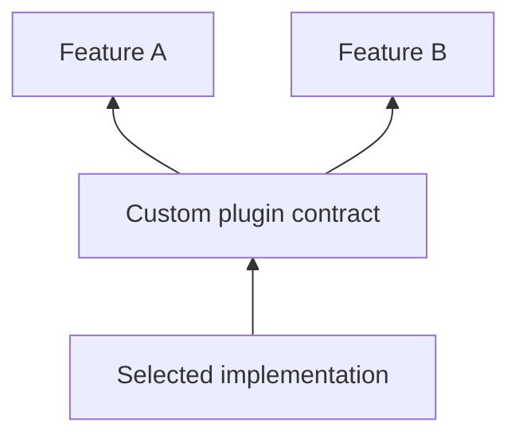

# Custom plugins

Use a custom plugin when several features need the same capability and none of the existing contracts fits. Define the contract in a shared package, keep implementations separate, and let the app choose one.



## Define and implement a capability

This complete in-memory implementation illustrates the lifecycle without requiring a vendor SDK:

```dart
import 'package:vyuh_core/vyuh_core.dart';

abstract class DraftsPlugin extends Plugin {
  DraftsPlugin() : super(name: 'app.drafts', title: 'Drafts');

  Future<String?> read(String key);
  Future<void> write(String key, String value);
}

final class MemoryDraftsPlugin extends DraftsPlugin {
  final _drafts = <String, String>{};

  @override
  Future<void> init() async {}

  @override
  Future<String?> read(String key) async => _drafts[key];

  @override
  Future<void> write(String key, String value) async {
    _drafts[key] = value;
  }

  @override
  Future<void> dispose() async {
    _drafts.clear();
  }
}
```

An app can replace this with a persistent adapter. If ordinary key-value storage meets your requirements, use `StoragePlugin` instead of duplicating it.

## Register and retrieve it

```dart
final plugins = PluginDescriptor(
  others: [MemoryDraftsPlugin()],
);
```

Pass this descriptor to `runApp`. The platform manages plugin `init` and `dispose`. Retrieve it by its abstract type after startup:

```dart
final drafts = vyuh.getPlugin<DraftsPlugin>();
if (drafts == null) {
  throw StateError('The app must provide a DraftsPlugin');
}
await drafts.write('checkout', 'Saved draft');
```

`others` registers plugins with the platform; it does not register them in DI. If you prefer a DI lookup, explicitly register the contract in a feature’s `init` hook after plugins are initialized.

## Match the lifecycle to the resource

Allocate clients in `init`, release subscriptions in `dispose`, and await cleanup. `InitOncePlugin` shares concurrent initialization and cleanup for a resource that should initialize once per lifecycle; implement its `initOnce` and `disposeOnce` hooks.

Keep plugin operations independent of feature widgets. Pass the data a capability needs into its methods, and keep product rules in the feature. See [Plugin APIs](/api/vyuh-core#plugin), [InitOncePlugin](/api/vyuh-core#initonceplugin), and [lifecycle ordering](/concepts/runtime-lifecycle).
