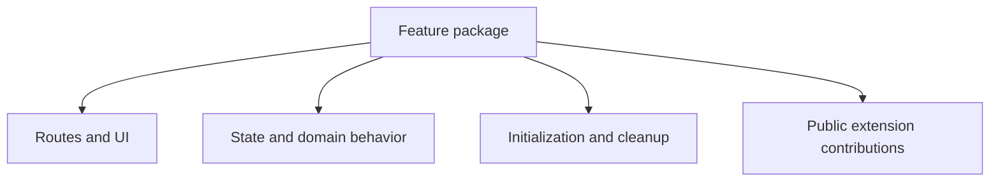
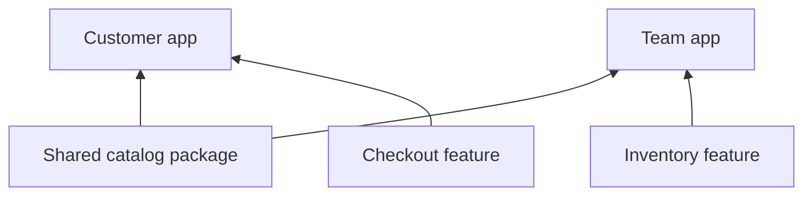

# Designing features

A feature should own a coherent product capability. Keep its routes, state, UI, initialization, and public contributions together. That boundary gives a team room to evolve the feature without changing the entire app.

## Follow product ownership

Catalog, account, and checkout are useful starting boundaries. A complete customer journey can cross all three. A single screen may be too small a boundary if it cannot own its behavior independently.

## Share services through plugins

Use the app’s network, auth, storage, telemetry, and logging contracts. Put shared infrastructure behavior in the plugin that owns it so every consuming feature benefits. Feature-specific domain behavior stays in the feature.

## Keep the public surface small

Export the descriptor and any components deliberately supported for reuse. Avoid importing another feature’s private implementation. Describe shared routes and extension contracts so consumers know how to integrate them.

## Make dependencies explicit

Declare the names of prerequisite features in `dependencies`. Include those features in the app composition. The runtime waits for prerequisites before initializing dependents; independent features remain free to initialize concurrently.

## Carry a feature between apps

Keep app-specific service implementations, branding, and configuration in the app. Reuse a feature package alongside a different collection of features. If a smaller part needs independent reuse, extract a supported component or a smaller coherent feature rather than copying private state.

Continue with [feature descriptors](feature-descriptors), [using plugins](using-plugins), and the [counter example](/examples/counter).
