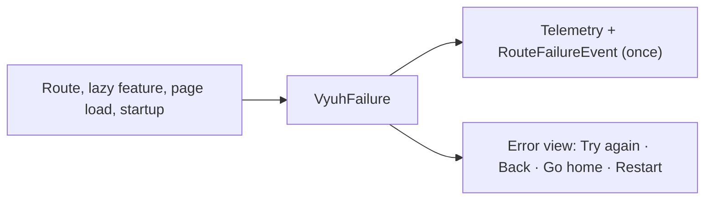

# Errors and recovery

When something fails, Vyuh does three things the same way everywhere:

1. **Describes** it as a `VyuhFailure`.
2. **Reports** it once, to telemetry and as an event.
3. **Shows** it in your theme, with a way out: try again, go back, go home,
   or restart.



## The failure model

```dart
final class VyuhFailure {
  final FailureKind kind;   // init, notFound, route, featureLoad,
                            // featureDisabled, content, unexpected
  final String title;       // user-facing
  final String? message;    // user-facing
  final Object? error;      // shown only in debug builds
  final StackTrace? stackTrace;
  final Uri? location;      // the route that failed
  final String? featureName;
}
```

The same object reaches telemetry, the
[failure events](events#system-events), and the error view.

## What the user sees

| Failure | View | Actions |
|---|---|---|
| A route has no match | Full page | Try again, Back, Go home |
| A page fails to load, or doesn't exist (for example a CMS page) | Full page | Try again, Back, Go home |
| A lazy feature fails to load | Full page | Try again, Back, Go home |
| A lazy feature is turned off by its flag | Full page | Back, Go home |
| A part of a page fails | Inline card | Try again |
| The app fails to start | Full page | Restart app |
| A widget throws while building (release builds) | Small placeholder | none |

The actions follow simple rules:

- **Back** appears only when there is a page to go back to.
- **Go home** appears whenever the router exists and the failure isn't on the
  home route itself.
- **Restart app** appears only when nothing else can help: the app failed to
  start, or there's no router, no history and no home route to go to.
- **Try again** re-runs only the operation that failed, such as the page
  fetch or the lazy load. It never rebuilds the whole app.

Error text and stack traces appear in a collapsible *Details* panel in debug
builds only.

## Set the home route

"Go home" goes to `homeLocation`, which defaults to `initialLocation`, then `/`:

```dart
runApp(
  initialLocation: '/welcome',
  homeLocation: '/',
  features: () => [...],
);
```

Code can go home too, with `vyuh.router.goHome()`.

## Uncaught errors

`runApp` routes uncaught Flutter and platform errors to the telemetry plugin
and keeps any handlers you installed before it. In release builds, a widget
that throws while building shows a small, themed placeholder instead of
Flutter's grey box, so one broken widget doesn't take down the page.

Turn this off with `runApp(captureErrors: false)` if your app installs its own
global handlers. It is always off under `flutter test`, which manages these
handlers itself.

## React to failures

Handle failure events in any feature, for example to log them or show a
banner:

```dart
FeatureDescriptor(
  name: 'monitoring',
  title: 'Monitoring',
  routes: () => [],
  events: [
    EventHandler<RouteFailureEvent>((e) => analytics.track('route_failed', {
      'kind': e.failure.kind.name,
      'location': '${e.failure.location}',
    })),
    EventHandler<FeatureLoadFailedEvent>((e) => log(e.failure)),
  ],
);
```

## Translate the text

Every string in these views comes from `PlatformWidgetBuilder.strings`. That
includes "Try again", "Go home", the failure titles and messages, and the
accessibility labels:

```dart
PlatformWidgetBuilder.system.copyWith(
  strings: VyuhStrings(
    tryAgain: 'Réessayer',
    goHome: 'Accueil',
    featureLoadFailedTitle: (title) => 'Impossible de charger $title',
  ),
);
```

## Customize the views

The views come from `PlatformWidgetBuilder`:

- `routeErrorView` for full-page failures
- `errorView` for inline failures

Both take a title, a subtitle, the error, the stack trace and an optional
retry callback. Inside either builder, `VyuhFailureScope.maybeOf(context)` returns the full
`VyuhFailure`, and `FailureActions` tells you which actions apply:

```dart
PlatformWidgetBuilder.system.copyWith(
  routeErrorView: (context, {required title, subtitle, error, stackTrace,
      onRetry, retryLabel}) {
    final failure = VyuhFailureScope.maybeOf(context);
    return MyErrorPage(
      title: title,
      message: subtitle,
      onRetry: onRetry,
      onBack: FailureActions.canGoBack(context)
          ? () => FailureActions.goBack(context)
          : null,
      onHome: FailureActions.canGoHome(context, failure)
          ? FailureActions.goHome
          : null,
    );
  },
);
```

To keep the default design but restyle it, use [theme tokens](theming#framework-tokens)
instead: colours, radius, title and message styles, an icon per failure
kind, icon size and page width. The default widgets `FailurePage` and `FailureCard` are public, so you
can also reuse them.

## Show a failure from your own code

When a route of yours can't be shown, use `RouteFailureView`. It reports the
failure once and renders it with the app's `routeErrorView`:

```dart
GoRoute(
  path: '/orders/:id',
  builder: (context, state) => OrderPage(
    id: state.pathParameters['id']!,
    onMissing: () => RouteFailureView(
      failure: VyuhFailure(
        kind: FailureKind.notFound,
        title: 'Order not found',
        message: 'It may have been cancelled.',
        location: state.uri,
      ),
    ),
  ),
);
```

For anything else, call `reportFailure(failure)` where the failure happens,
never from `build`.
