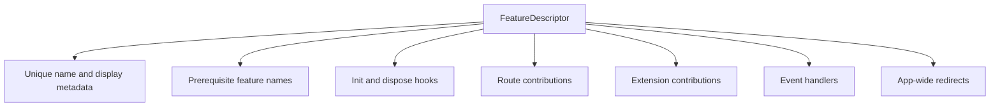

# Feature descriptors

`FeatureDescriptor` is the app-facing description of a Flutter feature. The app supplies descriptors; the runtime initializes their hooks and collects their contributions.

## Identity

`name` identifies the feature and must be unique in the app. Dependency names refer to this value. `title` is the human-readable label. Optional description and icon help development tooling describe the feature.

## Lifecycle

Use `init` for feature-owned setup after shared plugins and declared dependencies are ready. Use `dispose` to release subscriptions, controllers, and other resources the feature creates. Cleanup runs before plugins disappear.

## Routes

`routes` returns the feature’s GoRouter route contributions. It can be synchronous or asynchronous. It is optional: a feature that only adds services, event handlers, redirects or extensions leaves it out. Keep the paths public and intentional when other features navigate into them.

## Dependencies

List prerequisite descriptor names in `dependencies`. An app must include those descriptors. The runtime rejects missing dependencies and cycles. A dependency expresses initialization ordering; it does not import a Dart package for you.

## App-level behaviour

A feature can act on the whole app, not only on its own routes:

- `events` declares typed `EventHandler<T>` listeners. The platform subscribes
  them before `init` and cancels them on dispose or restart. See
  [events](/plugins/events).
- `redirects` adds `FeatureRedirect`s to the app's redirect chain. They
  re-run on chosen events or listenables. See
  [feature redirects](/guides/routes-and-navigation#feature-redirects).

Both work the same for lazy features.

## Extensions

Use `extensions` to contribute to a registered extension builder. A descriptor declares the contribution; a builder aggregates contributions and owns the shared registry or behavior.

The [complete API](/api/vyuh-core#featuredescriptor) documents every directly declared property and constructor. [Descriptors and builders](/concepts/descriptors-and-builders) explains the extension contract.

## Lazy descriptors

`LazyFeatureDescriptor` declares metadata, route prefixes, dependencies, and a loader. Keep its name aligned with the loaded descriptor. [Startup and lifecycle](/concepts/runtime-lifecycle) explains loading, retry, and readiness.
