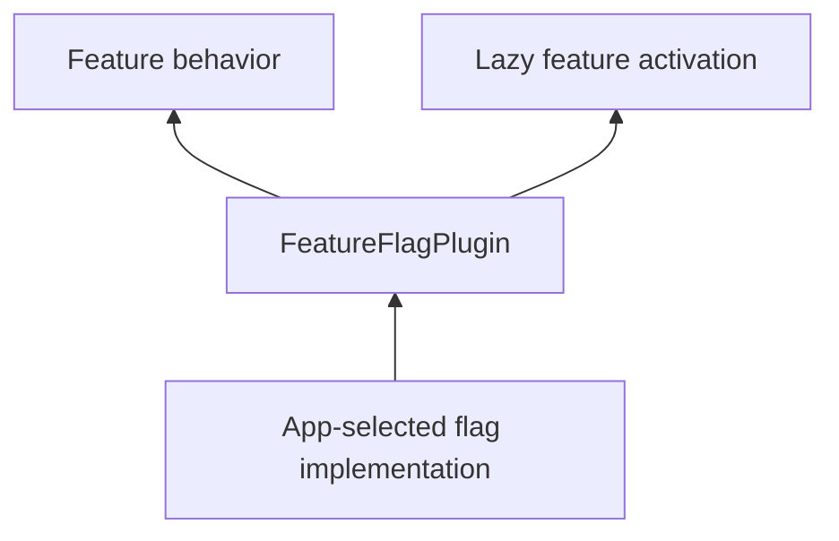

# Feature flags

Features read rollout decisions through `FeatureFlagPlugin`. The app chooses its backend implementation and registers it in `PluginDescriptor.others`.



## Evaluate a flag in code

```dart
import 'package:vyuh_core/vyuh_core.dart';

Future<bool> showNewCheckout() async {
  final flags = vyuh.featureFlag;
  if (flags == null) return false;
  return flags.getBool('checkout.new', defaultValue: false);
}
```

The contract also provides `getString`, `getInt`, `getDouble`, and `getJson`. Use `setDefaults` for fallback values, `updateContext` for implementation-specific evaluation context, and `refresh` to request updated decisions. Await evaluation and handle provider failures according to your app’s fallback policy.

## Gate lazy activation

Set `LazyFeatureDescriptor.featureFlag` to the flag name. The runtime checks it before loading the feature. The current runtime uses `defaultValue: true` for this check and permits loading when no flag plugin is configured. Configure a provider explicitly when rollout gating is required.

Feature flag evaluation is asynchronous. Evaluate before choosing a branch or updating observable state; the framework does not automatically rebuild a widget whenever a remote flag changes.

## Keep authorization separate

Flags control rollout and presentation. Enforce access permissions in the backend even when a screen is hidden. Test enabled, disabled, absent-provider, and provider-failure behavior.

See [FeatureFlagPlugin APIs](/api/vyuh-core#featureflagplugin) and [lazy feature APIs](/api/vyuh-core#lazyfeaturedescriptor).
