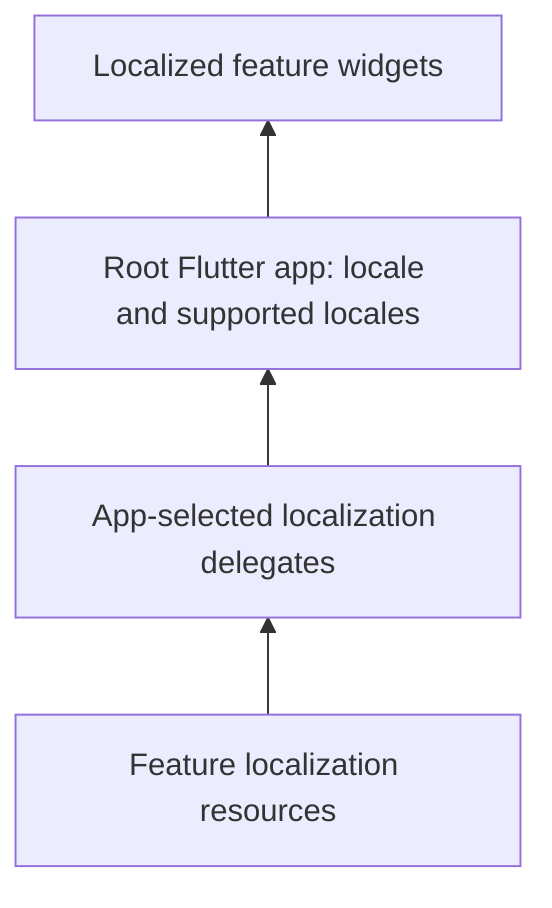

# Internationalization

Use Flutter’s localization system for UI strings and framework widgets. Keep translation resources with the features that own them, and let the app select its supported locales and root delegates.

## Keep translations with the feature

Place ARB resources and generated localization accessors in the package that owns the screens. Give messages meaningful names and include translator descriptions. Export the localization delegate and supported locale list needed by the host.

Use Flutter’s `gen-l10n` tooling and the `flutter_localizations` SDK package. Keep generated files reproducible rather than editing them manually.

## Compose localization in the app

Configure `localizationsDelegates`, `supportedLocales`, and the selected `locale` on the root `MaterialApp.router`. With Vyuh, the root is supplied through `PlatformWidgetBuilder.appBuilder`; retain `platform.router.instance` as its router configuration.

Include Flutter’s Material, Widgets, and Cupertino delegates alongside the feature-specific delegates. The app owns locale persistence and updates its root when the user changes language.

## Coordinate locale changes across features

The core also exports an optional `LocalePlugin`. Configure it in `PluginDescriptor.others`, retrieve it through `vyuh.locale` or `vyuh.getPlugin<LocalePlugin>()`, and register feature callbacks with `TranslationRegistration`. Its `currentLocale` is observable, and `setLocale` notifies registered translation handlers and persists the selected language with SharedPreferences.

The plugin does not automatically install Flutter localization delegates or feature translation providers. The app must observe locale changes in its root and connect the delegates used by its widgets. See [LocalePlugin APIs](/api/vyuh-core#localeplugin) and [TranslationRegistration](/api/vyuh-core#translationregistration).

## Design for translated text

Use flexible layouts, allow labels to wrap, and test longer translations. Respect locale-specific dates, numbers, plural forms, and text direction. Avoid assembling translated sentences from fragments.

See [platform customization](platform-customization) and the [app builder API](/api/vyuh-core#appbuilder).
