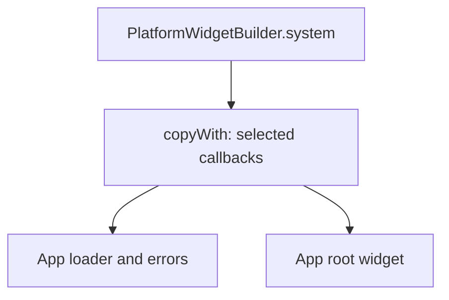

# Platform customization

`PlatformWidgetBuilder` holds callbacks for shared platform UI. Customize the defaults with `PlatformWidgetBuilder.system.copyWith`, then pass the result to `runApp`.



## Customize startup

```dart
import 'package:material_ui/material_ui.dart';
import 'package:vyuh_core/vyuh_core.dart' as vyuh;

final widgets = vyuh.PlatformWidgetBuilder.system.copyWith(
  appLoader: (_) => const Center(
    child: CircularProgressIndicator(),
  ),
);

// In your app composition:
// vyuh.runApp(features: () => [feature], platformWidgetBuilder: widgets);
```

The `appLoader` appears while the platform initializes. `routeErrorView` shows full-page failures and `errorView` inline ones. The defaults already use your theme, offer Try again, Back and Go home where they apply, and hide error details outside debug builds. See [errors and recovery](errors-and-recovery) before replacing them.

## Set the theme

Pass `theme: VyuhTheme(...)` to `copyWith`. The loading screen, the startup failure screen, the default app root and every framework view use it. To restyle the defaults without replacing them, use [theme tokens](theming#framework-tokens).

## Customize the app root

`appBuilder` receives `(BuildContext context, VyuhPlatform platform)`. Return your root app and connect `platform.router.instance` to its router configuration. This is where the app sets localization delegates, supported locales and other host-level behaviour. Read the theme from `platform.widgetBuilder.theme`, so the app matches the loading screen.

The default root uses Material UI. Customize it with the same package to select an app theme:

```dart
final widgets = vyuh.PlatformWidgetBuilder.system.copyWith(
  appBuilder: (_, platform) => MaterialApp.router(
    theme: platform.widgetBuilder.theme.light,
    darkTheme: platform.widgetBuilder.theme.dark,
    themeMode: platform.widgetBuilder.theme.mode,
    routerConfig: platform.router.instance,
  ),
);
```

This uses the Material UI imports from the first fragment. Keep the app root, widgets, themes, and localization delegates from the same package.

The widget builder does not define a `buildPage` method. Ordinary `GoRoute` pages own their transitions through `pageBuilder` and `CustomTransitionPage`; see [routes and navigation](routes-and-navigation).

See the [complete PlatformWidgetBuilder API](/api/vyuh-core#platformwidgetbuilder) for every callback and its signature.

## Migrate existing Material widgets

Vyuh uses `package:material_ui/material_ui.dart` for its Material widgets, themes, and app root. The package provides this Dart migration:

```sh
dart fix --apply --code=migrate_design_widgets
```

Review third-party widget boundaries after the command. A package exposing Flutter Material theme or decoration types may need its generic addon or a neutral binding API rather than an import-only change.
