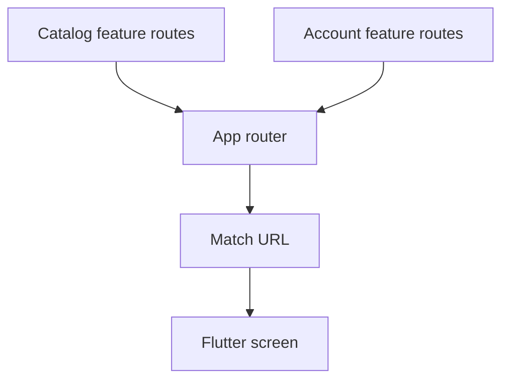

# Routes and navigation

Each feature declares its routes through `FeatureDescriptor.routes`. The platform collects those contributions and configures the app’s router using GoRouter.



## Declare a route

This descriptor fragment uses ordinary Flutter widgets. Import `material_ui/material_ui.dart`, `go_router/go_router.dart`, and `vyuh_core/vyuh_core.dart` in your feature library.

```dart
final catalog = FeatureDescriptor(
  name: 'catalog',
  title: 'Catalog',
  routes: () => [
    GoRoute(
      path: '/catalog',
      builder: (_, _) => const Scaffold(
        body: Center(child: Text('Catalog')),
      ),
    ),
  ],
);
```

Include the descriptor in the app’s feature list and use `initialLocation: '/catalog'` when that is the desired first screen. The [quick start](/intro/get-started) shows the complete composition.

## Choose the navigation operation

Use the shared navigation capability through `vyuh.router`. This keeps router ownership with the app.

```dart
// Navigation fragments inside a running Vyuh app.
vyuh.router.go('/catalog');
vyuh.router.push('/account');
vyuh.router.replace('/account/settings');
```

`go` selects a new route configuration. `push` adds a page to the stack. `replace` replaces the current page. See the [navigation plugin APIs](/api/vyuh-core#navigationplugin) for the return values and available operations.

## Parameters and nested routes

Use GoRouter path parameters and query parameters for route data. Keep route contracts public and deliberate when another feature needs to navigate into your feature. Avoid reaching into the destination’s private widget state.

## Feature redirects

A feature can guard or reroute URLs across the whole app with
`FeatureDescriptor.redirects`. It doesn't need to own those routes, and it
doesn't touch the app's router setup:

```dart
final account = FeatureDescriptor(
  name: 'account',
  title: 'Account',
  routes: () => [...],
  redirects: [
    FeatureRedirect(
      name: 'require-sign-in',
      // Re-run when this event fires...
      refreshOn: [UserSignedOutEvent],
      // ...or when this listenable notifies.
      listenable: session,
      redirect: (context, state) =>
          !session.signedIn && state.matchedLocation.startsWith('/orders')
              ? '/login?from=${state.uri}'
              : null,
    ),
  ],
);
```

How the chain works:

- **Order.** Redirects run in feature order, dependencies first. The app's
  global redirect runs before all of them; pass it as
  `PluginDescriptor(navigation: DefaultNavigationPlugin(redirect: ...))`,
  along with `urlStyle: RouterUrlStyle.path` for path URLs on the web.
- **First match wins.** The first redirect that returns a location wins.
  Returning `null` passes to the next one.
- **Reactive.** The router re-runs the chain when an event listed in
  `refreshOn` is emitted (matched by exact type), or when `listenable`
  notifies. Signing out on one screen moves the user off guarded pages
  everywhere, with no extra wiring.
- **Lazy features.** A lazy feature's redirects join the chain when it
  activates and leave it if activation fails.
- **Failure isolation.** A redirect that throws is reported to telemetry and
  skipped, so one broken feature can't block navigation.

Redirects pair naturally with [events](events): the feature that owns a state
change emits an event, and any feature that cares lists it in `refreshOn`.

## When a route fails

No matching route, a failed CMS page and a failed lazy feature all show a
themed failure page with Try again, Back and Go home. Each one is reported
once as a `RouteFailureEvent`. Set the home route with
`runApp(homeLocation: ...)`. See [errors and recovery](errors-and-recovery).

## Lazy features

A lazy descriptor declares route prefixes and a loader. When requested, the runtime loads the feature and replaces its placeholders with the feature’s real routes. Concurrent requests share activation. [Startup and lifecycle](/concepts/runtime-lifecycle) explains dependencies and readiness.

## Avoid route collisions

Choose distinct paths for independent features. Keep initial location aligned with a declared route. Test deep links, back navigation, parameter handling, and route lifecycle cleanup as part of the consuming app.
