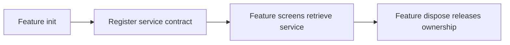

# Dependency injection

The default `DIPlugin` uses an isolated GetIt container. Features register shared services during initialization and retrieve them by their declared type.



## Register and retrieve

```dart
import 'package:vyuh_core/vyuh_core.dart';

class CatalogStore {
  String title = 'Catalog';
}

final feature = FeatureDescriptor(
  name: 'catalog',
  title: 'Catalog',
  init: () async {
    vyuh.di.register<CatalogStore>(CatalogStore());
  },
  dispose: () async {
    if (vyuh.di.has<CatalogStore>()) {
      vyuh.di.unregister<CatalogStore>();
    }
  },
  routes: () => [],
);

// After feature initialization:
CatalogStore get catalogStore => vyuh.di.get<CatalogStore>();
```

Use `registerLazy` to construct a shared instance on first access, or `registerFactory` to create a new instance per lookup. A named registration can distinguish two services with the same type.

## Await asynchronous services

`AsyncLazyDI.registerAsync<T>` stores a lazy `Future<T>`; retrieve it with `getAsync<T>` and await completion. It does not turn an asynchronous dependency into a synchronous instance.

## Own cleanup explicitly

The generic `DIPlugin` API has no disposer callback. Close subscriptions and owned resources before unregistering them. The default plugin resets its container at lifecycle boundaries; do not rely on container cleanup to implement domain-specific shutdown.

For state that belongs to a single screen, create and dispose it with the widget lifecycle or use your state management library’s scope. A feature that reads another feature’s registrations must declare that feature in `dependencies`.

See [DIPlugin APIs](/api/vyuh-core#diplugin), [AsyncLazyDI](/api/vyuh-core#asynclazydi), and [startup ordering](/concepts/runtime-lifecycle).
