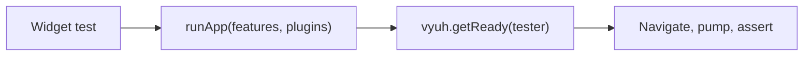

# Testing

`vyuh_test` holds small utilities for testing features and apps built with
Vyuh in `flutter_test`.



[Browse every public declaration and member](/api/vyuh-test).

<PubBadge package="vyuh_test" />

## Wait for the platform

`getReady` pumps until the platform is ready, or has failed, so a test can
navigate and assert against real routes:

```dart
import 'package:flutter_test/flutter_test.dart';
import 'package:vyuh_core/vyuh_core.dart' as vc;
import 'package:vyuh_test/vyuh_test.dart';

void main() {
  tearDown(() async {
    if (vc.VyuhBinding.instance.initialized) await vc.vyuh.dispose();
  });

  testWidgets('orders redirect to sign-in when signed out', (tester) async {
    vc.runApp(features: () => [home.feature, orders.feature]);
    await vc.vyuh.getReady(tester);

    vc.vyuh.router.go('/orders');
    await tester.pumpAndSettle();
    expect(find.text('Sign in'), findsOneWidget);
  });
}
```

Dispose the platform between tests so each one starts clean.

## A mocked context

`TestBuildContext` is a `mocktail` mock of `BuildContext` for unit-testing
code that takes a context, such as actions and conditions, without building a
widget tree.

## Tips

- Events are delivered asynchronously: pump the tester before asserting on
  what a handler did.
- Test a feature's `events` and `redirects` through the running platform, as
  above. They are subscribed and removed by the platform, not by your code.
- `runApp` does not install global error handlers under `flutter test`, so
  Flutter's own test error reporting stays intact.
