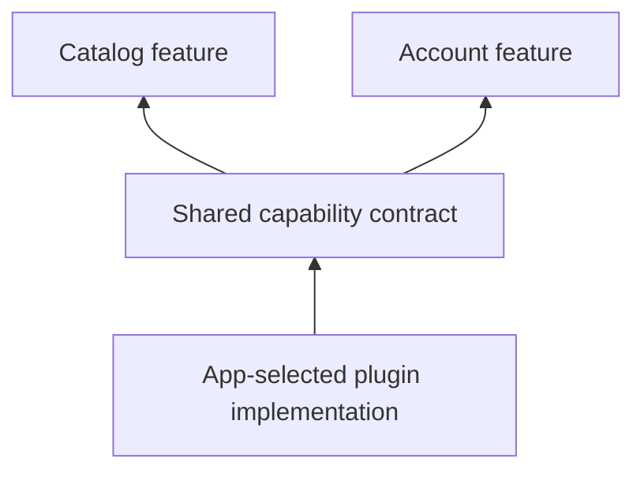

# Using plugins

A plugin supplies a shared capability. Features call its contract; the app selects the implementation. Several features can use the same network, storage, authentication, or telemetry capability.



## Choose implementations at startup

Pass a `PluginDescriptor` to `runApp`. Unspecified named slots use the framework defaults, including in-memory storage and no-op analytics/telemetry. Choose persistent or external implementations explicitly when your product needs them.

```dart
import 'package:vyuh_core/vyuh_core.dart';
import 'package:vyuh_plugin_storage_hive/vyuh_plugin_storage_hive.dart';

final plugins = PluginDescriptor(storage: HiveStoragePlugin());
```

Supply `plugins: plugins` alongside your `features` in the app’s `runApp` call. Features access initialized plugins during their `init` hook and after the platform is ready.

## Use the capability contract

```dart
import 'package:vyuh_core/vyuh_core.dart';

Future<void> saveDisplayName(String name) async {
  final storage = vyuh.getPlugin<StoragePlugin>()!;
  await storage.write('account.displayName', name);
}

Future<String> fetchStatus() async {
  final response = await vyuh.network.get(
    Uri.parse('https://example.com/status'),
  );
  if (response.statusCode != 200) {
    throw StateError('Unable to load status');
  }
  return response.body;
}
```

| Capability | Platform accessor | Selection |
| --- | --- | --- |
| Network | `vyuh.network` | `PluginDescriptor.network` |
| Storage | `vyuh.getPlugin<StoragePlugin>()` | `PluginDescriptor.storage` |
| Secure storage | `vyuh.getPlugin<SecureStoragePlugin>()` | `PluginDescriptor.secureStorage` |
| Authentication | `vyuh.auth` | `PluginDescriptor.auth` |
| Analytics | `vyuh.analytics` | `PluginDescriptor.analytics` |
| Telemetry | `vyuh.telemetry` | `PluginDescriptor.telemetry` |
| Dependency injection | `vyuh.di` | `PluginDescriptor.di` |
| Navigation | `vyuh.router` | `PluginDescriptor.navigation` |
| Events | `vyuh.event` | `PluginDescriptor.event` |
| Environment | `vyuh.env` | `PluginDescriptor.env` |
| Feature flags | `vyuh.featureFlag` | A `FeatureFlagPlugin` in `others` |

The `vyuh` object in these examples is the runtime exported by an unprefixed core import. With `import ... as vc`, write `vc.vyuh.getPlugin<vc.StoragePlugin>()`. `vc` is the library prefix; `vc.vyuh` is the runtime instance.

## Understand lifecycle and providers

Preloaded plugins initialize in an earlier stage. Remaining plugins initialize concurrently before feature initialization. There is no automatic dependency graph between plugins; avoid relying on their order in the descriptor.

Some capabilities aggregate providers. For example, `TelemetryPlugin.providers` can send diagnostics to multiple backends. Other contracts, such as `StoragePlugin`, select one implementation.

Read [custom plugins](custom-plugins), [feature flags](feature-flags), and the [core API](/api/vyuh-core).

## Explore each capability

- [Networking](capabilities/networking)
- [Authentication](capabilities/authentication)
- [Storage](capabilities/storage)
- [Secure storage](capabilities/secure-storage)
- [Analytics](capabilities/analytics)
- [Telemetry and logging](capabilities/telemetry)
- [Environment configuration](capabilities/environment)
- [Dependency injection](capabilities/dependency-injection)

- [Navigation](routes-and-navigation)
- [Events](events)
- [Feature flags](feature-flags)
- [Localization](i18n)
