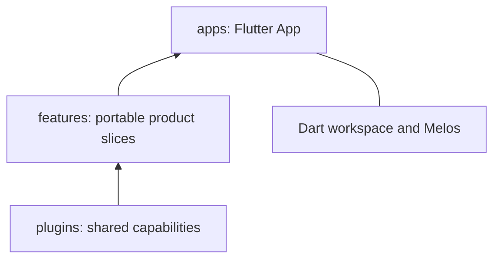

# Vyuh CLI

Start a modular Flutter App, add a portable feature, or create a capability plugin. The CLI sets up the package boundaries so your product can grow without starting from a CMS integration. **CMS is disabled by default.**

## Install

```bash
dart pub global activate vyuh_cli
```

Ensure Dart’s global executable directory and your Flutter/Dart SDK are on PATH. The commands below describe the repository’s updated CLI; use the corresponding released version when installing from pub.dev.

## Create a complete App workspace

```bash
vyuh create project shop --org-name=com.acme --platforms=ios,android,web -o products
```

The scaffold creates a Flutter App, a counter feature, directories for plugins and packages, a Dart workspace, and local Melos tooling. It runs Flutter project setup, adds framework packages, and bootstraps the workspace. Shared UI uses Material UI.



| Option | Purpose | Default |
| --- | --- | --- |
| `--org-name`, `--org` | Native organization prefix | `com.example.vyuh` |
| `--application-id` | Override native bundle/application identifier | Organization plus App name |
| `--platforms` | Comma-separated Flutter targets | `ios,android,web` |
| `--description`, `--desc` | App description | Starter description |
| `--cms` | Optional integration: `none` or `sanity` | `none` |
| `--output-directory`, `-o` | Parent output directory | Current directory |

Only select targets your development host can build. Native identifiers use dotted names such as `com.acme.shop`. Adding a CMS is an explicit choice: see [CMS scaffolding](/cms/scaffolding).

## Create a feature package

A feature keeps its routes and UI together, making the same product slice portable between Apps.

```bash
vyuh create feature feature_catalog --title="Catalog" --description="Product browsing" --route=/catalog -o features
```

The generated package contains a feature descriptor and a working counter starter screen. `--title` sets the descriptor label, `--description` describes ownership, and `--route` sets its entry path. The route defaults to the package name without a leading `feature_` prefix. Use lowercase Dart package names with underscores, and absolute route paths.

Add the package to your workspace/dependencies and include its descriptor in the App’s feature list. See [composing features](compose-features).

## Create a capability plugin

A plugin centralizes a capability that several features can share.

```bash
vyuh create plugin catalog_search --class-name=CatalogSearchPlugin --title="Catalog search" --description="Shared search capability" -o plugins
```

The package exports a custom `Plugin` using `InitOncePlugin`, initialization and disposal hooks, and a lifecycle test. `--class-name` accepts a PascalCase Dart class; the default is the package name in PascalCase followed by `Plugin`. Title and description configure its metadata.

After adding the generated package to your App:

```dart
import 'package:catalog_search/catalog_search.dart';
import 'package:vyuh_core/vyuh_core.dart';

final plugins = PluginDescriptor(others: [CatalogSearchPlugin()]);
// Supply plugins to runApp. From initialized features:
final search = vyuh.getPlugin<CatalogSearchPlugin>();
```

Add the capability methods your features need. Dispose resources owned by the plugin in `disposeOnce`. This scaffold creates a custom capability; implementing a built-in system contract such as `StoragePlugin` requires that contract’s methods and its named descriptor slot. See [custom plugins](/guides/custom-plugins).

## Check and maintain tooling

```bash
vyuh doctor
vyuh doctor --cms=sanity
vyuh update
vyuh --version
vyuh completion --help
vyuh create plugin --help
```

Doctor checks Flutter/Dart by default. Its Sanity option adds Node/pnpm checks. Schema and ContentItem commands remain explicit optional CMS tools.
