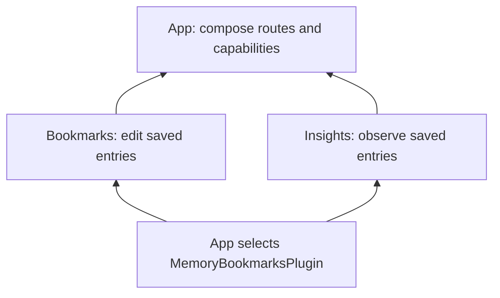

<script setup>
import ComposedApp from '../.vitepress/theme/components/ComposedApp.md';
</script>

# Two features. One shared capability.

After the [first feature](get-started), build an app with two independently declared features. Bookmarks owns saving and removing entries. Insights owns a summary screen. Both consume the same `BookmarksPlugin` contract selected by the app.



## Run the complete example

Use the project created in the quick start. Its dependencies are `vyuh_core` and `go_router`. Replace `lib/main.dart` with the code below and run `flutter run`.

<ComposedApp />

Save a bookmark, open Insights, and check the count. Return to Bookmarks, remove it, and check the count again. Both screens read the same plugin instance. This example stores titles in memory, deduplicates equal titles, and resets data when the platform lifecycle ends.

## What each layer owns

| Layer | Responsibility in this example |
| --- | --- |
| App | Selects the memory adapter, includes both feature descriptors, and chooses `/bookmarks` as the initial route |
| Bookmarks feature | Owns its route, form controller, and editing UI |
| Insights feature | Owns its route and summary UI |
| Plugin contract | Defines the shared observable entries and commands |
| Memory adapter | Owns the list, mutation rules, initialization, and cleanup |

The two features do not import each other's screen or state. They have no initialization dependency on each other: sharing a plugin is sufficient. `ValueListenableBuilder` observes the capability with ordinary Flutter state tools.

The app also selects a standard Flutter `MaterialApp.router` through `PlatformWidgetBuilder.appBuilder`. That root supplies the Material theme and localization context used by these Flutter widgets; the router instance remains owned by the configured navigation plugin.

## Give the boundaries their own packages

The single file keeps the example easy to run. In a product, move the `BookmarksPlugin` contract to a shared capability package, each feature's descriptor and widgets to its own Flutter package, and the memory adapter to an implementation package. The app imports those public entry points.

```text
apps/reader/          app composition
features/bookmarks/  bookmark routes and editing UI
features/insights/   summary route and UI
packages/bookmarks/  shared capability contract
plugins/memory/      app-selected implementation
```

Both features depend on the capability package. The app depends on both feature packages and the adapter. Neither feature needs a dependency on the other feature's implementation.

## Reuse a feature in another app

A second app can include Insights with another set of features and its own `BookmarksPlugin` implementation:

```dart
vc.runApp(
  initialLocation: '/insights',
  plugins: vc.PluginDescriptor(others: [MemoryBookmarksPlugin()]),
  platformWidgetBuilder: platformWidgets,
  features: () => [insightsFeature()],
);
```

The first app supplies companion destinations through `insightsPath` and `bookmarksPath`. Omitting `bookmarksPath` in this second app hides the shortcut to that absent feature. Insights still owns its `/insights` route and consumes the same capability contract.

Portable features receive app-specific destinations and configuration rather than hard-code routes owned by an optional companion. A production adapter can persist or fetch entries while preserving the contract, with loading and failure behavior added explicitly to that contract.

See [Why Vyuh?](/concepts/why-vyuh), [custom plugins](/plugins/custom-plugins), and the [core API](/api/vyuh-core) for the contracts used here.
