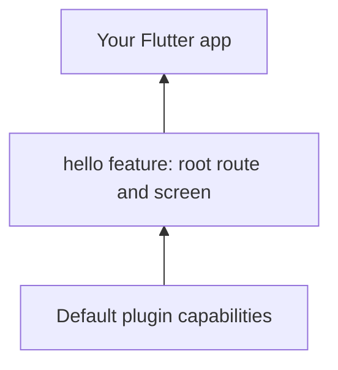

<script setup>
import FirstApp from '../.vitepress/theme/components/FirstApp.md';
</script>

# Build your first feature

Start with a standard Flutter screen. Vyuh supplies the composition and lifecycle around it.

## Create the app

Install a Flutter SDK compatible with the current `vyuh_core` release, then create the project and add its dependencies:

```sh
flutter create hello_vyuh
cd hello_vyuh
flutter pub add vyuh_core go_router
```

## Compose one feature

Replace `lib/main.dart` with this complete example:

<FirstApp />

The app supplies a list of `FeatureDescriptor` objects. This feature contributes the root route. The route renders an ordinary Flutter `Scaffold`. Vyuh initializes the platform and composes the route list.

The app explicitly selects a Flutter `MaterialApp.router` root, connecting `platform.router.instance`. This supplies the Material context for the screen and keeps root theme and localization decisions with the app.



## Run it

```sh
flutter run
```

You should see **Hello, Vyuh.** Select a connected device or browser when Flutter prompts you. The initial location `/` matches the feature’s root route.

## Give the feature its own package

As the feature grows, move its descriptor, routes, state, and widgets into a Flutter package. Export the descriptor from that package’s public library and import it into the app. Keep the app entry point focused on choosing features and plugins.

Follow [Compose features](compose-features) to add a second descriptor and share an app-selected plugin. Give each descriptor a unique name and each route an intentional path.

## Choose your plugins

Pass a `PluginDescriptor` to Vyuh’s `runApp` when you want a concrete network, auth, storage, or telemetry implementation. Consult the [plugin guide](/plugins/) and [core API](/api/vyuh-core) for available capability slots.

## Troubleshooting

- If the app starts on an unknown route, check `initialLocation` and the route paths supplied by your features.
- If a feature fails initialization, inspect the startup error and confirm its named dependencies are included.
- If package resolution fails, check the Flutter/Dart SDK constraints of the selected package release.

Continue with [project structure](project-structure), [features and plugins](/concepts/features-and-plugins), or the [counter example](/examples/counter). Use the [CLI](cli) for scaffolding after you understand these pieces.
