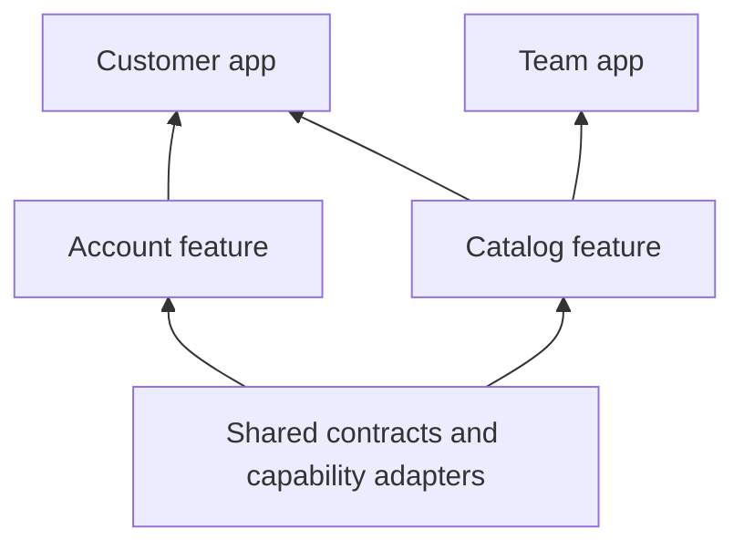

# Project structure

A modular project separates the app that chooses the composition, feature packages that implement product areas, and shared packages that define reusable contracts.

```text
my_product/
├── apps/
│   ├── customer_app/          # Selects features, plugins, theme, and routes
│   └── team_app/              # Another composition of shared features
├── features/
│   ├── feature_catalog/
│   │   ├── lib/feature_catalog.dart
│   │   ├── lib/src/           # Screens, state, and domain logic
│   │   ├── test/
│   │   └── pubspec.yaml
│   └── feature_account/
├── packages/
│   ├── product_models/        # Shared domain contracts
│   └── product_plugins/       # Capability contracts and adapters
└── pubspec.yaml               # Optional Dart workspace
```



## Apps choose the composition

Each app owns its entry point, dependencies, plugin selection, branding, environment, and feature list. Keep business behavior in feature packages so another app can reuse it without copying screens.

## Features own product slices

Export a `FeatureDescriptor` and deliberately public domain contracts. Keep routes, widgets, stores, and private implementation together. Use feature `dependencies` for initialization ordering and Dart dependencies for compile-time imports.

## Shared packages own reusable contracts

Share models and API contracts when multiple features need them. Put app-wide infrastructure behind plugin interfaces so features can run with production, test, or alternative implementations.

## Choose tooling as the project grows

A single Flutter app can start with ordinary path dependencies. Dart workspaces and Melos help resolve and operate on several packages together; they are useful tooling choices rather than runtime requirements.

Continue with [creating a feature](/guides/creating-a-feature) and [the quick start](get-started).
