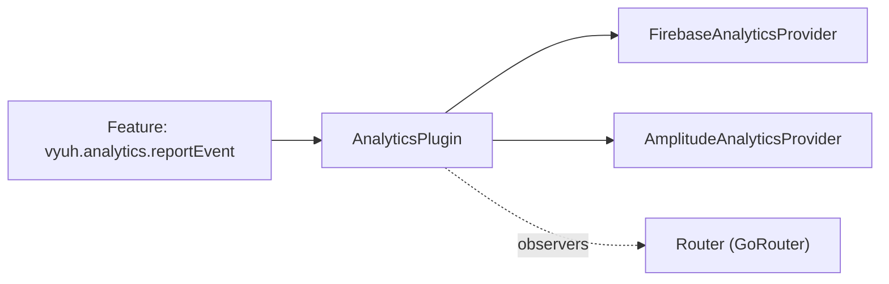

# Analytics

`AnalyticsPlugin` gives every feature one way to report product events, so the app can send them to Firebase, Amplitude, or any other backend without the features knowing which one.

| | |
| --- | --- |
| **Contract** | [`AnalyticsPlugin`](/api/vyuh-core#analyticsplugin), which forwards to [`AnalyticsProvider`](/api/vyuh-core#analyticsprovider) objects |
| **Default** | `AnalyticsPlugin(providers: [NoOpAnalyticsProvider()])`: nothing is sent |
| **Accessor** | `vyuh.analytics` (never null), or `VyuhBinding.instance.analytics` in widget mode |
| **Slot** | `PluginDescriptor(analytics: ...)` |
| **Implementations** | [`NoOpAnalyticsProvider`](/api/vyuh-core#noopanalyticsprovider) in `vyuh_core`. You write providers for your backend. |

## How it fits together

`AnalyticsPlugin` is a final class. You don't subclass it. Instead you give it a list of **providers**, and it passes every call to all of them.



The plugin mixes in three things from the plugin system:

- `PreloadedPlugin`: it is initialized before the platform starts, so analytics works while features load.
- `InitOncePlugin`: concurrent `init()` calls share one initialization of the providers.
- `RouteObservers`: it collects the `NavigatorObserver`s of all its providers, and the router adds them to the navigator. This is how providers track screen views.

## Set up

Pass the plugin in the `analytics` slot of `PluginDescriptor`. If you leave the slot empty, the app uses the no-op default.

```dart
import 'package:vyuh_core/vyuh_core.dart';

void main() {
  runApp(
    features: () => [/* your features */],
    plugins: PluginDescriptor(
      analytics: AnalyticsPlugin(
        providers: [
          FirebaseAnalyticsProvider(),
          AmplitudeAnalyticsProvider(apiKey: 'your-key'),
        ],
      ),
    ),
  );
}
```

`FirebaseAnalyticsProvider` and `AmplitudeAnalyticsProvider` are examples. You write them yourself; see [Write your own](#write-your-own) below.

::: warning System plugins use their named slot
Don't put an `AnalyticsPlugin` in `others`. `PluginDescriptor` throws an `ArgumentError` if a system plugin is passed there.
:::

## Use it

Call `vyuh.analytics` from any feature once the platform has started, for example in a button handler, a feature's `init`, or an event handler.

```dart
import 'package:vyuh_core/vyuh_core.dart';

Future<void> onCheckout(String cartId, double total) async {
  await vyuh.analytics.reportEvent(
    'checkout_started',
    params: {'cart_id': cartId, 'total': total},
  );
}
```

Identify the user after sign-in, and reset when they sign out:

```dart
await vyuh.analytics.identifyUser(
  user.id,
  traits: {'plan': 'pro', 'country': 'IN'},
);

// Later, on sign-out:
await vyuh.analytics.resetUser();
```

The plugin has these members:

| Member | What it does |
| --- | --- |
| `providers` | The `List<AnalyticsProvider>` you passed in. |
| `reportEvent(name, {params})` | Sends an event with optional parameters to every provider. |
| `identifyUser(userId, {traits})` | Tells every provider who the current user is. |
| `resetUser()` | Clears the user identity in every provider. |
| `observers` | All providers' `observers`, joined into one list. |
| `init()` / `dispose()` | Called by the framework. They run each provider's `init()` / `dispose()`. |

Agree on event names and parameter keys across teams, keep personal data out of `params`, and respect your app's consent rules before reporting.

### Screen tracking

You don't call anything to track screens. When the router is created, it asks every plugin that mixes in `RouteObservers` for its `observers` and passes them to `GoRouter`. `AnalyticsPlugin` returns the observers of all its providers, so a provider that returns a `NavigatorObserver` sees every push, pop and replace.

The router reads `observers` once, when it is built during startup. Return the observer instances your provider creates up front, not new ones on each call.

## Behaviour and lifecycle

- **Startup.** Because it is preloaded, the framework calls `init()` before the platform starts. That runs every provider's `init()` at the same time (`Future.wait`).
- **Init once.** `init()` comes from `InitOncePlugin`. Calls made while initialization is running wait for the same result. If a provider's `init()` throws, the plugin stays uninitialized and the next `init()` call tries again.
- **Restart.** Preloaded plugins are not re-initialized when the platform restarts, so your providers keep their state.
- **Dispose.** `vyuh.dispose()` calls `dispose()`, which runs every provider's `dispose()`.
- **Fan-out.** Each call waits for all providers with `Future.wait`. If one provider throws, the call you awaited throws too. Unlike telemetry, analytics does not catch provider errors for you, so catch errors inside your provider if a failed report should not reach the caller.
- **Default.** `NoOpAnalyticsProvider` accepts every call, sends nothing and has no observers. Its description reminds you to set a real provider before going to production.

## Testing

Write a small recording provider and pass it to an `AnalyticsPlugin`. You can test the plugin on its own, without starting an app.

```dart
import 'package:flutter/widgets.dart';
import 'package:flutter_test/flutter_test.dart';
import 'package:vyuh_core/vyuh_core.dart';

final class RecordingAnalytics implements AnalyticsProvider {
  final calls = <String>[];

  @override
  String get name => 'test.analytics';

  @override
  String get title => 'Recording Analytics';

  @override
  String get description => 'Records every call';

  @override
  List<NavigatorObserver> get observers => [];

  @override
  Future<void> init() async => calls.add('init');

  @override
  Future<void> dispose() async => calls.add('dispose');

  @override
  Future<void> reportEvent(String name, {Map<String, dynamic>? params}) async =>
      calls.add('event $name $params');

  @override
  Future<void> identifyUser(String userId, {Map<String, dynamic>? traits}) async =>
      calls.add('identify $userId');

  @override
  Future<void> resetUser() async => calls.add('reset');
}

void main() {
  test('sends events to every provider', () async {
    final first = RecordingAnalytics();
    final second = RecordingAnalytics();
    final analytics = AnalyticsPlugin(providers: [first, second]);

    await analytics.init();
    await analytics.reportEvent('clicked', params: {'id': 1});

    expect(first.calls, ['init', 'event clicked {id: 1}']);
    expect(second.calls, first.calls);
  });
}
```

To check that a feature reports the right events, pass `PluginDescriptor(analytics: AnalyticsPlugin(providers: [recorder]))` to `runApp` in a widget test, then wait with `vyuh.getReady(tester)` from `vyuh_test`.

## Write your own

A provider implements every member of `AnalyticsProvider`:

```dart
abstract interface class AnalyticsProvider {
  List<NavigatorObserver> get observers;
  String get name;
  String get title;
  String get description;

  Future<void> init();
  Future<void> dispose();

  Future<void> reportEvent(String name, {Map<String, dynamic>? params});
  Future<void> identifyUser(String userId, {Map<String, dynamic>? traits});
  Future<void> resetUser();
}
```

Here is a provider in the style of Firebase or Amplitude. The `_client` stands in for the vendor SDK; replace its calls with the real ones.

```dart
import 'package:flutter/widgets.dart';
import 'package:vyuh_core/vyuh_core.dart';

/// Stand-in for a vendor SDK client.
class _AnalyticsClient {
  Future<void> start(String apiKey) async {}
  Future<void> track(String event, Map<String, Object?> properties) async {}
  Future<void> setUser(String? id, Map<String, Object?> properties) async {}
  Future<void> flush() async {}
}

/// Sends a `screen_view` event whenever a named route is pushed.
final class _ScreenObserver extends NavigatorObserver {
  _ScreenObserver(this._client);

  final _AnalyticsClient _client;

  @override
  void didPush(Route<dynamic> route, Route<dynamic>? previousRoute) {
    final screen = route.settings.name;
    if (screen != null) {
      _client.track('screen_view', {'screen': screen});
    }
  }
}

final class AmplitudeAnalyticsProvider implements AnalyticsProvider {
  AmplitudeAnalyticsProvider({required this.apiKey});

  final String apiKey;
  final _client = _AnalyticsClient();

  // Create the observer once. The router reads `observers` when it is built.
  late final _screens = _ScreenObserver(_client);

  @override
  String get name => 'app.analytics.amplitude';

  @override
  String get title => 'Amplitude Analytics';

  @override
  String get description => 'Sends product events to Amplitude';

  @override
  List<NavigatorObserver> get observers => [_screens];

  @override
  Future<void> init() => _client.start(apiKey);

  @override
  Future<void> dispose() => _client.flush();

  @override
  Future<void> reportEvent(String name, {Map<String, dynamic>? params}) async {
    try {
      await _client.track(name, params ?? const {});
    } catch (error, stack) {
      // Analytics should not break the screen that reported the event.
      vyuh.telemetry.reportError(error, stackTrace: stack);
    }
  }

  @override
  Future<void> identifyUser(String userId, {Map<String, dynamic>? traits}) =>
      _client.setUser(userId, traits ?? const {});

  @override
  Future<void> resetUser() => _client.setUser(null, const {});
}
```

Tips:

- Keep `init()` fast. Analytics is preloaded, so a slow `init()` delays the whole app.
- Catch errors inside `reportEvent`, as above, unless you want callers to see them.
- If your backend has no screen tracking, return an empty list from `observers`.
- Give `name` a stable, dotted id such as `app.analytics.amplitude`.

See also [plugins overview](/plugins/), [writing a custom plugin](/plugins/custom-plugins), and [telemetry](/plugins/telemetry).
