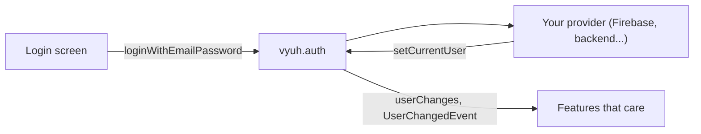

# Authentication

The auth plugin gives every feature the same view of who is signed in, and one
place to call to sign in or out.

| | |
|---|---|
| Contract | `AuthPlugin` |
| Default implementation | `UnknownAuthPlugin` (always signed out, no sign-in methods) |
| Accessor | `vyuh.auth` |
| `PluginDescriptor` slot | `auth` |
| Implementations | Your provider (Firebase, Supabase, your own backend...) |

Vyuh Core does not ship a working sign-in service. You plug in an `AuthPlugin`
that talks to your identity provider, and features only ever talk to
`vyuh.auth`.



## Set up

Put your provider in the `auth` slot:

```dart
import 'package:vyuh_core/vyuh_core.dart';

void main() {
  runApp(
    plugins: PluginDescriptor(
      auth: MyAuthPlugin(), // see "Write your own" below
    ),
    features: () => [/* ... */],
  );
}
```

If you leave the slot empty you get `UnknownAuthPlugin`. Its `currentUser` is
always `User.unknown`, its `token` and `refreshToken` are empty strings, and
every sign-in method fails with `UnimplementedError`.

## Use it

### The current user

```dart
final user = vyuh.auth.currentUser;

if (user.isUnknown) {
  // Nobody is signed in.
} else {
  print('Hello ${user.name ?? user.email}, via ${user.loginMethod.label()}');
}
```

`currentUser` is never null. When no one is signed in it is `User.unknown`, so
check `isUnknown` instead of comparing with null.

### Listen for changes

`userChanges` is a broadcast stream that emits the new `User` every time the
provider signs someone in or out:

```dart
final subscription = vyuh.auth.userChanges.listen((user) {
  print(user.isUnknown ? 'Signed out' : 'Signed in as ${user.id}');
});

// Later:
await subscription.cancel();
```

The stream only emits **changes**. It does not replay the current user to a
new listener, so read `currentUser` first if you need the starting value.

### Sign in and out

All methods return a `Future<void>`. When sign-in succeeds the provider
updates `currentUser` and `userChanges`; you don't get the user back from the
call.

```dart
Future<void> signIn(String email, String password) async {
  try {
    await vyuh.auth.loginWithEmailPassword(email: email, password: password);
  } on LoginMethodCanceled {
    // The user closed the sign-in dialog. Not an error.
  } on AuthException catch (e) {
    showError('Sign-in failed: ${e.error}');
  }
}

Future<void> signInWithGoogle() => vyuh.auth.loginWithOAuth(OAuthType.google);

Future<void> signOut() => vyuh.auth.logout();
```

The full set of members:

| Member | What it does |
|---|---|
| `currentUser` | The signed-in `User`, or `User.unknown` |
| `userChanges` | Stream of `User`, emitted on every change |
| `token`, `refreshToken` | The provider's current tokens, as strings |
| `loginAnonymously()` | Sign in without an account |
| `sendOtp(phoneNumber:)` | Send a one-time code by SMS |
| `loginWithPhoneOtp(phoneNumber:, otp:)` | Sign in with that code |
| `loginWithEmailPassword(email:, password:)` | Sign in with email and password |
| `registerWithEmailPassword(email:, password:)` | Create an account with email and password |
| `sendEmailLink(email:, clientId:)` | Send a passwordless sign-in link |
| `loginWithEmailLink(email:, link:)` | Sign in with that link |
| `sendPasswordResetEmail(email:)` | Start a password reset |
| `loginWithOAuth(OAuthType)` | Sign in with Google, Apple, Meta, GitHub, Twitter, LinkedIn, Microsoft or a custom provider |
| `logout()` | Sign out |
| `refreshSession()` | Try to refresh the session; returns `true` on success. Vyuh never calls it for you |
| `deleteAccount()` | Delete the signed-in user's account |

A provider implements only the methods it supports. The rest fail with an
`UnimplementedError` whose message names the method, for example
`loginAnonymously() is not implemented. Configure the Auth Plugin to support
this method.`

### React to sign-in across features

Every time the provider sets the user, `AuthPlugin` emits a
`UserChangedEvent` on the [event bus](/plugins/events): on sign-in, on
sign-out (the user is then `User.unknown`) and on profile changes. Its
`user` getter is the new user, and its name is `'vyuh.auth.user_changed'`.

Use it to re-run a [feature
redirect](/guides/routes-and-navigation#feature-redirects) with `refreshOn`:

```dart
import 'package:vyuh_core/vyuh_core.dart';

final account = FeatureDescriptor(
  name: 'account',
  title: 'Account',
  redirects: [
    FeatureRedirect(
      name: 'require-sign-in',
      refreshOn: [UserChangedEvent],
      redirect: (context, state) {
        final signedIn = !vyuh.auth.currentUser.isUnknown;
        final onLogin = state.matchedLocation == '/login';

        if (!signedIn && state.matchedLocation.startsWith('/account')) {
          return '/login';
        }
        if (signedIn && onLogin) return '/account';
        return null;
      },
    ),
  ],
  routes: () => [/* /login, /account ... */],
);
```

When the user signs in or out, the event fires, the router re-runs its
redirects, and the user moves on or off the guarded pages. Any feature can
also handle the event with an `EventHandler`, for example to clear a cart on
sign-out:

```dart
final cart = FeatureDescriptor(
  name: 'cart',
  title: 'Cart',
  events: [
    EventHandler<UserChangedEvent>((event) {
      if (event.user.isUnknown) clearCart();
    }),
  ],
  routes: () => [/* ... */],
);
```

Hiding a page is not security. Your backend must still check the token on
every request.

## The `User` model

| Field | Type |
|---|---|
| `id` | `String` (required) |
| `loginMethod` | `LoginMethod` (required) |
| `name`, `email`, `phoneNumber`, `photoUrl` | `String?` |
| `lastSignInTime`, `creationTime` | `DateTime?` |

`User.unknown` is the constant signed-out user (`id: 'unknown'`,
`LoginMethod.unknown`), and `isUnknown` is `true` only for it. `User` is not a
`final` class, so a provider can extend it with its own fields.

`LoginMethod` lists how the user signed in: `unknown`, `anonymous`,
`emailPassword`, `phoneOtp`, `emailLink`, `google`, `facebook`, `apple`,
`twitter`, `github`, `linkedin`, `microsoft` and `custom`. Each value has a
`label()` and an `icon()` for showing in the UI.

`OAuthType` lists the OAuth providers you can pass to `loginWithOAuth`:
`google`, `apple`, `meta`, `github`, `twitter`, `linkedin`, `microsoft` and
`custom`. `type.loginMethod` gives the matching `LoginMethod` (note that
`OAuthType.meta` maps to `LoginMethod.facebook`).

## Errors

Providers report failures with subclasses of `AuthException`. Each one carries
the original `error`.

| Exception | Thrown when |
|---|---|
| `LoginMethodFailure(method, error)` | A sign-in method failed |
| `LoginMethodCanceled(method, error)` | The user cancelled sign-in |
| `CreateUserFailure(error)` | Creating an account failed |
| `LogoutFailure(error)` | Signing out failed |
| `DeleteAccountFailure(error)` | Deleting the account failed |
| `SendEmailLinkFailure(error)` | Sending the sign-in link failed |
| `SendPasswordResetEmailFailure(error)` | Sending the reset email failed |

These are a convention: the base class doesn't throw them, your provider does.
Methods a provider hasn't implemented throw `UnimplementedError` instead.

## Behaviour and lifecycle

- **Start-up.** `AuthPlugin` is a regular (not preloaded) plugin. It starts
  with the other regular plugins, before any feature, so `vyuh.auth` is ready
  in a feature's `init`.
- **`userChanges` needs `init`.** Reading `userChanges` before `init()` throws
  a `StateError`. Inside a running app this never happens; in a unit test,
  call `init()` first.
- **Shutdown and restart.** `dispose()` closes the stream (listeners get a
  done event) and resets `currentUser` to `User.unknown`. The next `init()`
  opens a fresh stream, so subscribe again after a restart, for example in
  your feature's `init`. An `EventHandler<UserChangedEvent>` needs no
  re-subscribing: the platform manages it.
- **`refreshSession()`.** The default returns `false`. Nothing in Vyuh calls
  it automatically, including `HttpNetworkPlugin`. Call it yourself, for
  example after a request returns `401`, then retry the request.

## Testing

Write a small fake provider that lets the test choose the user. `setCurrentUser`
is protected, so expose it through a method of your own:

```dart
import 'package:flutter_test/flutter_test.dart';
import 'package:vyuh_core/vyuh_core.dart';
import 'package:vyuh_test/vyuh_test.dart';

final class FakeAuthPlugin extends AuthPlugin {
  FakeAuthPlugin() : super(name: 'test.auth', title: 'Fake Auth');

  @override
  String get token => 'test-token';

  @override
  String get refreshToken => '';

  void signIn(User user) => setCurrentUser(user);

  @override
  Future<void> logout() async => setCurrentUser(User.unknown);
}

const alice = User(id: 'alice', loginMethod: LoginMethod.emailPassword);

void main() {
  tearDown(() async {
    if (VyuhBinding.instance.initialized) await vyuh.dispose();
  });

  testWidgets('signs in', (tester) async {
    final auth = FakeAuthPlugin();
    runApp(plugins: PluginDescriptor(auth: auth), features: () => []);
    await vyuh.getReady(tester);

    auth.signIn(alice);
    expect(vyuh.auth.currentUser.id, 'alice');
  });
}
```

For a unit test without an app, call `await auth.init()` before using
`userChanges`.

## Write your own

Extend `AuthPlugin`, implement `token` and `refreshToken`, and override the
sign-in methods your provider supports. After each successful sign-in or
sign-out, call `setCurrentUser` with the new user (or `User.unknown`). That
updates `currentUser`, emits on `userChanges` and emits a `UserChangedEvent`.

```dart
import 'package:vyuh_core/vyuh_core.dart';

final class BackendAuthPlugin extends AuthPlugin {
  BackendAuthPlugin() : super(name: 'example.auth', title: 'Backend Auth');

  String _token = '';

  @override
  String get token => _token;

  @override
  String get refreshToken => '';

  @override
  Future<void> init() async {
    await super.init(); // required: opens the userChanges stream
    // Connect to your provider here.
  }

  @override
  Future<void> loginWithEmailPassword({
    required String email,
    required String password,
  }) async {
    try {
      _token = await _callBackend(email, password);
      setCurrentUser(User(
        id: email,
        email: email,
        loginMethod: LoginMethod.emailPassword,
      ));
    } catch (e) {
      throw LoginMethodFailure(LoginMethod.emailPassword, e);
    }
  }

  @override
  Future<void> logout() async {
    _token = '';
    setCurrentUser(User.unknown);
  }

  Future<String> _callBackend(String email, String password) async =>
      'token-for-$email';
}
```

Rules to follow:

- `init` and `dispose` are `@mustCallSuper`. Always call `super.init()` and
  `super.dispose()`.
- `setCurrentUser` is protected and can't be overridden. Call it; don't
  replace it.
- `AuthPlugin` is not preloaded, and there is no start order between regular
  plugins. If your `init` needs another regular plugin, such as
  `vyuh.secureStorage` to restore a saved session, don't assume it has
  started; restore the session lazily or after `SystemReadyEvent`.
- Report failures with the `AuthException` types above, so features can
  handle them without knowing your provider.

See [writing a plugin](/plugins/custom-plugins) for the general pattern.

## API

- [AuthPlugin](/api/vyuh-core#authplugin)
- [User](/api/vyuh-core#user), [LoginMethod](/api/vyuh-core#loginmethod), [OAuthType](/api/vyuh-core#oauthtype)
- [AuthException](/api/vyuh-core#authexception)

`UserChangedEvent` and `UnknownAuthPlugin` are exported from
`package:vyuh_core/vyuh_core.dart`.
