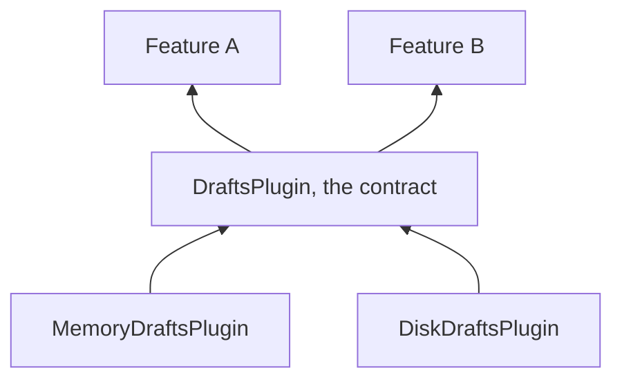
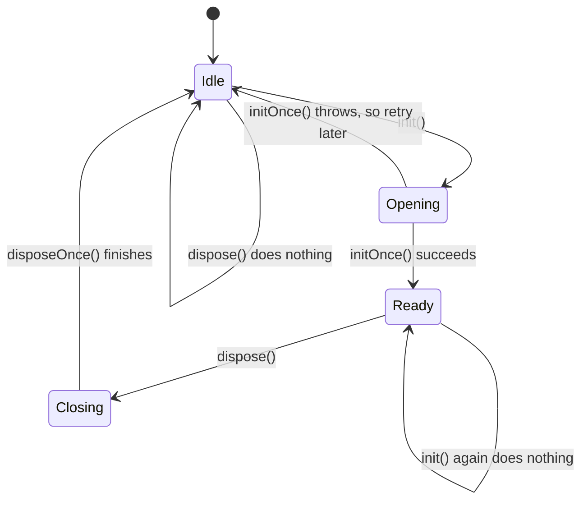
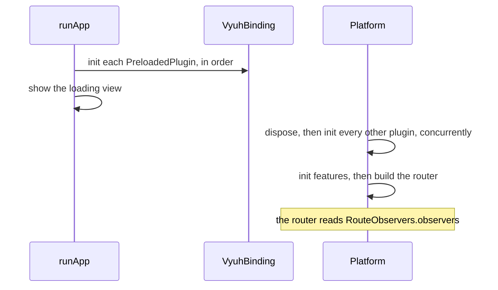

# Custom plugins

A custom plugin is a shared service you write yourself, such as search, drafts or a payments client, that many features can use while the app decides which implementation to run.

| | |
| --- | --- |
| **Contract** | [`Plugin`](/api/vyuh-core#plugin), plus the mixins [`InitOncePlugin`](/api/vyuh-core#initonceplugin), [`PreloadedPlugin`](/api/vyuh-core#preloadedplugin) and [`RouteObservers`](/api/vyuh-core#routeobservers) |
| **Default** | None. A custom plugin exists only if the app registers it. |
| **Accessor** | `vyuh.getPlugin<T>()` (nullable), or a named extension you add, such as `vyuh.drafts` |
| **Slot** | `PluginDescriptor(others: [...])`, or a system plugin's named slot when you implement a system contract |
| **Implementations** | Yours. Scaffold one with `vyuh create plugin`. |

## When to write one

Write a plugin when **several features** need the **same service** and none of the built-in plugins fits. If plain key-value storage, HTTP, auth or events are enough, use [storage](/plugins/storage), [networking](/plugins/networking), [authentication](/plugins/authentication) or [events](/plugins/events) instead.

A good pattern is an abstract **contract** in a shared package and one or more **implementations** next to it. Features depend on the contract; the app picks an implementation.



## Set up

### Scaffold with the CLI

The quickest start is the [Vyuh CLI](/intro/cli#create-a-capability-plugin):

```bash
vyuh create plugin catalog_search \
  --class-name=CatalogSearchPlugin \
  --title="Catalog search" \
  --description="Shared search capability" \
  -o plugins
```

This creates a package with a plugin class that uses `InitOncePlugin`, empty `initOnce` and `disposeOnce` hooks, and a lifecycle test. `--class-name` defaults to the package name in PascalCase followed by `Plugin`. Run `vyuh create plugin --help` for all options.

### The `Plugin` base class

Every plugin extends `Plugin`. It has just four members:

| Member | Meaning |
| --- | --- |
| `name` | A stable id, such as `'app.drafts'`. Passed to the constructor. |
| `title` | A human-readable name. Startup traces use it (`Plugin: <title>`). |
| `init()` | `Future<void>`: open clients, load data, start listeners. |
| `dispose()` | `Future<void>`: close everything `init()` opened. |

Define a contract by extending `Plugin` with the methods features will call:

```dart
import 'package:vyuh_core/vyuh_core.dart';

abstract class DraftsPlugin extends Plugin {
  DraftsPlugin({required super.name, required super.title});

  Future<String?> read(String key);
  Future<void> write(String key, String value);
}
```

### Manage the lifecycle with `InitOncePlugin`

The platform calls `dispose()` and then `init()` on each normal plugin **every time it starts**, including the first start and every restart. So `dispose()` may run before `init()` ever did, and `init()` may be called while another call is still running.

`InitOncePlugin` handles all of that. You implement two hooks, `initOnce()` and `disposeOnce()`, and the mixin provides `init()` and `dispose()` for you (they are marked `@nonVirtual`, so don't override them).

```dart
import 'package:vyuh_core/vyuh_core.dart';

final class MemoryDraftsPlugin extends DraftsPlugin with InitOncePlugin {
  MemoryDraftsPlugin() : super(name: 'app.drafts.memory', title: 'Drafts');

  final _drafts = <String, String>{};

  @override
  Future<void> initOnce() async {
    // Open a database, create a client, read a file...
  }

  @override
  Future<void> disposeOnce() async {
    _drafts.clear();
  }

  @override
  Future<String?> read(String key) async => _drafts[key];

  @override
  Future<void> write(String key, String value) async => _drafts[key] = value;
}
```

What the mixin guarantees:



- **Shared concurrent init.** Many `init()` calls at once run `initOnce()` once; they all wait for the same `Future`.
- **Already initialized.** Another `init()` returns straight away.
- **Retry after failure.** If `initOnce()` throws, every waiting `init()` fails with that error, the plugin stays uninitialized, and the next `init()` runs `initOnce()` again.
- **Dispose waits for init.** A `dispose()` during a running `init()` waits for it, then runs `disposeOnce()`. If that init failed, there is nothing to close.
- **Dispose before init is safe.** `disposeOnce()` runs only for an initialized plugin, and concurrent `dispose()` calls share one run.
- **Init during dispose.** An `init()` that arrives while disposing waits for the dispose to finish, then starts a new lifecycle.
- **`initialized`.** A `bool` getter that is `true` between a successful init and the end of dispose.

If you extend `Plugin` directly without the mixin, your `init()` and `dispose()` must handle these cases themselves.

### Initialize before the platform with `PreloadedPlugin`

Add `PreloadedPlugin` when the plugin must work **before** the platform starts its plugins and features. Telemetry, analytics and events are preloaded, so startup can be logged and traced.

```dart
final class CrashGuardPlugin extends Plugin with PreloadedPlugin, InitOncePlugin {
  CrashGuardPlugin() : super(name: 'app.crash-guard', title: 'Crash guard');

  @override
  Future<void> initOnce() async {/* ... */}

  @override
  Future<void> disposeOnce() async {/* ... */}
}
```

Preloaded plugins are initialized one after another, in registration order, when `runApp` starts and before the first frame. They are **not** re-initialized when the platform restarts. Keep their `init` short and safe: a slow one delays the app, and nothing shows a retry screen if it fails. Most plugins should not be preloaded.

### Watch navigation with `RouteObservers`

Mix in `RouteObservers` and return `NavigatorObserver`s to see route changes. When the router is built during startup, it collects the `observers` of every registered plugin with this mixin and passes them to `GoRouter`.

```dart
import 'package:flutter/widgets.dart';
import 'package:vyuh_core/vyuh_core.dart';

final class _LastRouteObserver extends NavigatorObserver {
  String? lastRoute;

  @override
  void didPush(Route<dynamic> route, Route<dynamic>? previousRoute) {
    lastRoute = route.settings.name;
  }
}

final class LastRoutePlugin extends Plugin with InitOncePlugin, RouteObservers {
  LastRoutePlugin() : super(name: 'app.last-route', title: 'Last route');

  final _observer = _LastRouteObserver();

  String? get lastRoute => _observer.lastRoute;

  // Return the same instances every time.
  @override
  List<NavigatorObserver> get observers => [_observer];

  @override
  Future<void> initOnce() async {}

  @override
  Future<void> disposeOnce() async {}
}
```

## Register it

### Custom plugins go in `others`

```dart
void main() {
  runApp(
    features: () => [/* your features */],
    plugins: PluginDescriptor(
      others: [MemoryDraftsPlugin(), LastRoutePlugin()],
    ),
  );
}
```

`others` registers the plugin with the platform, which runs its lifecycle. It does **not** add it to dependency injection. If you also want a DI lookup, register it yourself in a feature's `init`.

### System contracts go in their named slot

If your class implements a system contract, pass it in that contract's slot. The system types are `DIPlugin`, `AnalyticsPlugin`, `TelemetryPlugin`, `NetworkPlugin`, `AuthPlugin`, `NavigationPlugin`, `EnvPlugin`, `EventPlugin`, `StoragePlugin` and `SecureStoragePlugin` (also listed in `PluginDescriptor.systemPluginTypes`).

```dart
final class MapStoragePlugin extends StoragePlugin with InitOncePlugin {
  MapStoragePlugin() : super(name: 'app.storage.map', title: 'Map storage');

  final _values = <String, dynamic>{};

  @override
  Future<void> initOnce() async {}

  @override
  Future<void> disposeOnce() async => _values.clear();

  @override
  Future<dynamic> read(String key) async => _values[key];

  @override
  Future<dynamic> write(String key, dynamic value) async => _values[key] = value;

  @override
  Future<bool> has(String key) async => _values.containsKey(key);

  @override
  Future<bool> delete(String key) async => _values.remove(key) != null;
}

final plugins = PluginDescriptor(storage: MapStoragePlugin());
```

Putting a system plugin in `others` throws, so a second storage plugin can't sneak in next to the real one:

```dart
PluginDescriptor(others: [MapStoragePlugin()]); // throws ArgumentError
```

Slots you leave empty get the framework defaults. `AnalyticsPlugin` and `TelemetryPlugin` are final classes; to change those, write a provider instead (see [analytics](/plugins/analytics#write-your-own) and [telemetry](/plugins/telemetry#write-your-own)).

## Use it

### Look it up with `vyuh.getPlugin<T>()`

`getPlugin<T>()` returns the first registered plugin that **is a** `T`, or `null` if there is none. Ask for the contract type, so features don't depend on one implementation:

```dart
final drafts = vyuh.getPlugin<DraftsPlugin>();
if (drafts == null) {
  throw StateError('Register a DraftsPlugin in PluginDescriptor.others');
}
await drafts.write('checkout', 'Two lattes, one croissant');
```

Call it once the app has started, for example in a feature's `init`, a widget, or an action. Before `runApp`, `vyuh` is not ready and the call throws.

### Add a named accessor

A short getter reads better than `getPlugin<DraftsPlugin>()!` everywhere. Add an extension on `VyuhPlatform` in your plugin package, the same way the framework defines `vyuh.storage` and `vyuh.locale`:

```dart
extension DraftsAccess on VyuhPlatform {
  /// The drafts plugin. Throws if the app did not register one.
  DraftsPlugin get drafts => getPlugin<DraftsPlugin>()!;
}

// In a feature:
await vyuh.drafts.write('note', 'Hello');
```

Return a nullable type (`DraftsPlugin? get drafts => getPlugin<DraftsPlugin>();`) when the plugin is optional, like `vyuh.locale`.

If your plugin is also used by widgets embedded in a non-Vyuh app (widget mode, where `runApp` and so `vyuh` aren't used), add the same getter on `VyuhBinding`:

```dart
extension DraftsBindingAccess on VyuhBinding {
  DraftsPlugin get drafts => get<DraftsPlugin>()!;
}

// Works in both app mode and widget mode:
await VyuhBinding.instance.drafts.write('note', 'Hello');
```

Keep plugin methods free of widgets and product rules. Pass in the data a method needs, and keep decisions in the feature.

## Behaviour and lifecycle



- Non-preloaded plugins are initialized **at the same time**, with no ordering between them. If one plugin needs another, call `await other.init()` inside your `initOnce`; with `InitOncePlugin` that safely shares the other plugin's single init.
- Every plugin is initialized before any feature's `init` runs.
- If a plugin's `init` throws, startup fails and the app shows the startup failure screen. A restart runs `dispose()` and `init()` again, which is where retry-after-failure matters.
- `vyuh.dispose()` disposes all plugins at the same time.
- In widget mode, `VyuhBinding.instance.widgetInit` disposes, then initializes **all** plugins one by one (preloaded or not), before its extension builder.

See [runtime lifecycle](/concepts/runtime-lifecycle) for the whole startup sequence.

## Testing

Test the lifecycle directly. You don't need an app for this.

```dart
import 'dart:async';

import 'package:flutter_test/flutter_test.dart';
import 'package:vyuh_core/vyuh_core.dart';

final class CountingPlugin extends Plugin with InitOncePlugin {
  CountingPlugin() : super(name: 'test.counting', title: 'Counting');

  int opens = 0;
  int closes = 0;
  bool fail = false;
  Completer<void>? opening;

  @override
  Future<void> initOnce() async {
    opens++;
    if (fail) throw StateError('open failed');
    await opening?.future;
  }

  @override
  Future<void> disposeOnce() async => closes++;
}

void main() {
  test('concurrent init opens once', () async {
    final plugin = CountingPlugin()..opening = Completer<void>();
    final calls = List.generate(5, (_) => plugin.init());
    plugin.opening!.complete();
    await Future.wait(calls);

    expect(plugin.opens, 1);
    expect(plugin.initialized, isTrue);
  });

  test('a failed init can be retried', () async {
    final plugin = CountingPlugin()..fail = true;
    await expectLater(plugin.init(), throwsStateError);

    plugin.fail = false;
    await plugin.init();
    expect(plugin.opens, 2);
  });

  test('dispose before init does nothing', () async {
    final plugin = CountingPlugin();
    await plugin.dispose();
    expect(plugin.closes, 0);
  });
}
```

To test that features find your plugin, start an app in a widget test:

```dart
import 'package:flutter/widgets.dart';
import 'package:go_router/go_router.dart';
import 'package:vyuh_test/vyuh_test.dart';

testWidgets('features can read and write drafts', (tester) async {
  runApp(
    features: () => [
      FeatureDescriptor(
        name: 'home',
        title: 'Home',
        routes: () => [GoRoute(path: '/', builder: (_, _) => const Text('home'))],
      ),
    ],
    plugins: PluginDescriptor(others: [MemoryDraftsPlugin()]),
  );
  await vyuh.getReady(tester);

  await vyuh.drafts.write('a', 'b');
  expect(await vyuh.drafts.read('a'), 'b');

  await vyuh.dispose();
});
```

## Write your own: a checklist

1. Scaffold with `vyuh create plugin`, or extend `Plugin` by hand.
2. Put the contract (an abstract class) where features can import it.
3. Mix in `InitOncePlugin` and implement `initOnce` and `disposeOnce`.
4. Add `PreloadedPlugin` only if the plugin must work before the platform starts.
5. Add `RouteObservers` only if you need to watch navigation.
6. Register it in `others`, or in its named slot if it implements a system contract.
7. Add a named accessor on `VyuhPlatform`, and on `VyuhBinding` if it is used in widget mode.
8. Test the lifecycle on its own, and test the lookup in a widget test.

See also the [plugins overview](/plugins/), the [`PluginDescriptor` API](/api/vyuh-core#plugindescriptor), [`VyuhPlatform`](/api/vyuh-core#vyuhplatform) and [`VyuhBinding`](/api/vyuh-core#vyuhbinding).
