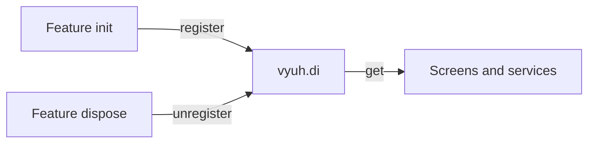

# Dependency injection

The dependency injection (DI) plugin is a shared container where features put
services, stores and clients so other code can look them up by type.

| | |
|---|---|
| Contract | `DIPlugin` |
| Default implementation | `GetItDIPlugin` (an isolated [get_it](https://pub.dev/packages/get_it) container) |
| Accessor | `vyuh.di` |
| `PluginDescriptor` slot | `di` |
| Implementations | `GetItDIPlugin`, or your own |



## Set up

You don't need to do anything: every app gets a `GetItDIPlugin` by default.
To be explicit, or to use your own implementation, fill the `di` slot:

```dart
import 'package:vyuh_core/vyuh_core.dart';

void main() {
  runApp(
    plugins: PluginDescriptor(
      di: GetItDIPlugin(),
    ),
    features: () => [/* ... */],
  );
}
```

## Use it

### Register in `init`, unregister in `dispose`

A feature registers the services it owns in its `init` hook and removes them
in `dispose`. Plugins are ready before any feature starts, so `vyuh.di` is
always usable inside `init`.

```dart
import 'package:vyuh_core/vyuh_core.dart';

class CatalogApi {
  Future<List<String>> products() async => ['Tea', 'Coffee'];
}

class CartStore {
  final items = <String>[];
}

final catalog = FeatureDescriptor(
  name: 'catalog',
  title: 'Catalog',
  init: () async {
    // One shared instance, created now.
    vyuh.di.register<CatalogApi>(CatalogApi());

    // One shared instance, created the first time someone asks for it.
    vyuh.di.registerLazy<CartStore>(() => CartStore());
  },
  dispose: () async {
    if (vyuh.di.has<CatalogApi>()) vyuh.di.unregister<CatalogApi>();
    if (vyuh.di.has<CartStore>()) vyuh.di.unregister<CartStore>();
  },
  routes: () => [/* ... */],
);
```

Anywhere after that, look the service up by its type:

```dart
final api = vyuh.di.get<CatalogApi>();
final products = await api.products();
```

If another feature reads `CatalogApi` in its own `init`, list `'catalog'` in
that feature's `dependencies`, so the catalog feature starts first.

### The registration methods

| Method | What you get from `get<T>()` |
|---|---|
| `register<T>(instance)` | The same instance you passed in, every time |
| `registerLazy<T>(() => ...)` | One instance, built on the first `get` and reused after that |
| `registerFactory<T>(() => ...)` | A **new** instance on every `get` |
| `unregister<T>()` | Removes the registration |
| `has<T>()` | `true` if something is registered for `T` |
| `get<T>()` | The registered instance; throws if nothing is registered |
| `reset()` | Removes every registration (returns a `Future`) |

Register under the type other code will ask for. If you register a
`FirestoreCatalogApi` as `register<CatalogApi>(...)`, callers use
`get<CatalogApi>()` and never see the concrete class.

### Named instances

Every method takes an optional `name`. Use it when you need two registrations
of the same type:

```dart
vyuh.di.register<Uri>(Uri.parse('https://api.example.com'), name: 'api');
vyuh.di.register<Uri>(Uri.parse('https://cdn.example.com'), name: 'cdn');

final cdn = vyuh.di.get<Uri>(name: 'cdn');
final hasApi = vyuh.di.has<Uri>(name: 'api'); // true
vyuh.di.unregister<Uri>(name: 'cdn');
```

A named registration and an unnamed one of the same type are separate entries.

### Asynchronous services

Some services need `await` before they are ready, such as a database that
must open. The `AsyncLazyDI` extension on `DIPlugin` adds two methods for
them:

```dart
class Database {
  static Future<Database> open() async => Database();
}

// In init: nothing runs yet.
vyuh.di.registerAsync<Database>(() => Database.open());

// Later: the first call starts opening; every call gets the same Future.
final db = await vyuh.di.getAsync<Database>();
```

`registerAsync<T>` is a lazy registration of a `Future<T>`, so you must read it
back with `getAsync<T>()` (or `get<Future<T>>()`), not `get<T>()`.

## Behaviour and lifecycle

- **Start-up.** `GetItDIPlugin.init()` resets its container, so it starts
  empty. DI is not a preloaded plugin: it starts with the other regular
  plugins, before any feature.
- **Restart and shutdown.** Features stop first (their `dispose` runs while
  `vyuh.di` still works), then `GetItDIPlugin.dispose()` resets the container.
  After a restart each feature registers its services again in `init`.
- **No cleanup callbacks.** Unregistering or resetting only forgets the
  object. If a service holds streams, timers or sockets, close them yourself
  in the feature's `dispose` before you unregister it.
- **Errors.** `GetItDIPlugin` passes calls straight to get_it, which throws
  when you `get` a type that isn't registered, or `register` a type (and name)
  that already is. Use `has` to check first.
- **Isolated container.** `GetItDIPlugin` uses `GetIt.asNewInstance()`, not the
  global `GetIt.instance`, so it never clashes with other get_it code in your
  app.

## Platform DI and scoped DI

`vyuh.di` is **platform-global**: one container for the whole app, living as
long as the platform. That suits services a feature shares across all its
screens.

Some state belongs to one part of the screen instead. CMS-driven apps use
`ScopedDIWidget` from `vyuh_extension_content`, which gives a subtree its own
`GetItDIPlugin(debugLabel: ...)` and resets it when the widget goes away.
`toString()` shows the label, as `GetItDIPlugin(<label>)`, so you can tell
scoped containers apart while debugging.
Descendants read it with `ScopedDIWidget.of(context)`, which falls back to the
platform container when there is no scope. See
[scoped dependency injection](/guides/scoped-di).

## Testing

In a test that runs the app, register fakes in a feature's `init`, exactly as
real code does, and wait for start-up with `getReady` from
[`vyuh_test`](/api/vyuh-test):

```dart
import 'package:flutter_test/flutter_test.dart';
import 'package:vyuh_core/vyuh_core.dart';
import 'package:vyuh_test/vyuh_test.dart';

class FakeCatalogApi extends CatalogApi {
  @override
  Future<List<String>> products() async => ['Test tea'];
}

void main() {
  tearDown(() async {
    if (VyuhBinding.instance.initialized) await vyuh.dispose();
  });

  testWidgets('uses the fake API', (tester) async {
    runApp(
      features: () => [
        FeatureDescriptor(
          name: 'test',
          title: 'Test',
          init: () async => vyuh.di.register<CatalogApi>(FakeCatalogApi()),
        ),
      ],
    );
    await vyuh.getReady(tester);

    expect(await vyuh.di.get<CatalogApi>().products(), ['Test tea']);
  });
}
```

For a plain unit test with no app, create a `GetItDIPlugin()` directly and
call its methods. It works without `init()`.

## Write your own

To back `vyuh.di` with another container, extend `DIPlugin` and implement
`register`, `registerLazy`, `registerFactory`, `unregister`, `get`, `has`,
`reset`, plus `init` and `dispose`. The `registerAsync`/`getAsync` extension
works on top of `registerLazy` and `get`, so you get it for free. Then pass
your class in the `di` slot. See [writing a plugin](/plugins/custom-plugins).

## API

- [DIPlugin](/api/vyuh-core#diplugin)
- [GetItDIPlugin](/api/vyuh-core#getitdiplugin)
- [AsyncLazyDI](/api/vyuh-core#asynclazydi)
