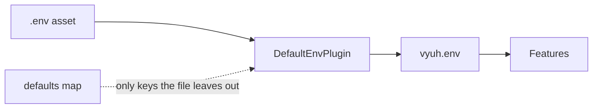

# Environment

`EnvPlugin` lets every feature read the app's settings, such as an API URL or a build mode, without hard-coding them.

| | |
| --- | --- |
| Contract | `EnvPlugin` (`get`, `maybeGet`, `all`, `clear`) |
| Default | `NoOpEnvPlugin` (holds no values) |
| Accessor | `vyuh.env` |
| `PluginDescriptor` slot | `env:` |
| Implementations | `DefaultEnvPlugin` (in `vyuh_core`, built on `flutter_dotenv`) |

The app picks where the settings come from. Features only ask for keys by name, so the same feature package can run in a dev app, a staging app and a production app.



## Set up

### 1. Create the env file

Put a `.env` file next to your app's `pubspec.yaml`. Each line is `KEY=value`:

```ini
API_URL=https://api.example.com
MODE=production
```

### 2. List it as a Flutter asset

`DefaultEnvPlugin` loads the file from the app's asset bundle, not from disk. If the file isn't listed under `assets`, `init` fails with a `FileNotFoundError` from `flutter_dotenv`. An empty file fails too, with an `EmptyEnvFileError`.

```yaml
flutter:
  assets:
    - .env
```

### 3. Register the plugin

```dart
import 'package:vyuh_core/vyuh_core.dart' as vc;

void main() {
  vc.runApp(
    plugins: vc.PluginDescriptor(
      env: vc.DefaultEnvPlugin(
        // The asset to load. Defaults to '.env'.
        fileName: '.env',
        // Used only for keys the file doesn't set.
        defaults: {
          'MODE': 'development',
          'LOG_LEVEL': 'info',
        },
      ),
    ),
    features: () => [
      // your features
    ],
  );
}
```

`DefaultEnvPlugin` takes two optional arguments:

| Argument | Default | What it does |
| --- | --- | --- |
| `fileName` | `'.env'` | The asset path of the env file, for example `'config/staging.env'`. |
| `defaults` | `{}` | Fallback values for keys the file does not set. |

### Values in the file win

`defaults` only fill gaps. When a key is in both the file and `defaults`, the file's value is used.

With the `.env` file above and the `defaults` in the snippet:

| Key | In the file | In `defaults` | `vyuh.env.get(key)` |
| --- | --- | --- | --- |
| `API_URL` | `https://api.example.com` | | `https://api.example.com` |
| `MODE` | `production` | `development` | `production` (the file wins) |
| `LOG_LEVEL` | | `info` | `info` |

To switch environments, load a different file, for example `DefaultEnvPlugin(fileName: 'config/staging.env')`. Don't try to override file values with `defaults`.

::: danger Don't put secrets in the env file
The env file is a normal asset. Anyone who installs your app can unpack it. On the web it is worse: the file is served as a plain URL next to your app, and anyone can download it with a browser.

Only put values in it that are fine to be public, such as API URLs and public client IDs. Keep API secrets, signing keys and passwords on your server.
:::

## Use it

Read settings through `vyuh.env` after the plugins have started, for example in a feature's `init` or a screen:

```dart
import 'package:vyuh_core/vyuh_core.dart';

Future<void> initCatalog() async {
  // Required: throws if the key is missing and there is no fallback.
  final apiUrl = vyuh.env.get('API_URL');

  // Required, with a fallback.
  final mode = vyuh.env.get('MODE', fallback: 'development');

  // Optional: returns null if the key is missing.
  final analyticsKey = vyuh.env.maybeGet('ANALYTICS_KEY');

  // Every loaded key and value.
  final everything = vyuh.env.all();
}
```

| Method | `DefaultEnvPlugin` | `NoOpEnvPlugin` (default) |
| --- | --- | --- |
| `get(key, {fallback})` | The value, else `fallback`. Throws an `AssertionError` when both are missing. | Always throws `UnsupportedError` |
| `maybeGet(key, {fallback})` | The value, else `fallback`, else `null` | `fallback` (or `null` without one) |
| `all()` | An unmodifiable map of every loaded key | An empty map |
| `clear()` | Removes every value (see below) | Does nothing |

Some tips:

- **Use `get` for settings the feature can't work without.** A missing key fails early, with the key's name in the message.
- **Use `maybeGet` for optional settings**, and decide what to do when it returns `null`.
- **The map from `all()` is read-only.** `DefaultEnvPlugin` returns an unmodifiable map, so changing it throws.
- **All values are strings.** Parse numbers and booleans yourself, for example `int.parse(vyuh.env.get('PAGE_SIZE', fallback: '20'))`.

::: tip The default throws on `get`
Without an `env:` plugin, Vyuh uses `NoOpEnvPlugin`. Its `get` always throws, and its `maybeGet` returns the fallback you pass. If a feature reads the environment, register `DefaultEnvPlugin` or your own `EnvPlugin`. `NoOpEnvPlugin` is exported from `vyuh_core.dart` if you want to create it yourself.
:::

## Behaviour and lifecycle

- **`init` loads the file.** It reads the asset, then adds each `defaults` entry whose key the file doesn't set. `DefaultEnvPlugin` doesn't use `InitOncePlugin`, so every `init` loads the file again from scratch.
- **When you can read it.** Vyuh starts the env plugin together with the other regular plugins, before any feature starts. Read it in a feature's `init` or later. Don't read it from another plugin's `init`, because the two start at the same time. The env plugin is not preloaded, because loading an asset needs the Flutter binding. So the preloaded plugins (network, telemetry, analytics and events) can't read env values during their own `init`: they start before the env file is loaded. Pass their settings in code instead.
- **`clear` and `dispose` empty it.** Both call `dotenv.clean()`. After that, `get`, `maybeGet` and `all` throw `flutter_dotenv`'s `NotInitializedError` until `init` runs again. Vyuh calls `dispose` and `init` for you on a restart.
- **There is one store, so use one `DefaultEnvPlugin` per app.** It loads into `flutter_dotenv`'s single global `dotenv` object. Two `DefaultEnvPlugin` instances, or other code that calls `dotenv.load`, share and overwrite the same values.

```dart
final env = vc.DefaultEnvPlugin();
await env.init();
env.get('API_URL'); // 'https://api.example.com'

env.clear();
env.get('API_URL'); // throws NotInitializedError

await env.init();
env.get('API_URL'); // 'https://api.example.com' again
```

## Testing

### Use a map-backed fake

For feature tests, the easiest option is a small `EnvPlugin` that reads from a map. It needs no assets:

```dart
import 'package:vyuh_core/vyuh_core.dart';

final class FakeEnvPlugin extends EnvPlugin {
  FakeEnvPlugin(this.values) : super(name: 'test.env', title: 'Fake Env');

  final Map<String, String> values;

  @override
  Future<void> init() async {}

  @override
  Future<void> dispose() async {}

  @override
  Map<String, String?> all() => values;

  @override
  String get(String key, {String? fallback}) =>
      values[key] ?? fallback ?? (throw StateError('$key is not set'));

  @override
  String? maybeGet(String key, {String? fallback}) => values[key] ?? fallback;

  @override
  void clear() => values.clear();
}
```

Then register it in your test app with `PluginDescriptor(env: FakeEnvPlugin({'API_URL': 'https://api.test'}))`.

### Test DefaultEnvPlugin with a fake asset

To test the real plugin, answer the `flutter/assets` channel with your file's text. Call `dotenv.clean()` afterwards, because the store is global:

```dart
import 'dart:convert';

import 'package:flutter/services.dart';
import 'package:flutter_dotenv/flutter_dotenv.dart';
import 'package:flutter_test/flutter_test.dart';
import 'package:vyuh_core/vyuh_core.dart';

void main() {
  TestWidgetsFlutterBinding.ensureInitialized();

  setUp(() {
    TestDefaultBinaryMessengerBinding.instance.defaultBinaryMessenger
        .setMockMessageHandler('flutter/assets', (message) async {
      final key = utf8.decode(message!.buffer.asUint8List());
      if (key != 'test.env') return null;
      return ByteData.sublistView(utf8.encode('MODE=file\n'));
    });
  });

  tearDown(() {
    TestDefaultBinaryMessengerBinding.instance.defaultBinaryMessenger
        .setMockMessageHandler('flutter/assets', null);
    dotenv.clean();
  });

  test('the file wins over defaults', () async {
    final env = DefaultEnvPlugin(
      fileName: 'test.env',
      defaults: {'MODE': 'default', 'ONLY_DEFAULT': 'yes'},
    );
    await env.init();

    expect(env.get('MODE'), 'file');
    expect(env.get('ONLY_DEFAULT'), 'yes');
    expect(env.maybeGet('MISSING'), isNull);
  });
}
```

`flutter_dotenv` is a dependency of `vyuh_core`. To import it in your tests, add it to your own `dev_dependencies`.

## Write your own

You can load settings from somewhere else, such as `--dart-define` values or a remote config service. Extend `EnvPlugin` and implement `init`, `dispose`, `get`, `maybeGet`, `all` and `clear`, like the fake above. Match the contract: `get` returns the fallback when the key is missing, and `maybeGet` returns `null` when there is neither a value nor a fallback.

See [Custom plugins](/plugins/custom-plugins) for the full steps.

## API

- [EnvPlugin](/api/vyuh-core#envplugin)
- [DefaultEnvPlugin](/api/vyuh-core#defaultenvplugin)
- [PluginDescriptor](/api/vyuh-core#plugindescriptor)
