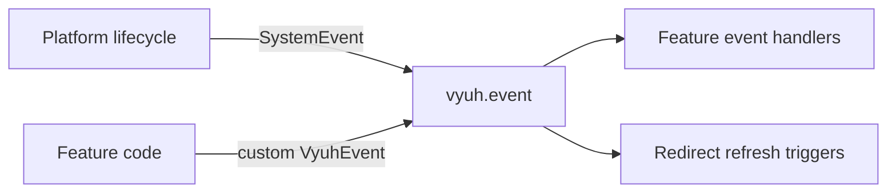

# Events

Events let features react to what happens in the app without knowing about
each other. The platform emits typed lifecycle events, and features can define
and emit their own. Everything flows through the `EventPlugin`, available as
`vyuh.event`.



## The event plugin

| | |
|---|---|
| Contract | `EventPlugin` |
| Default implementation | `DefaultEventPlugin` (built on [event_bus](https://pub.dev/packages/event_bus)) |
| Accessor | `vyuh.event` |
| `PluginDescriptor` slot | `event` |
| Implementations | `DefaultEventPlugin`, or your own |

Every app gets a `DefaultEventPlugin`; you only fill the `event` slot to swap
in your own. It is a **preloaded** plugin, so it starts before the platform
and every other plugin. That is why system events such as
`SystemInitStartedEvent` can be delivered at all.

The contract has three methods:

| Method | What it does |
|---|---|
| `on<T>(listener)` | Calls `listener` for every event of type `T` (or a subtype). Returns a `DisposeFunction` that cancels the subscription |
| `once<T>(listener)` | Calls `listener` for the next event of type `T` only, then cancels itself. Returns nothing, so you can't cancel it early |
| `emit<T>(event)` | Sends `event` to every listener of its type |

All events extend `VyuhEvent<T>`, which has a `name`, an optional `data`
payload of type `T`, and a `timestamp` set when the event is created.

Delivery is **asynchronous**: `emit` returns straight away and listeners run
shortly after (see [Delivery](#delivery)). `DefaultEventPlugin.init()` creates
a fresh bus and `dispose()` destroys it, so listeners don't survive a restart;
calling `on` or `emit` before `init()` throws.

## Declare handlers on a feature

The recommended way to listen is declaratively, with `FeatureDescriptor.events`.
Each `EventHandler<T>` listens to events of type `T`:

```dart
final account = FeatureDescriptor(
  name: 'account',
  title: 'Account',
  events: [
    EventHandler<SystemReadyEvent>((_) => restoreSession()),
    EventHandler<RouteFailureEvent>((e) => log('Route failed: ${e.failure}')),
    EventHandler<UserSignedOutEvent>((_) => clearCaches()),
  ],
  routes: () => [...],
);
```

The platform owns these subscriptions:

- It subscribes a feature's handlers **before** the feature's `init` runs, so a
  feature hears events that other features emit while they initialize.
- It cancels them when the feature is disposed or the platform restarts. A
  restart never leaves duplicate listeners behind.
- A **lazy feature** gets the same treatment. Its handlers start when it
  activates, and they are removed again if activation fails and rolls back.

You never store or cancel a subscription yourself.

## System events

The platform emits these events. All of them extend `SystemEvent`, so
`EventHandler<SystemEvent>` observes every one.

| Event | When | Payload |
|---|---|---|
| `SystemInitStartedEvent` | Platform init starts, including on restart | `isRestart` |
| `FeatureLoadedEvent` | An eager feature finished `init`, or a lazy feature activated | `featureName`, `isLazy` |
| `FeatureLoadFailedEvent` | A lazy feature failed to load, or its flag turned it off | `featureName`, `failure` |
| `SystemReadyEvent` | Plugins, features and routes are ready | none |
| `SystemInitFailedEvent` | Platform init failed | `failure` |
| `RouteFailureEvent` | A route could not be shown, reported once per failure | `failure` |

`failure` is a [`VyuhFailure`](/guides/errors-and-recovery#the-failure-model): the same
object the error views show, with a `kind`, a user-facing `title` and `message`,
the `location`, and the underlying `error`.

A load cancelled by a restart or dispose is not a failure, so it emits no
`FeatureLoadFailedEvent`.

## Define and emit your own events

Extend `VyuhEvent<T>`, where `T` is the payload type (`void` for none). Use a
reverse-domain `name`:

```dart
final class UserSignedOutEvent extends VyuhEvent<void> {
  UserSignedOutEvent() : super(name: 'com.example.account.signedOut');
}

vyuh.event.emit(UserSignedOutEvent());
```

Feature events are the glue between features. The account feature emits
`UserSignedOutEvent`; a cart feature handles it, and so can a
[redirect](/guides/routes-and-navigation#feature-redirects) that sends signed-out users
to the login page. Neither feature imports the other.

## Listen imperatively

For listeners with a shorter life than a feature, such as a widget or a
controller, subscribe with `vyuh.event.on<T>()` and cancel with the returned
function:

```dart
late final DisposeFunction _cancel;

@override
void initState() {
  super.initState();
  _cancel = vyuh.event.on<CartChangedEvent>((e) => setState(() {}));
}

@override
void dispose() {
  _cancel();
  super.dispose();
}
```

`vyuh.event.once<T>()` listens to the next event of that type only.

## Delivery

Events are delivered **asynchronously**. `emit` returns at once, and listeners
run shortly after, in subscription order. Don't rely on a listener having run
by the line after `emit`. In widget tests, pump the tester before asserting.

A listener that throws does not stop other listeners from running.

## Testing

In a widget test, run the app and wait with `getReady` from
[`vyuh_test`](/api/vyuh-test). Because delivery is asynchronous, pump (or
`await pumpEventQueue()`) after `emit` before you assert:

```dart
import 'package:flutter_test/flutter_test.dart';
import 'package:vyuh_core/vyuh_core.dart';
import 'package:vyuh_test/vyuh_test.dart';

void main() {
  tearDown(() async {
    if (VyuhBinding.instance.initialized) await vyuh.dispose();
  });

  testWidgets('handles sign-out', (tester) async {
    var signedOut = 0;
    runApp(
      features: () => [
        FeatureDescriptor(
          name: 'cart',
          title: 'Cart',
          events: [EventHandler<UserSignedOutEvent>((_) => signedOut++)],
        ),
      ],
    );
    await vyuh.getReady(tester);

    vyuh.event.emit(UserSignedOutEvent());
    await tester.pump();

    expect(signedOut, 1);
  });
}
```

For a unit test without an app, create a `DefaultEventPlugin()` and call
`await plugin.init()` before using it.

## Write your own

Extend `EventPlugin` and implement `on`, `once`, `emit`, `init` and
`dispose`, then pass it in the `event` slot. Keep it preloaded (the base class
already mixes in `PreloadedPlugin`), match listeners by type including
subtypes, so `EventHandler<SystemEvent>` still sees every system event, and
make sure the function returned by `on` really cancels. See
[writing a plugin](/plugins/custom-plugins).

## See also

- [EventPlugin API](/api/vyuh-core#eventplugin),
  [DefaultEventPlugin](/api/vyuh-core#defaulteventplugin),
  [VyuhEvent](/api/vyuh-core#vyuhevent)
- [Errors and recovery](/guides/errors-and-recovery) for the failure events in context
- [Routes and navigation](/guides/routes-and-navigation#feature-redirects) for
  event-driven redirects
- [Authentication](/plugins/authentication#react-to-sign-in-across-features)
  for turning sign-in into an event
- [Startup and lifecycle](/concepts/runtime-lifecycle) for when each event fires
