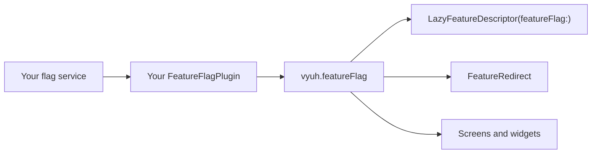
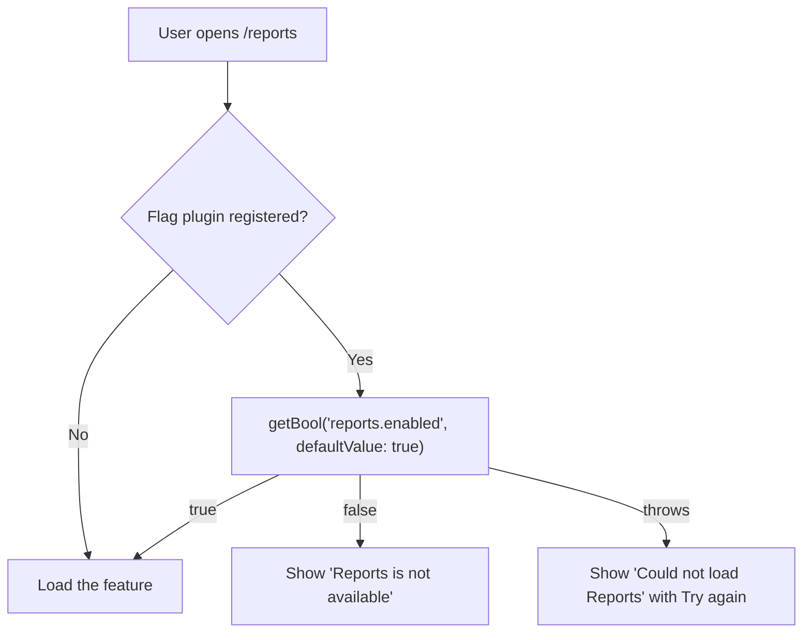

# Feature flags

`FeatureFlagPlugin` lets your app ask a flag service, such as a remote config backend, whether a feature or screen should be on.

| | |
| --- | --- |
| Contract | `FeatureFlagPlugin<TSettings, TContext>` (`getBool`, `getString`, `getInt`, `getDouble`, `getJson`, `setDefaults`, `updateContext`, `refresh`) |
| Default | None. Without a plugin, `vyuh.featureFlag` is `null`. |
| Accessor | `vyuh.featureFlag` (nullable) |
| `PluginDescriptor` slot | `others: [...]` (there is no named slot) |
| Implementations | None ship with Vyuh. You write one for your flag service (see [Write your own](#write-your-own)). |

Vyuh uses flags in one place by itself: a [lazy feature](#gate-a-lazy-feature) with a `featureFlag:` only loads when its flag is on. Everything else, such as redirects, events and widgets, is up to your code.



::: info Using Vyuh CMS?
CMS routes, content and actions can also be shown or hidden by flags, through CMS conditions. That is covered in [CMS feature flags](/cms/feature-flags). This page covers only the core contract.
:::

## The contract

`FeatureFlagPlugin` has two type parameters:

- `TSettings` is the type of the `settings` field. Put whatever your plugin needs to connect, such as an API key or a map of local flags.
- `TContext` is the type you pass to `updateContext`, such as the signed-in user.

| Member | What it does |
| --- | --- |
| `settings` | The `TSettings` value passed to the constructor. |
| `getBool(name, {defaultValue = false})` | The flag as a `bool`. |
| `getString(name, {defaultValue = ''})` | The flag as a `String`. |
| `getInt(name, {defaultValue = 0})` | The flag as an `int`. |
| `getDouble(name, {defaultValue = 0.0})` | The flag as a `double`. |
| `getJson(name, {defaultValue = const {}})` | The flag as a `Map<String, dynamic>`. |
| `setDefaults(defaults)` | Sets fallback values, for example before the first fetch finishes. |
| `updateContext(context)` | Tells the service who the user is, so it can return the right flags. |
| `refresh()` | Asks the service for fresh values. |

Every method returns a `Future`. The `defaultValue` is what your plugin should return when it doesn't know a flag.

## Set up

Register your plugin in `others`. `FeatureFlagPlugin` isn't a system plugin, so it has no named slot:

```dart
import 'package:vyuh_core/vyuh_core.dart' as vc;

void main() {
  vc.runApp(
    plugins: vc.PluginDescriptor(
      others: [
        LocalFeatureFlags({'reports.enabled': false, 'checkout.v2': true}),
      ],
    ),
    features: () => [
      // your features
    ],
  );
}
```

`LocalFeatureFlags` is the small example plugin from [Write your own](#write-your-own). Use your real implementation here.

Vyuh starts plugins in `others` together with the other regular plugins, before any feature starts. That makes your plugin's `init` a good place for the first fetch.

Register only one flag plugin. `vyuh.featureFlag` returns the first one it finds.

## Use it

`vyuh.featureFlag` is `null` when no plugin is registered. Always decide what happens in that case:

```dart
import 'package:vyuh_core/vyuh_core.dart';

Future<bool> showNewCheckout() async {
  final flags = vyuh.featureFlag;
  if (flags == null) return false; // no flag service: keep the old checkout

  return flags.getBool('checkout.v2', defaultValue: false);
}
```

Flags are read with `await`. Vyuh doesn't rebuild a widget when a flag changes on the server. Read the flag again when you need it, or listen for an event that your plugin emits (see [React when flags change](#react-when-flags-change)).

In a widget, a `FutureBuilder` is the simplest way:

```dart
import 'package:flutter/material.dart';
import 'package:vyuh_core/vyuh_core.dart';

class CheckoutButton extends StatelessWidget {
  const CheckoutButton({super.key});

  @override
  Widget build(BuildContext context) {
    return FutureBuilder<bool>(
      future: vyuh.featureFlag?.getBool('checkout.v2') ?? Future.value(false),
      builder: (context, snapshot) {
        final useV2 = snapshot.data ?? false;
        return FilledButton(
          onPressed: () => vyuh.router.go(useV2 ? '/checkout/v2' : '/checkout'),
          child: const Text('Check out'),
        );
      },
    );
  }
}
```

### Gate a lazy feature

Give a `LazyFeatureDescriptor` a `featureFlag:`. Vyuh checks the flag each time it is about to load the feature:

```dart
import 'package:vyuh_core/vyuh_core.dart' as vc;
import 'package:feature_reports/feature_reports.dart' deferred as reports;

final reportsFeature = vc.LazyFeatureDescriptor(
  name: 'reports',
  title: 'Reports',
  routePrefixes: ['/reports'],
  featureFlag: 'reports.enabled',
  loader: () async {
    await reports.loadLibrary();
    return reports.feature;
  },
);

void main() {
  vc.runApp(
    plugins: vc.PluginDescriptor(
      others: [LocalFeatureFlags({'reports.enabled': false})],
    ),
    features: () => [/* eager features */],
    lazyFeatures: () => [reportsFeature],
  );
}
```



What happens:

- **Flag on:** the feature loads as usual.
- **Flag off:** the feature is not loaded. The user sees a page titled "Reports is not available" with the message "This part of the app is turned off right now." There is no "Try again" button. Vyuh also emits a `FeatureLoadFailedEvent` whose `failure.kind` is `FailureKind.featureDisabled`, and calling `vyuh.loadFeature('reports')` throws.
- **No flag plugin:** the flag is ignored and the feature loads.
- **Unknown flag:** Vyuh asks with `defaultValue: true`. If your plugin returns the default for flags it doesn't know, the feature loads.
- **`getBool` throws:** this is treated as a normal load failure. The user sees "Could not load Reports" with a "Try again" button.

To keep a feature off until the service says otherwise, make sure the service always sends a value for that flag. You can also call `setDefaults` with `false` in your plugin's `init`.

The flag is only checked before a load. Once the feature has loaded, turning the flag off does not unload it. It stays until the app restarts.

You can change the wording through `VyuhStrings` (`featureDisabledTitle` and `featureDisabledMessage`), passed as `strings:` to your `PlatformWidgetBuilder`.

To log or track disabled features, listen for the event:

```dart
import 'package:vyuh_core/vyuh_core.dart';

final reportsWatcher = EventHandler<FeatureLoadFailedEvent>((event) {
  if (event.failure.kind == FailureKind.featureDisabled) {
    vyuh.analytics.reportEvent(
      'feature_disabled',
      params: {'feature': event.featureName},
    );
  }
});
```

Add `reportsWatcher` to the `events:` list of one of your eager features.

### Redirect with a flag

A `FeatureRedirect` can `await` a flag and send the user somewhere else. Return `null` to let navigation continue:

```dart
import 'package:vyuh_core/vyuh_core.dart';

final checkoutRedirect = FeatureRedirect(
  name: 'checkout-v2',
  refreshOn: [FlagsRefreshedEvent],
  redirect: (context, state) async {
    if (state.matchedLocation != '/checkout') return null;

    final useV2 =
        await vyuh.featureFlag?.getBool('checkout.v2') ?? false;
    return useV2 ? '/checkout/v2' : null;
  },
);

final checkout = FeatureDescriptor(
  name: 'checkout',
  title: 'Checkout',
  redirects: [checkoutRedirect],
  routes: () => [/* '/checkout' and '/checkout/v2' */],
);
```

Redirects run on every navigation, so keep `getBool` fast. Most flag services cache values in memory after the first fetch.

If a redirect throws, Vyuh reports the error to telemetry and skips that redirect. Navigation still works.

### React when flags change

`refreshOn` re-runs the redirects when an event of that exact type is emitted. Define your own event, and emit it after your flags change:

```dart
import 'package:vyuh_core/vyuh_core.dart';

final class FlagsRefreshedEvent extends VyuhEvent<void> {
  FlagsRefreshedEvent() : super(name: 'app.flagsRefreshed');
}

final flagRefresh = EventHandler<SystemReadyEvent>((_) async {
  final flags = vyuh.featureFlag;
  if (flags == null) return;

  await flags.refresh();
  vyuh.event.emit(FlagsRefreshedEvent());
});
```

Put `flagRefresh` in a feature's `events:` list. Vyuh subscribes it when the feature starts and cancels it when the feature stops.

You can do the same when the user signs in. Pass the user to `updateContext`, call `refresh`, and emit `FlagsRefreshedEvent`.

### Keep security on the server

Flags decide what the app shows. They do not protect anything. A user can still call your API directly, so check permissions on the server even when a screen is hidden.

## Behaviour and lifecycle

- **Start-up.** Your plugin's `init` runs with the other regular plugins, before features start. `dispose` runs when the app stops or restarts.
- **No default.** Unlike storage or environment, there is no fallback plugin. `vyuh.featureFlag` is `null` until you register one.
- **One check per load.** Lazy features check their flag before every load attempt. Once a feature is loaded, the flag is not checked again until a restart.
- **No automatic rebuilds.** Nothing in Vyuh listens to flag changes. Emit your own event, as shown above, when your code needs to react.

## Testing

Write a fake that reads from a map. The `LocalFeatureFlags` plugin below works well as a test fake too.

Test both states, and the case with no plugin at all:

```dart
import 'package:flutter_test/flutter_test.dart';
import 'package:vyuh_core/vyuh_core.dart' as vc;
import 'package:vyuh_test/vyuh_test.dart';

void main() {
  testWidgets('reports is off when its flag is off', (tester) async {
    vc.runApp(
      plugins: vc.PluginDescriptor(
        others: [LocalFeatureFlags({'reports.enabled': false})],
      ),
      features: () => [homeFeature],
      lazyFeatures: () => [reportsFeature],
    );
    await vc.vyuh.getReady(tester);

    vc.vyuh.router.go('/reports');
    await tester.pumpAndSettle();

    expect(find.text('Reports is not available'), findsOneWidget);
    expect(vc.vyuh.isFeatureLoaded('reports'), isFalse);
  });

  testWidgets('reports loads when no flag plugin is registered',
      (tester) async {
    vc.runApp(
      features: () => [homeFeature],
      lazyFeatures: () => [reportsFeature],
    );
    await vc.vyuh.getReady(tester);

    await vc.vyuh.loadFeature('reports');
    expect(vc.vyuh.isFeatureLoaded('reports'), isTrue);
  });
}
```

`getReady` comes from the [`vyuh_test`](/framework/vyuh-test) package. It waits until the app has started.

Also test what happens when your plugin throws, for example when the flag service is offline.

## Write your own

Extend `FeatureFlagPlugin`, pick your `TSettings` and `TContext` types, and implement every method. This example keeps flags in a map. It is handy for local development and tests:

```dart
import 'package:vyuh_core/vyuh_core.dart';

/// Flags from a map. TSettings is the map, TContext is a user id.
final class LocalFeatureFlags
    extends FeatureFlagPlugin<Map<String, dynamic>, String?> {
  LocalFeatureFlags(Map<String, dynamic> flags)
      : super(
          settings: {...flags},
          name: 'app.flags.local',
          title: 'Local Feature Flags',
        );

  final Map<String, dynamic> _defaults = {};
  String? userId;

  T _value<T>(String name, T defaultValue) {
    final value = settings[name] ?? _defaults[name];
    return value is T ? value : defaultValue;
  }

  @override
  Future<void> init() async {}

  @override
  Future<void> dispose() async {}

  @override
  Future<bool> getBool(String featureName, {bool defaultValue = false}) async =>
      _value(featureName, defaultValue);

  @override
  Future<String> getString(String featureName,
          {String defaultValue = ''}) async =>
      _value(featureName, defaultValue);

  @override
  Future<int> getInt(String featureName, {int defaultValue = 0}) async =>
      _value(featureName, defaultValue);

  @override
  Future<double> getDouble(String featureName,
          {double defaultValue = 0.0}) async =>
      _value(featureName, defaultValue);

  @override
  Future<Map<String, dynamic>> getJson(String featureName,
          {Map<String, dynamic> defaultValue = const {}}) async =>
      _value(featureName, defaultValue);

  @override
  Future<void> setDefaults(Map<String, dynamic> defaults) async =>
      _defaults.addAll(defaults);

  @override
  Future<void> updateContext(String? context) async => userId = context;

  @override
  Future<void> refresh() async {}
}
```

A real plugin for a flag service would fetch values in `init`, send the user in `updateContext`, and fetch again in `refresh`. It should also cache values, so that `getBool` stays fast.

See [Custom plugins](/plugins/custom-plugins) for the full steps.

## API

- [FeatureFlagPlugin](/api/vyuh-core#featureflagplugin)
- [LazyFeatureDescriptor](/api/vyuh-core#lazyfeaturedescriptor)
- [FeatureRedirect](/api/vyuh-core#featureredirect)
- [EventHandler](/api/vyuh-core#eventhandler)
- [PluginDescriptor](/api/vyuh-core#plugindescriptor)
- [CMS feature flags](/cms/feature-flags) for CMS conditions
