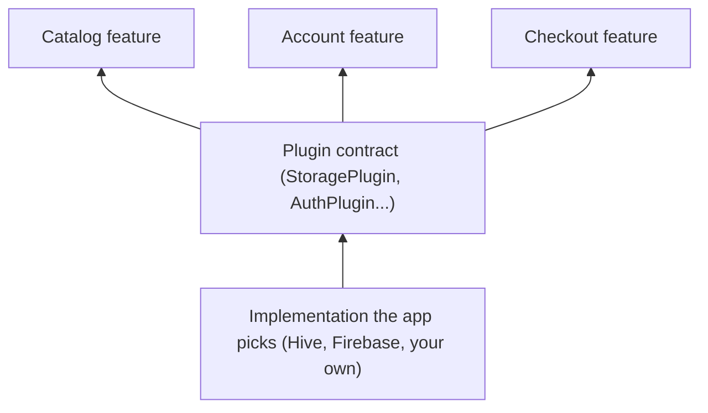

# Plugins

A **plugin** is a capability that many features share: networking, storage,
sign-in, telemetry and so on. Features use the plugin's **contract**; the
**app** decides which **implementation** to plug in. A feature that saves
settings never knows whether they land in memory, Hive or shared preferences.



## Every plugin at a glance

Vyuh Core ships twelve plugins. Ten have a slot in `PluginDescriptor` and work
out of the box with a sensible default. Two are optional and go in `others`.

| Plugin | What it's for | Contract | Default | Access | Other implementations |
|---|---|---|---|---|---|
| [Dependency injection](dependency-injection) | Share services between features | `DIPlugin` | `GetItDIPlugin` | `vyuh.di` | Your own |
| [Networking](networking) | HTTP requests with timeouts and retries | `NetworkPlugin` | `HttpNetworkPlugin` | `vyuh.network` | Your own |
| [Authentication](authentication) | Sign-in, the current user, sessions | `AuthPlugin` | `UnknownAuthPlugin` (signed out) | `vyuh.auth` | Your provider (Firebase, Supabase...) |
| [Navigation](navigation) | Routes, redirects, deep links | `NavigationPlugin` | `DefaultNavigationPlugin` (go_router) | `vyuh.router` | Your own |
| [Events](events) | Typed events between features and the platform | `EventPlugin` | `DefaultEventPlugin` | `vyuh.event` | Your own |
| [Storage](storage) | Key-value storage | `StoragePlugin` | `InMemoryStoragePlugin` | `vyuh.storage` | `HiveStoragePlugin`, `SharedPreferencesStoragePlugin` |
| [Secure storage](secure-storage) | Secrets such as tokens | `SecureStoragePlugin` | `InMemorySecureStoragePlugin` | `vyuh.secureStorage` | `FlutterSecureStoragePlugin` |
| [Environment](environment) | Configuration values | `EnvPlugin` | `NoOpEnvPlugin` | `vyuh.env` | `DefaultEnvPlugin` (.env files) |
| [Analytics](analytics) | Product analytics and screen tracking | `AnalyticsPlugin` + `AnalyticsProvider` | no-op provider | `vyuh.analytics` | Your providers |
| [Telemetry and logging](telemetry) | Errors, traces and logs | `TelemetryPlugin` + `TelemetryProvider` | no-op provider | `vyuh.telemetry`, `vyuh.log` | `ConsoleLoggerTelemetryProvider` |
| [Locale and translations](locale) | Languages, translations, device locale | `LocalePlugin` | not registered | `vyuh.locale` (nullable) | — |
| [Feature flags](feature-flags) | Turn features and behaviour on or off | `FeatureFlagPlugin` | not registered | `vyuh.featureFlag` (nullable) | Your provider |

The implementation packages:

| Package | Provides |
|---|---|
| [`vyuh_plugin_storage_hive`](https://pub.dev/packages/vyuh_plugin_storage_hive) | `HiveStoragePlugin` |
| [`vyuh_plugin_storage_shared_preferences`](https://pub.dev/packages/vyuh_plugin_storage_shared_preferences) | `SharedPreferencesStoragePlugin` |
| [`vyuh_plugin_storage_secure`](https://pub.dev/packages/vyuh_plugin_storage_secure) | `FlutterSecureStoragePlugin` |
| [`vyuh_plugin_telemetry_provider_console`](https://pub.dev/packages/vyuh_plugin_telemetry_provider_console) | `ConsoleLoggerTelemetryProvider` |

::: info Content and CMS
The content plugin is not part of the core. CMS-driven apps add it from
[`vyuh_extension_content`](/cms/packages/vyuh-extension-content); see the
[CMS section](/cms/).
:::

## Pick implementations

Pass a `PluginDescriptor` to `runApp`. Any slot you leave out keeps its
default, so you only name what you want to change. Optional plugins and your
own go in `others`.

```dart
import 'package:vyuh_core/vyuh_core.dart';
import 'package:vyuh_plugin_storage_hive/vyuh_plugin_storage_hive.dart';
import 'package:vyuh_plugin_storage_secure/vyuh_plugin_storage_secure.dart';
import 'package:vyuh_plugin_telemetry_provider_console/vyuh_plugin_telemetry_provider_console.dart';

void main() {
  runApp(
    plugins: PluginDescriptor(
      storage: HiveStoragePlugin(),
      secureStorage: FlutterSecureStoragePlugin(),
      env: DefaultEnvPlugin(),
      telemetry: TelemetryPlugin(providers: [ConsoleLoggerTelemetryProvider()]),
      navigation: DefaultNavigationPlugin(urlStyle: RouterUrlStyle.path),
      others: [
        LocalePlugin(locales: [/* LocaleConfiguration... */]),
        MyFeatureFlags(),
      ],
    ),
    features: () => [/* ... */],
  );
}
```

A system plugin belongs in its named slot: putting, say, a `StoragePlugin` in
`others` throws, so there is never any doubt about which one is active.

## Use a plugin from a feature

Every plugin has a named accessor on `vyuh`:

```dart
final token = await vyuh.secureStorage.read('auth.token');
final response = await vyuh.network.get(Uri.parse('https://api.example.com/me'));
vyuh.analytics.reportEvent('checkout_started');
vyuh.log.info('Cart has ${items.length} items');
vyuh.router.push('/cart');
```

Optional plugins return null when the app hasn't registered them:

```dart
final enabled = await vyuh.featureFlag?.getBool('new-checkout') ?? false;
```

Code that must also run without `runApp`, such as an embedded
`VyuhContentWidget`, uses the same accessors on `VyuhBinding.instance`.

## When plugins start

Plugins start before any feature, so a feature's `init` can use all of them.

1. **Preloaded plugins** start first: events, networking, telemetry and
   analytics. They're needed while everything else starts. If one fails, the
   app shows its startup failure screen instead of crashing, and Restart
   tries the failed plugin again. Preloaded plugins that started keep running
   across restarts.
2. **The remaining plugins** start together.
3. **Features** start, in dependency order.

There's no dependency order between plugins of the same stage. If your plugin
needs another one, await it in its own `init`. On restart and shutdown,
features stop first, while the plugins they use still exist.

## Write your own

Any shared capability your features need can be a plugin: a payments client,
a search index, a remote config service. See [writing a plugin](custom-plugins).
