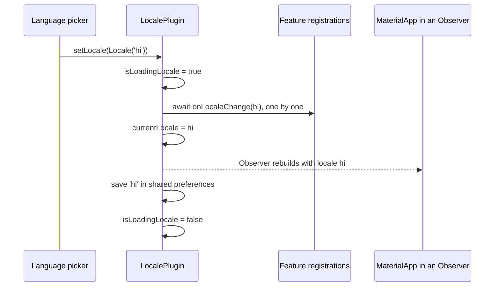

# Locale and translations

`LocalePlugin` holds the app's current language, remembers the user's choice, and tells every feature when the language changes so each one can load its own translations.

| | |
| --- | --- |
| **Contract** | [`LocalePlugin`](/api/vyuh-core#localeplugin), configured with [`LocaleConfiguration`](/api/vyuh-core#localeconfiguration) entries |
| **Default** | None. The plugin is optional; without it `vyuh.locale` is `null`. |
| **Accessor** | `vyuh.locale` (nullable), `vyuh.getPlugin<LocalePlugin>()`, or `VyuhBinding.instance.locale` in widget mode |
| **Slot** | `PluginDescriptor(others: [...])` |
| **Implementations** | `LocalePlugin` in `vyuh_core`. Features plug in with [`TranslationRegistration`](/api/vyuh-core#translationregistration). |

## How it fits together

The app lists the languages it supports. Each feature registers a callback that loads its translations. When the language changes, the plugin calls every callback first and only then switches `currentLocale`, so the UI rebuilds with the new strings already loaded.



`LocalePlugin` does not install Flutter's localization delegates or wrap your app in any widget. You connect its `currentLocale` to your `MaterialApp` yourself, as shown below.

## Set up

### 1. Describe your languages

Create one `LocaleConfiguration` per language. Each has a `Locale`, the language's name in that language, and an icon (often a flag emoji).

```dart
import 'package:flutter/widgets.dart';
import 'package:vyuh_core/vyuh_core.dart';

const english = LocaleConfiguration(
  locale: Locale('en'),
  nativeName: 'English',
  icon: '🇺🇸',
);

const hindi = LocaleConfiguration(
  locale: Locale('hi'),
  nativeName: 'हिन्दी',
  icon: '🇮🇳',
);

// The same thing, built from a language code:
final tamil = LocaleConfiguration.fromCode('ta', nativeName: 'தமிழ்', icon: '🇮🇳');
```

The plugin matches languages by **language code** only (`languageCode`, such as `hi`). Use plain language locales like `Locale('hi')` here.

### 2. Register the plugin

`LocalePlugin` is not a system plugin, so it goes in `others`. Give it at least one locale; it asserts that the list is not empty. The **default locale** is the `defaultLocale` you pass, or the first entry in `locales`.

```dart
final localePlugin = LocalePlugin(
  locales: [english, hindi, tamil],
  defaultLocale: english,
);

runApp(
  features: () => [/* your features */],
  plugins: PluginDescriptor(others: [localePlugin]),
);
```

### 3. Wire the locale into `MaterialApp`

Read `currentLocale.value` inside a MobX `Observer`, so the app rebuilds when it changes. Add Flutter's localization delegates so built-in widgets are translated too.

```yaml
# pubspec.yaml
dependencies:
  flutter_localizations:
    sdk: flutter
  flutter_mobx: ^2.2.0
```

```dart
import 'package:flutter/material.dart';
import 'package:flutter_localizations/flutter_localizations.dart';
import 'package:flutter_mobx/flutter_mobx.dart';
import 'package:vyuh_core/vyuh_core.dart';

final widgetBuilder = PlatformWidgetBuilder.system.copyWith(
  appBuilder: (_, platform) => Observer(
    builder: (_) {
      final locale = platform.locale; // null if LocalePlugin isn't registered
      final theme = platform.widgetBuilder.theme;

      return MaterialApp.router(
        routerConfig: platform.router.instance,
        theme: theme.light,
        darkTheme: theme.dark,
        themeMode: theme.mode,
        locale: locale?.currentLocale.value,
        supportedLocales: locale?.supportedLocales ?? const [Locale('en')],
        localizationsDelegates: GlobalMaterialLocalizations.delegates,
      );
    },
  ),
);

// runApp(platformWidgetBuilder: widgetBuilder, ...)
```

Keep `routerConfig: platform.router.instance`; that is how Vyuh's routes reach the app. See [platform customization](/guides/platform-customization) for more on `appBuilder`.

## Use it

### Change the language

`setLocale` returns `true` when the language changed and `false` when the locale's language code isn't one of your `locales`.

```dart
final changed = await vyuh.locale?.setLocale(const Locale('hi')) ?? false;
if (!changed) {
  vyuh.log.warn('Hindi is not configured');
}
```

To go back to the device language, call `useDeviceLocale()`:

```dart
await vyuh.locale?.useDeviceLocale();
```

It reads the device locale and picks the configured locale **for the same language**. So a device set to `hi_IN` gets your app's `Locale('hi')`, not `hi_IN`. If the device language isn't configured, it uses the default locale.

### Build a language picker

The name and icon helpers make a picker short. Wrap it in an `Observer` so the check mark and loading state update.

```dart
import 'package:flutter/material.dart';
import 'package:flutter_mobx/flutter_mobx.dart';
import 'package:vyuh_core/vyuh_core.dart';

class LanguagePicker extends StatelessWidget {
  const LanguagePicker({super.key});

  @override
  Widget build(BuildContext context) {
    final plugin = vyuh.locale;
    if (plugin == null) return const SizedBox.shrink();

    return Observer(
      builder: (_) => Column(
        children: [
          if (plugin.isLoadingLocale.value) const LinearProgressIndicator(),
          for (final config in plugin.locales)
            ListTile(
              leading: Text(plugin.getLocaleIcon(config.languageCode)),
              title: Text(plugin.getLocaleName(config.languageCode)),
              trailing: plugin.isLocaleActive(config.locale)
                  ? const Icon(Icons.check)
                  : null,
              onTap: () => plugin.setLocale(config.locale),
            ),
        ],
      ),
    );
  }
}
```

### Members

| Member | What it does |
| --- | --- |
| `locales` | The `List<LocaleConfiguration>` you passed in. |
| `defaultLocale` | The `defaultLocale` you passed, or `locales.first`. |
| `supportedLocales` | `List<Locale>` of all configured locales, ready for `MaterialApp`. |
| `currentLocale` | `Observable<Locale>`: the active locale. Read `.value` in an `Observer`. |
| `currentLocaleCode` | The active language code, such as `'hi'`. |
| `isLoadingLocale` | `Observable<bool>`: `true` while `setLocale` is loading translations. |
| `setLocale(locale)` | `Future<bool>`: switches language, as described below. |
| `useDeviceLocale()` | Switches to the configured locale for the device's language, or the default. |
| `isLocaleActive(locale)` | `true` when `locale` has the same language code as the current one. |
| `getLocaleName(code)` | The `nativeName` for a language code, or the code in upper case (`'FR'`) if unknown. |
| `getLocaleIcon(code)` | The `icon` for a language code, or `'🌐'` if unknown. |
| `registerTranslations(registration)` | Adds a feature's `TranslationRegistration`. |
| `registrationCount` | How many registrations there are. |

## Feature translations

Each feature owns its strings. In the feature's `init`, register a `TranslationRegistration` with a `name` (used in log messages) and an async `onLocaleChange` callback. The callback is `async` so you can load a deferred library and keep other languages out of the first download.

This example uses [slang](https://pub.dev/packages/slang) with `lazy: true`, which generates deferred loading for you. Any translation library works the same way.

```dart
import 'package:flutter/widgets.dart';
import 'package:vyuh_core/vyuh_core.dart';

import 'i18n/strings.g.dart'; // generated by slang

final catalog = FeatureDescriptor(
  name: 'catalog',
  title: 'Catalog',
  init: () async {
    vyuh.locale?.registerTranslations(
      TranslationRegistration(
        name: 'catalog',
        onLocaleChange: (Locale locale) async {
          final appLocale = AppLocale.values.firstWhere(
            (l) => l.languageCode == locale.languageCode,
            orElse: () => AppLocale.en,
          );
          // Loads the deferred library for this language, if needed.
          await LocaleSettings.setLocale(appLocale);
        },
      ),
    );
  },
  routes: () => [/* ... */],
);
```

Then use the generated strings in widgets, for example `Text(t.catalog.title)`. Because `MaterialApp` rebuilds when `currentLocale` changes, and `currentLocale` only changes after every callback has finished, the new strings are ready when the screens rebuild.

`TranslationRegistration` has only `name` and `onLocaleChange`. Vyuh does not wrap your app in any translation widget. If your library needs one (for example slang's generated `TranslationProvider`, which you need for `context.t`), wrap it around the app yourself in `appBuilder`.

Keep translated text flexible: let labels wrap, test longer languages, and use the locale for dates, numbers and plurals instead of building sentences from pieces.

## Behaviour and lifecycle

- **Not preloaded.** `LocalePlugin` is a plain plugin. The platform initializes it with the other non-preloaded plugins, before any feature's `init` runs, so features can register in `init`.
- **Startup.** `init()` opens `SharedPreferences` and reads the key `app_locale`. If a saved language is configured, it calls `setLocale` with it. Otherwise (nothing saved, or a language you no longer support) it calls `useDeviceLocale()`.
- **Before `init`.** Right after construction, `currentLocale` is already the default locale, so the first frame has a valid locale.
- **`setLocale` steps.** It returns `false` for an unsupported language. Otherwise it sets `isLoadingLocale` to `true`, awaits each registration's `onLocaleChange` in registration order, then sets `currentLocale`, saves the language code in `app_locale`, and finally sets `isLoadingLocale` back to `false`.
- **A failing registration doesn't stop the change.** If a callback throws, the plugin logs `LocalePlugin: Error notifying "<name>" of locale change: ...` with `vyuh.log.error` and goes on to the next one.
- **Registering late is fine.** `registerTranslations` calls the new registration's `onLocaleChange` with the current locale on the next microtask, not right away. Errors there are logged as `Error initializing "<name>" translations`.
- **Only the language is saved.** The saved value is the language code (`hi`), not a country variant. `setLocale(Locale('hi', 'IN'))` is accepted and becomes the current locale as given, but after a restart the app loads `Locale('hi')`. Pass the locales from your configuration to avoid surprises.
- **Dispose and restart.** `dispose()` removes all registrations and drops the preferences handle. It does not reset `currentLocale`. On a platform restart, features run `init` again and register again.

## Testing

Mock shared preferences, set the device locale on the tester, then start the app. `vyuh.getReady` comes from `vyuh_test`.

```dart
import 'package:flutter/widgets.dart';
import 'package:flutter_test/flutter_test.dart';
import 'package:go_router/go_router.dart';
import 'package:shared_preferences/shared_preferences.dart';
import 'package:vyuh_core/vyuh_core.dart';
import 'package:vyuh_test/vyuh_test.dart';

const en = LocaleConfiguration(locale: Locale('en'), nativeName: 'English', icon: 'EN');
const hi = LocaleConfiguration(locale: Locale('hi'), nativeName: 'हिन्दी', icon: 'HI');

final home = FeatureDescriptor(
  name: 'home',
  title: 'Home',
  routes: () => [GoRoute(path: '/', builder: (_, _) => const Text('home'))],
);

void main() {
  tearDown(() async {
    if (VyuhBinding.instance.initialized) await vyuh.dispose();
  });

  testWidgets('maps the device locale to the configured language', (tester) async {
    SharedPreferences.setMockInitialValues({});
    tester.platformDispatcher.localeTestValue = const Locale('hi', 'IN');
    addTearDown(tester.platformDispatcher.clearLocaleTestValue);

    final plugin = LocalePlugin(locales: [en, hi]);
    runApp(
      features: () => [home],
      plugins: PluginDescriptor(others: [plugin]),
    );
    await vyuh.getReady(tester);

    expect(plugin.currentLocale.value, const Locale('hi'));
  });

  testWidgets('restores a saved language', (tester) async {
    SharedPreferences.setMockInitialValues({'app_locale': 'hi'});

    final plugin = LocalePlugin(locales: [en, hi]);
    runApp(
      features: () => [home],
      plugins: PluginDescriptor(others: [plugin]),
    );
    await vyuh.getReady(tester);

    expect(plugin.currentLocaleCode, 'hi');
  });
}
```

You can check the helpers without starting an app: `LocalePlugin(locales: [en, hi]).getLocaleName('fr')` is `'FR'`. After calling `registerTranslations` in a widget test, `await tester.pump()` so the deferred first call runs.

## Write your own

You rarely need a different locale plugin. Use `TranslationRegistration` to connect any translation library to `LocalePlugin`. If you need extra behaviour, such as saving the language to the user's account, extend `LocalePlugin` and override `setLocale`:

```dart
import 'package:flutter/widgets.dart';
import 'package:vyuh_core/vyuh_core.dart';

class AccountLocalePlugin extends LocalePlugin {
  AccountLocalePlugin({required super.locales});

  @override
  Future<bool> setLocale(Locale locale) async {
    final changed = await super.setLocale(locale);
    if (changed) {
      await vyuh.analytics.reportEvent(
        'language_changed',
        params: {'language': locale.languageCode},
      );
    }
    return changed;
  }
}
```

Register it in `others` as before. `vyuh.locale` still finds it, because the lookup matches subclasses of `LocalePlugin`. See [writing a custom plugin](/plugins/custom-plugins) for plugins of your own.
