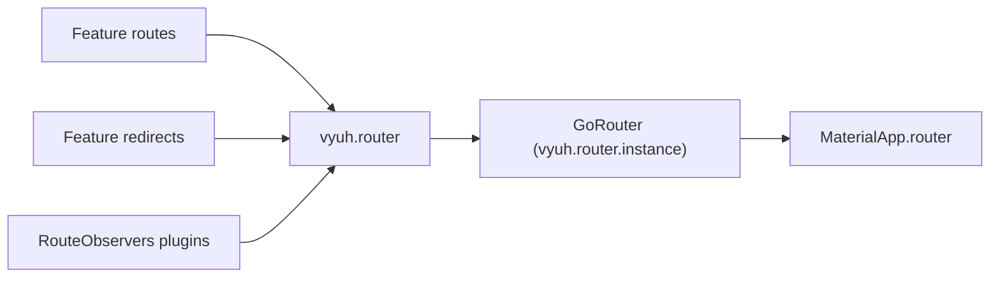

# Navigation

The navigation plugin owns the app's router: it collects every feature's
routes and redirects into one [go_router](https://pub.dev/packages/go_router)
`GoRouter`, and gives features `vyuh.router` to move around.

| | |
|---|---|
| Contract | `NavigationPlugin` |
| Default implementation | `DefaultNavigationPlugin` (go_router) |
| Accessor | `vyuh.router` |
| `PluginDescriptor` slot | `navigation` |
| Implementations | `DefaultNavigationPlugin`, or your own |

This page is the plugin reference. For declaring routes, redirects and lazy
features from a feature, read [routes and
navigation](/guides/routes-and-navigation).



## Set up

Every app gets a `DefaultNavigationPlugin` with no options. To configure it,
fill the `navigation` slot:

```dart
import 'package:vyuh_core/vyuh_core.dart';

void main() {
  runApp(
    initialLocation: '/',
    homeLocation: '/',
    plugins: PluginDescriptor(
      navigation: DefaultNavigationPlugin(
        urlStyle: RouterUrlStyle.path,
        urlReflectsImperativeAPIs: true,
        redirect: (context, state) =>
            state.matchedLocation == '/old-home' ? '/' : null,
      ),
    ),
    features: () => [/* ... */],
  );
}
```

`DefaultNavigationPlugin` takes three optional arguments:

| Argument | Default | What it does |
|---|---|---|
| `redirect` | none | A go_router redirect that runs before every feature redirect. Return a location to redirect, or `null` to continue |
| `urlStyle` | Flutter's default (hash) | `RouterUrlStyle.path` gives `example.com/orders`; `RouterUrlStyle.hash` gives `example.com/#/orders`. Web only |
| `urlReflectsImperativeAPIs` | `false` | When `true`, `push` and the other imperative calls also update the browser URL. Sets go_router's global `GoRouter.optionURLReflectsImperativeAPIs` |

`urlStyle` and `urlReflectsImperativeAPIs` take effect as soon as the plugin
is **constructed**, so create it in `main`, before `runApp`, as above. With
`RouterUrlStyle.path`, your web host must serve the app for every path.

The static methods `DefaultNavigationPlugin.usePathStrategy()`,
`useHashStrategy()` and `enableURLReflectsImperativeAPIs()` do the same
things on their own. `DefaultNavigationPlugin.setRouterRedirect()` is
deprecated: pass `redirect` to the constructor, or use feature redirects.

### Connect the router to your app

The router lives at `vyuh.router.instance`. Your app widget hands it to
`MaterialApp.router`:

```dart
appBuilder: (_, platform) => MaterialApp.router(
  routerConfig: platform.router.instance,
),
```

The default `PlatformWidgetBuilder.system` already does this.

## Use it

### Go, push, pop and replace

```dart
vyuh.router.go('/catalog');                   // jump to a location
await vyuh.router.push('/cart');              // open a page on top
vyuh.router.pop();                            // close the top page
await vyuh.router.replace('/cart/checkout');  // swap the top page
await vyuh.router.pushReplacement('/thanks'); // push and drop the old page
```

`push`, `pushReplacement` and `replace` return a `Future` that completes with
the value the pushed page passes to `pop(result)`:

```dart
final confirmed = await vyuh.router.push<bool>('/confirm');
// On the /confirm page: vyuh.router.pop(true);
```

Every location method also has a `...Named` form that takes a route name
plus `pathParameters`, `queryParameters` and `extra`: `goNamed`, `pushNamed`,
`pushReplacementNamed` and `replaceNamed`.

```dart
vyuh.router.goNamed(
  'product',
  pathParameters: {'id': '42'},
  queryParameters: {'tab': 'reviews'},
);
```

Every method accepts `extra`, an object passed to the destination route
without going in the URL.

### Home

`vyuh.router.homeLocation` is the app's home route. The platform sets it from
`runApp(homeLocation: ...)`, falling back to `initialLocation`, then `/`. Error
pages use it for their Go home button. Call `vyuh.router.goHome()` to go
there yourself.

### The GoRouter itself

`vyuh.router.instance` is the underlying `GoRouter`, for anything the plugin
doesn't wrap, such as `routerDelegate`, `routeInformationProvider` or
`state`. Before the router is initialised it is an empty placeholder
`GoRouter`, so read it after start-up.

## Feature redirects

Features add redirects through `FeatureDescriptor.redirects`. The platform
adds them to `vyuh.router.featureRedirects`, a `RedirectRegistry`, when a
feature starts, and removes them when it stops.

On every navigation the router runs:

1. the `redirect` you passed to `DefaultNavigationPlugin`, then
2. each feature redirect, in feature order (dependencies first, lazy
   features once they activate).

The first one that returns a location wins. A feature redirect that throws is
reported to telemetry and skipped, so one broken feature can't block
navigation. A feature redirect that returns the current location counts as
"no redirect".

`DefaultNavigationPlugin` calls `watchRedirectTriggers` when it creates the
router. It re-runs the redirects (with `GoRouter.refresh()`) when:

- an event whose exact type is in some redirect's `refreshOn` is emitted,
- a redirect's `listenable` notifies, or
- the set of redirects changes, for example when a lazy feature activates.

See [feature redirects](/guides/routes-and-navigation#feature-redirects) for
writing one.

## Unmatched locations

A location that matches no route shows the themed not-found
`RouteFailureView`, with a `FailureKind.notFound` failure and a Try again
button that re-runs matching for the current location.

To handle unmatched locations yourself, contribute a `GoRoute` whose path is
`NavigationPlugin.catchAllPath` (`'/:path(.*)'`):

```dart
import 'package:go_router/go_router.dart';
import 'package:vyuh_core/vyuh_core.dart';

final pages = FeatureDescriptor(
  name: 'pages',
  title: 'Pages',
  routes: () => [
    GoRoute(
      path: NavigationPlugin.catchAllPath,
      builder: (context, state) => MyPageLookup(path: state.uri.path),
    ),
  ],
);
```

`DefaultNavigationPlugin` always moves this route to the end of the list, so
it only sees locations no other route matches, even routes added later by a
lazy feature. If more than one feature contributes a catch-all, the first one
is kept, the others are dropped, and a warning is logged.

## Route observers

A plugin can add `NavigatorObserver`s to the router by mixing in
`RouteObservers` and returning them from `observers`. `AnalyticsPlugin` does
this to track screen views.

```dart
import 'package:material_ui/material_ui.dart';
import 'package:vyuh_core/vyuh_core.dart';

final class ScreenLogPlugin extends Plugin with RouteObservers {
  ScreenLogPlugin() : super(name: 'example.screenLog', title: 'Screen Log');

  @override
  List<NavigatorObserver> get observers => [_LogObserver()];

  @override
  Future<void> init() async {}

  @override
  Future<void> dispose() async {}
}

class _LogObserver extends NavigatorObserver {
  @override
  void didPush(Route route, Route? previousRoute) {
    vyuh.log.info('Opened ${route.settings.name}');
  }
}
```

Add it in `PluginDescriptor(others: [ScreenLogPlugin()])`. The router reads
`observers` from every `RouteObservers` plugin once, when it is created. They
are attached to the root navigator only.

## How lazy features swap routes

A [lazy feature](/guides/routes-and-navigation#lazy-features) starts with one
placeholder route per route prefix. Visiting one shows a loading page and
loads the feature. When it has loaded, the platform:

1. runs the feature's `init` and builds its routes,
2. removes the placeholder routes for its prefixes,
3. calls `vyuh.router.replaceRoutes(...)` with the remaining routes plus the
   feature's real routes, and
4. starts the feature's event handlers and redirects.

`replaceRoutes` updates go_router's routing config in place, so the back
stack is kept. If any step fails, the platform puts the original routes back.

## Behaviour and lifecycle

- **Start-up.** `NavigationPlugin` is a regular plugin. Its `init()` clears
  the routes. After every feature has started, the platform calls
  `initRouter(routes: ..., initialLocation: ..., rootNavigatorKey: ...)` once
  with all their routes. Calling it twice throws a `StateError`.
- **Before `initRouter`.** `appendInitialRoutes` adds routes to include when
  the router is created; it throws once the router exists.
- **After `initRouter`.** `appendRoutes` adds routes, and `replaceRoutes`
  swaps the whole list. Both keep the catch-all rule.
- **Deep links.** On start-up the router opens the platform's initial route
  (a deep link) if there is one, otherwise `initialLocation`.
- **Debug logging.** In debug builds go_router's diagnostics are logged.
- **Shutdown and restart.** `dispose()` stops watching redirect triggers and
  disposes the `GoRouter`. A restart builds a fresh one.

## Testing

Run the app with your features and use `vyuh.router` to drive it. Wait for
start-up with `getReady` from [`vyuh_test`](/api/vyuh-test), and pump after
each navigation:

```dart
import 'package:flutter_test/flutter_test.dart';
import 'package:go_router/go_router.dart';
import 'package:material_ui/material_ui.dart';
import 'package:vyuh_core/vyuh_core.dart';
import 'package:vyuh_test/vyuh_test.dart';

GoRoute page(String path) =>
    GoRoute(path: path, builder: (_, _) => Text('page $path'));

void main() {
  tearDown(() async {
    if (VyuhBinding.instance.initialized) await vyuh.dispose();
  });

  testWidgets('navigates to the cart', (tester) async {
    runApp(
      initialLocation: '/',
      features: () => [
        FeatureDescriptor(
          name: 'shop',
          title: 'Shop',
          routes: () => [page('/'), page('/cart')],
        ),
      ],
    );
    await vyuh.getReady(tester);
    await tester.pumpAndSettle();

    vyuh.router.go('/cart');
    await tester.pumpAndSettle();

    expect(find.text('page /cart'), findsOneWidget);
  });
}
```

To test code that calls `vyuh.router` without a real router, implement
`NavigationPlugin` with a fake that records calls, and pass it in the
`navigation` slot.

## Write your own

Extend `NavigationPlugin` to change how the router is built. The contract is
tied to go_router: `instance` must return a `GoRouter`. You implement:

- `instance`, `init` and `dispose`,
- `initRouter`, `replaceRoutes`, `appendRoutes` and `appendInitialRoutes`,
- `go`, `push`, `pop`, `replace`, `pushReplacement` and their `...Named` forms.

`featureRedirects`, `homeLocation`, `goHome()` and `watchRedirectTriggers` come
from the base class. Your router's redirect should call
`featureRedirects.evaluate(context, state)`, and you should call
`watchRedirectTriggers(() => router.refresh())` after building the router,
keeping the returned function to stop watching in `dispose`. Keep the
catch-all route last as well. Extending `DefaultNavigationPlugin` is not
possible: it is a `final` class.

See [writing a plugin](/plugins/custom-plugins).

## API

- [NavigationPlugin](/api/vyuh-core#navigationplugin)
- [DefaultNavigationPlugin](/api/vyuh-core#defaultnavigationplugin)
- [RouterUrlStyle](/api/vyuh-core#routerurlstyle)
- [RedirectRegistry](/api/vyuh-core#redirectregistry), [FeatureRedirect](/api/vyuh-core#featureredirect)
- [RouteObservers](/api/vyuh-core#routeobservers)
