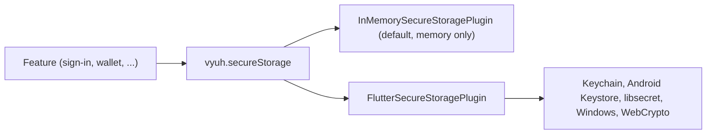

# Secure storage

`SecureStoragePlugin` gives features one shared place to keep sensitive values, such as access tokens, in the platform's protected store.

| | |
| --- | --- |
| Contract | `SecureStoragePlugin` (`read`, `write`, `has`, `delete`) |
| Default | `InMemorySecureStoragePlugin` (**not** encrypted, **not** persisted) |
| Accessor | `vyuh.secureStorage` |
| `PluginDescriptor` slot | `secureStorage:` |
| Implementation | `FlutterSecureStoragePlugin` (package `vyuh_plugin_storage_secure`, built on `flutter_secure_storage` 11) |

The contract has the same four methods as [storage](/plugins/storage). It is a separate plugin so that the app can keep secrets apart from everyday settings, and protect them differently.



::: danger The default is not secure
`InMemorySecureStoragePlugin` keeps values in a plain `Map`. It does not encrypt them and loses them when the app stops. The word "secure" names the contract, not the default. Register `FlutterSecureStoragePlugin` before you ship.
:::

## Set up

Add the package:

```yaml
dependencies:
  vyuh_plugin_storage_secure: ^1.6.6
```

It re-exports the option classes of `flutter_secure_storage` 11 (`AndroidOptions`, `IOSOptions`, `KeychainAccessibility`, `LinuxOptions`, `MacOsOptions`, `WebOptions` and `WindowsOptions`), so you don't need to import `flutter_secure_storage` to pass platform options.

Register the plugin in the `secureStorage:` slot:

```dart
import 'package:vyuh_core/vyuh_core.dart' as vc;
import 'package:vyuh_plugin_storage_secure/vyuh_plugin_storage_secure.dart';

void main() {
  vc.runApp(
    plugins: vc.PluginDescriptor(
      secureStorage: FlutterSecureStoragePlugin(),
    ),
    features: () => [
      // your features
    ],
  );
}
```

With no arguments, every platform uses the `flutter_secure_storage` defaults.

### Platform options

The constructor takes one optional options object per platform. Each one is passed straight to `FlutterSecureStorage` when the plugin starts. Any you leave out use that class's default constructor.

| Parameter | Type | Passed to `FlutterSecureStorage` as |
| --- | --- | --- |
| `androidOptions` | `AndroidOptions?` | `aOptions` |
| `iOSOptions` | `IOSOptions?` | `iOptions` |
| `macOSOptions` | `MacOsOptions?` | `mOptions` |
| `webOptions` | `WebOptions?` | `webOptions` |
| `linuxOptions` | `LinuxOptions?` | `lOptions` |
| `windowsOptions` | `WindowsOptions?` | `wOptions` |

```dart
import 'package:vyuh_core/vyuh_core.dart' as vc;
import 'package:vyuh_plugin_storage_secure/vyuh_plugin_storage_secure.dart';

final plugins = vc.PluginDescriptor(
  secureStorage: FlutterSecureStoragePlugin(
    androidOptions: const AndroidOptions(
      preferencesKeyPrefix: 'my_app',
    ),
    iOSOptions: const IOSOptions(
      accessibility: KeychainAccessibility.first_unlock,
    ),
    macOSOptions: const MacOsOptions(
      accountName: 'my_app',
    ),
    webOptions: const WebOptions(
      dbName: 'my_app_secure',
    ),
  ),
);
```

These are the options that `flutter_secure_storage` 11.2 offers. Check its [package page](https://pub.dev/packages/flutter_secure_storage) for the full details.

| Class | Options |
| --- | --- |
| `AndroidOptions()` | `resetOnError` (default `true`), `migrateOnAlgorithmChange` (`true`), `migrateWithBackup` (`false`), `enforceBiometrics` (`false`), `requireBiometricsPerOperation` (`false`), `keyCipherAlgorithm`, `storageCipherAlgorithm`, `biometricType`, `requireBiometricConfirmation` (`true`), `preferencesKeyPrefix`, `storageNamespace`, `biometricPromptTitle`, `biometricPromptSubtitle`, `biometricPromptNegativeButton` |
| `AndroidOptions.biometric()` | The same, without the two cipher options. It always uses AES-GCM with a Keystore key, so biometrics can protect it. |
| `IOSOptions` | `accountName`, `groupId`, `accessibility` (default `KeychainAccessibility.unlocked`), `synchronizable` (`false`), `label`, `description`, `comment`, `isInvisible`, `isNegative`, `creationDate`, `lastModifiedDate`, `resultLimit`, `shouldReturnPersistentReference`, `authenticationUIBehavior`, `accessControlFlags`, `useSecureEnclave` (`false`) |
| `MacOsOptions` | Everything in `IOSOptions`, plus `usesDataProtectionKeychain` (default `true`) |
| `WebOptions` | `dbName` (default `'FlutterEncryptedStorage'`), `publicKey` (`'FlutterSecureStorage'`), `wrapKey`, `wrapKeyIv`, `useSessionStorage` (`false`) |
| `LinuxOptions` | None |
| `WindowsOptions` | `useBackwardCompatibility` (default `false`) |

::: warning Older options are gone
`flutter_secure_storage` 10 and 11 removed `encryptedSharedPreferences` and `sharedPreferencesName` from `AndroidOptions`. Older examples that pass them no longer compile. Data saved with `encryptedSharedPreferences` is migrated for you while `migrateOnAlgorithmChange` is `true`.
:::

Changing `preferencesKeyPrefix`, `storageNamespace` or `accountName` later points the plugin at a different set of entries, so values saved before become unreachable. Pick them once.

### Platform setup

`flutter_secure_storage` needs some native setup. The [package README](https://pub.dev/packages/flutter_secure_storage) is the source of truth. The main points:

| Platform | What to do |
| --- | --- |
| Android | Use `minSdkVersion` 23 or higher. Turn off Auto Backup (`android:allowBackup="false"`) or exclude the plugin's shared preferences from it. Restored backups can fail with `InvalidKeyException`. For biometrics, add the `USE_BIOMETRIC` permission. |
| iOS | Add a `keychain-access-groups` entry to the app's entitlements. If you use App Groups or `groupId`, list the group there, otherwise writes appear to work but are never saved. |
| macOS | Add `keychain-access-groups` to both `DebugProfile.entitlements` and `Release.entitlements`. This needs a provisioning profile. If you don't share keychain items, you can instead pass `MacOsOptions(usesDataProtectionKeychain: false)` and skip the entitlement. |
| Web | Works only on HTTPS or `localhost`. The web version uses WebCrypto and the README marks it experimental. Serve the app with strict security headers (HSTS). |
| Linux | Install `libsecret` (`libsecret-1-dev` to build, `libsecret-1-0` to run). |
| Windows | Install the C++ ATL libraries with the Visual Studio Build Tools. |

An iOS or macOS entitlement looks like this:

```xml
<key>keychain-access-groups</key>
<array/>
```

## Use it

Read the plugin through `vyuh.secureStorage` after the plugins have started:

```dart
import 'package:vyuh_core/vyuh_core.dart';

Future<void> saveSession(String token) async {
  await vyuh.secureStorage.write('auth.accessToken', token);
}

Future<String?> loadSession() async {
  final token = await vyuh.secureStorage.read('auth.accessToken');
  return token as String?;
}

Future<void> signOut() async {
  final removed = await vyuh.secureStorage.delete('auth.accessToken');
  // removed is false if there was no token to begin with.
}
```

| Method | `FlutterSecureStoragePlugin` | `InMemorySecureStoragePlugin` |
| --- | --- | --- |
| `read(key)` | The stored `String`, or `null` | The stored value as written, or `null` |
| `write(key, value)` | Saves `value.toString()` and returns that string. A `null` value deletes the key and returns `null`. | Saves the value as it is. Returns the value. |
| `has(key)` | `true` if the key exists | `true` if the key exists |
| `delete(key)` | `true` if the key existed and was removed, `false` if it was missing | `true` if the key existed (even with a `null` value), `false` if it was missing |

Some tips:

- **Everything comes back as a string** from `FlutterSecureStoragePlugin`. `write('pin.attempts', 3)` reads back as `'3'`. Use `jsonEncode` for maps and lists, and parse numbers yourself.
- **Writing `null` is a delete.** `write('auth.accessToken', null)` removes the key. If the key is missing, nothing happens.
- **`delete` is safe to repeat.** It first checks whether the key exists. For a missing key it returns `false` and does not call the platform's delete.
- **Prefix keys with the feature name**, such as `auth.accessToken`, so features don't clash.
- **Clear secrets on sign-out.** Nothing clears them for you. Call `delete` for each key your feature owns.

## Behaviour and lifecycle

Both implementations use the `InitOncePlugin` mixin, so `init` runs once even if it is called more than once.

**`FlutterSecureStoragePlugin`**

- `init` creates the `FlutterSecureStorage` instance with your options.
- `dispose` releases the plugin. Values stay in the platform store, and a new `init` (or a new plugin instance) sees them again.
- Calling a method before `init` or after `dispose` throws a `StateError` that says the plugin is not initialized, like the Hive and SharedPreferences [storage](/plugins/storage) plugins. Vyuh starts the plugin for you, so this only matters when you create it yourself, for example in a test.

**`InMemorySecureStoragePlugin`**

- Both `init` and `dispose` clear every value.
- Vyuh disposes and starts plugins again on every restart, so values do not survive a restart either.

## Testing

### Use the in-memory default

Leave out `secureStorage:` and your feature uses `InMemorySecureStoragePlugin`. You can also create it yourself. It is exported from `vyuh_core.dart`:

```dart
import 'package:flutter_test/flutter_test.dart';
import 'package:vyuh_core/vyuh_core.dart';

void main() {
  test('stores a token', () async {
    final storage = InMemorySecureStoragePlugin();
    await storage.init();

    await storage.write('auth.accessToken', 'abc');
    expect(await storage.read('auth.accessToken'), 'abc');

    await storage.dispose();
  });
}
```

Remember that the in-memory plugin keeps values as they are. If your code relies on getting strings back, test against `FlutterSecureStoragePlugin` too.

### Test FlutterSecureStoragePlugin

`flutter_secure_storage` ships a test helper. `FlutterSecureStorage.setMockInitialValues` swaps the platform for an in-memory one, so no native code runs. `FlutterSecureStorage` itself is not re-exported, so add `flutter_secure_storage` to your `dev_dependencies` and import it in the test:

```dart
import 'package:flutter_secure_storage/flutter_secure_storage.dart';
import 'package:flutter_test/flutter_test.dart';
import 'package:vyuh_plugin_storage_secure/vyuh_plugin_storage_secure.dart';

void main() {
  TestWidgetsFlutterBinding.ensureInitialized();

  test('reads seeded values and stores strings', () async {
    FlutterSecureStorage.setMockInitialValues({'auth.accessToken': 'abc'});

    final storage = FlutterSecureStoragePlugin();
    await storage.init();

    expect(await storage.read('auth.accessToken'), 'abc');

    expect(await storage.write('pin.attempts', 3), '3');
    expect(await storage.read('pin.attempts'), '3');

    await storage.write('pin.attempts', null);
    expect(await storage.has('pin.attempts'), isFalse);

    expect(await storage.delete('missing'), isFalse);

    await storage.dispose();
  });
}
```

## Write your own

To use another secure store, such as a hardware security module or a platform plugin of your own, extend `SecureStoragePlugin` and implement `read`, `write`, `has` and `delete`. Add `InitOncePlugin` and put setup in `initOnce` and cleanup in `disposeOnce`. Keep the contract: `read` returns `null` for a missing key and `delete` returns `false` for one.

See [Custom plugins](/plugins/custom-plugins) for the full steps.

## API

- [SecureStoragePlugin](/api/vyuh-core#securestorageplugin)
- [PluginDescriptor](/api/vyuh-core#plugindescriptor)
- [Secure storage package](https://pub.dev/packages/vyuh_plugin_storage_secure) and [FlutterSecureStoragePlugin API](/api/vyuh-plugin-storage-secure#fluttersecurestorageplugin)
- [Storage](/plugins/storage) for data that isn't sensitive
