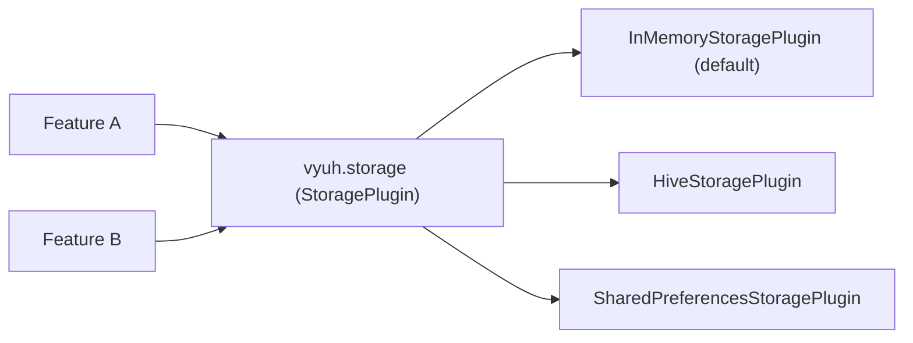

# Storage

`StoragePlugin` gives every feature one shared place to save and read small key-value data, such as settings, preferences and cached flags.

| | |
| --- | --- |
| Contract | `StoragePlugin` (`read`, `write`, `has`, `delete`) |
| Default | `InMemoryStoragePlugin` (values live in memory only) |
| Accessor | `vyuh.storage` |
| `PluginDescriptor` slot | `storage:` |
| Implementations | `HiveStoragePlugin` (package `vyuh_plugin_storage_hive`), `SharedPreferencesStoragePlugin` (package `vyuh_plugin_storage_shared_preferences`) |

Features only talk to `StoragePlugin`. The app decides where the data really goes. This means you can switch from in-memory storage to Hive without changing any feature code.



::: warning Not for secrets
`StoragePlugin` does not encrypt anything. Keep tokens and passwords in [secure storage](/plugins/secure-storage).
:::

## Pick an implementation

| | `InMemoryStoragePlugin` | `HiveStoragePlugin` | `SharedPreferencesStoragePlugin` |
| --- | --- | --- | --- |
| Package | `vyuh_core` (the default) | `vyuh_plugin_storage_hive` | `vyuh_plugin_storage_shared_preferences` |
| Survives an app restart | No | Yes | Yes |
| Survives `dispose` and `init` | No, both clear the map | Yes, the box is on disk | Yes |
| What `write` stores | The value as it is | The value as it is (Hive types: `String`, numbers, `bool`, `List`, `Map`, and so on) | `value.toString()`, always a string |
| What `read` returns | The same value | The same value and type | The stored value of any type. Values this plugin wrote come back as strings |
| Options | None | `boxName` (default `'vyuh_storage'`) | None |
| Use before `init` or after `dispose` | Works on the in-memory map | Throws `StateError` | Throws `StateError` |
| Good for | Tests, demos, prototypes | Structured local data, many keys | A few simple settings, data shared with native `SharedPreferences` code |

If you are not sure, start with `SharedPreferencesStoragePlugin` for simple settings. Pick `HiveStoragePlugin` when you want to store lists and maps without converting them yourself.

## Set up

### Use the default

You don't have to do anything. If you leave out `storage:`, Vyuh uses `InMemoryStoragePlugin`. Its values are lost when the app stops, so only rely on it in tests and prototypes.

### Hive

Add the package:

```yaml
dependencies:
  vyuh_plugin_storage_hive: ^1.4.6
```

Register the plugin in the `storage:` slot:

```dart
import 'package:vyuh_core/vyuh_core.dart' as vc;
import 'package:vyuh_plugin_storage_hive/vyuh_plugin_storage_hive.dart';

void main() {
  vc.runApp(
    plugins: vc.PluginDescriptor(
      // Opens the Hive box named 'settings'. Leave out boxName for 'vyuh_storage'.
      storage: HiveStoragePlugin(boxName: 'settings'),
    ),
    features: () => [
      // your features
    ],
  );
}
```

On `init`, the plugin calls `Hive.initFlutter()` and opens the box. `Hive.initFlutter()` keeps boxes in the app documents directory (from `path_provider`).

### SharedPreferences

Add the package:

```yaml
dependencies:
  vyuh_plugin_storage_shared_preferences: ^1.0.6
```

Register the plugin. It takes no options:

```dart
import 'package:vyuh_core/vyuh_core.dart' as vc;
import 'package:vyuh_plugin_storage_shared_preferences/vyuh_plugin_storage_shared_preferences.dart';

void main() {
  vc.runApp(
    plugins: vc.PluginDescriptor(
      storage: SharedPreferencesStoragePlugin(),
    ),
    features: () => [
      // your features
    ],
  );
}
```

On `init`, the plugin calls `SharedPreferences.getInstance()`.

## Use it

Read the plugin through `vyuh.storage`. Do this after the plugins have started, for example in a feature's `init`, an event handler, or a screen.

```dart
import 'package:vyuh_core/vyuh_core.dart';

Future<void> rememberDisplayName(String name) async {
  await vyuh.storage.write('account.displayName', name);
}

Future<String?> loadDisplayName() async {
  final value = await vyuh.storage.read('account.displayName');
  return value as String?;
}
```

All four methods are `async`. Always `await` them.

| Method | What it does |
| --- | --- |
| `read(key)` | Returns the stored value, or `null` when the key is missing. |
| `write(key, value)` | Saves the value. Returns what was stored: the value itself, or for `SharedPreferencesStoragePlugin` the string it saved. |
| `has(key)` | Returns `true` when the key exists. |
| `delete(key)` | Removes the key. Returns `true` if it was there, even when it held `null`, and `false` if it was missing. |

A few habits keep features from stepping on each other:

- **Prefix keys with the feature name**, such as `account.displayName` or `onboarding.done`. All features share one store.
- **Handle `null`.** A key may never have been written, or another implementation may be in use.
- **Store simple values.** If you want the same code to work with every implementation, convert objects to JSON first:

```dart
import 'dart:convert';

import 'package:vyuh_core/vyuh_core.dart';

Future<void> saveFilters(Map<String, dynamic> filters) =>
    vyuh.storage.write('catalog.filters', jsonEncode(filters));

Future<Map<String, dynamic>> loadFilters() async {
  final raw = await vyuh.storage.read('catalog.filters');
  if (raw is! String) return {};
  return jsonDecode(raw) as Map<String, dynamic>;
}
```

### Watch the value types

The implementations do not return the same types:

```dart
await vyuh.storage.write('cart.count', 3);
final count = await vyuh.storage.read('cart.count');
// InMemoryStoragePlugin and HiveStoragePlugin: 3 (an int)
// SharedPreferencesStoragePlugin: '3' (a String)
```

`SharedPreferencesStoragePlugin` saves every value with `setString(key, value.toString())` and returns that string, so `true` becomes `'true'`. Writing `null` deletes the key and returns `null`.

It still reads values of any type. If native code or another package stored an `int` or a `bool` in `SharedPreferences`, `read` returns that `int` or `bool`.

## Behaviour and lifecycle

All three implementations use the `InitOncePlugin` mixin. Calling `init` twice, even at the same time, starts the plugin once. Calling `dispose` before `init` does nothing.

Vyuh starts plugins for you before your features run. On a restart, it disposes the plugins and starts them again.

| | `InMemoryStoragePlugin` | `HiveStoragePlugin` | `SharedPreferencesStoragePlugin` |
| --- | --- | --- | --- |
| `init` | Clears the map | `Hive.initFlutter()`, then opens the box | `SharedPreferences.getInstance()` |
| `dispose` | Clears the map | Closes the box | Drops its reference. The data stays on the device |
| Before `init` or after `dispose` | Reads and writes the map | Every method throws `StateError` | Every method throws `StateError` |
| `delete` of a missing key | `false` | `false` | `false` |
| `write(key, null)` | Keeps the key, with a `null` value | Keeps the key, with a `null` value | Deletes the key |

The `StateError` message says the plugin is not initialized, and asks you to register it in `PluginDescriptor` or call `init()` first. You normally see it when you create the plugin yourself in a test and forget to call `init`.

Some details that can surprise you:

- **The in-memory default loses data on restart.** `dispose` and `init` both clear it, and Vyuh disposes plugins on every restart.
- **Hive and in-memory keep a key whose value is `null`.** After `write('key', null)`, `has('key')` is `true`, `read('key')` is `null`, and `delete('key')` returns `true`.
- **Hive boxes are shared by name.** Several `HiveStoragePlugin` instances with the same `boxName` share one Hive box and read the same data. The box closes only when the last of them is disposed. Use different box names to keep data apart.

## Testing

### Use the in-memory default

The simplest test leaves out `storage:`. Your feature then uses `InMemoryStoragePlugin`, which needs no platform channels. Each `init` starts empty.

You can also create it yourself. It is exported from `vyuh_core.dart`:

```dart
import 'package:flutter_test/flutter_test.dart';
import 'package:vyuh_core/vyuh_core.dart';

void main() {
  test('remembers the display name', () async {
    final storage = InMemoryStoragePlugin();
    await storage.init();

    await storage.write('account.displayName', 'Asha');

    expect(await storage.read('account.displayName'), 'Asha');
    expect(await storage.delete('missing'), isFalse);

    await storage.dispose();
  });
}
```

### Test with SharedPreferences

Call `SharedPreferences.setMockInitialValues` before `init`. You can seed it with values, including non-string ones:

```dart
import 'package:flutter_test/flutter_test.dart';
import 'package:shared_preferences/shared_preferences.dart';
import 'package:vyuh_plugin_storage_shared_preferences/vyuh_plugin_storage_shared_preferences.dart';

void main() {
  TestWidgetsFlutterBinding.ensureInitialized();

  setUp(() => SharedPreferences.setMockInitialValues({'launches': 3}));

  test('reads seeded values and stores strings', () async {
    final storage = SharedPreferencesStoragePlugin();
    await storage.init();

    expect(await storage.read('launches'), 3);

    await storage.write('launches', 4);
    expect(await storage.read('launches'), '4');

    await storage.dispose();
  });
}
```

### Test with Hive

`Hive.initFlutter()` asks `path_provider` for the documents directory. In a unit test, point that channel at a temporary folder:

```dart
import 'dart:io';

import 'package:flutter/services.dart';
import 'package:flutter_test/flutter_test.dart';
import 'package:hive_ce_flutter/hive_flutter.dart';
import 'package:vyuh_plugin_storage_hive/vyuh_plugin_storage_hive.dart';

const _pathProvider = MethodChannel('plugins.flutter.io/path_provider');

void main() {
  TestWidgetsFlutterBinding.ensureInitialized();
  late Directory dir;

  setUp(() {
    dir = Directory.systemTemp.createTempSync('hive_test_');
    TestDefaultBinaryMessengerBinding.instance.defaultBinaryMessenger
        .setMockMethodCallHandler(_pathProvider, (call) async {
      if (call.method == 'getApplicationDocumentsDirectory') return dir.path;
      return null;
    });
  });

  tearDown(() async {
    await Hive.close();
    dir.deleteSync(recursive: true);
  });

  test('keeps lists as lists', () async {
    final storage = HiveStoragePlugin(boxName: 'test');
    await storage.init();

    await storage.write('tags', ['a', 'b']);
    expect(await storage.read('tags'), ['a', 'b']);

    await storage.dispose();
  });
}
```

## Write your own

To store data somewhere else, such as SQLite or a remote cache, extend `StoragePlugin` and implement `read`, `write`, `has` and `delete`. Add the `InitOncePlugin` mixin and put your setup in `initOnce` and cleanup in `disposeOnce`. Keep the contract: `read` returns `null` for a missing key, and `delete` returns `false` for a missing key and `true` for one that exists, even with a `null` value.

See [Custom plugins](/plugins/custom-plugins) for the full steps.

## API

- [StoragePlugin](/api/vyuh-core#storageplugin)
- [PluginDescriptor](/api/vyuh-core#plugindescriptor)
- [Hive storage package](https://pub.dev/packages/vyuh_plugin_storage_hive) and [HiveStoragePlugin API](/api/vyuh-plugin-storage-hive#hivestorageplugin)
- [SharedPreferences storage package](https://pub.dev/packages/vyuh_plugin_storage_shared_preferences) and [SharedPreferencesStoragePlugin API](/api/vyuh-plugin-storage-shared-preferences#sharedpreferencesstorageplugin)
- [Secure storage](/plugins/secure-storage) for sensitive values
