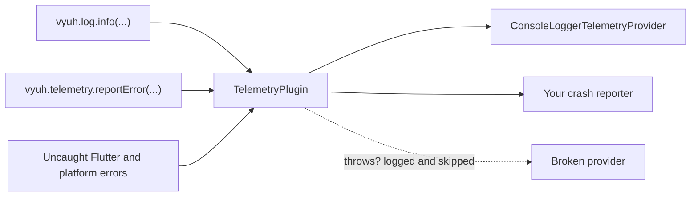
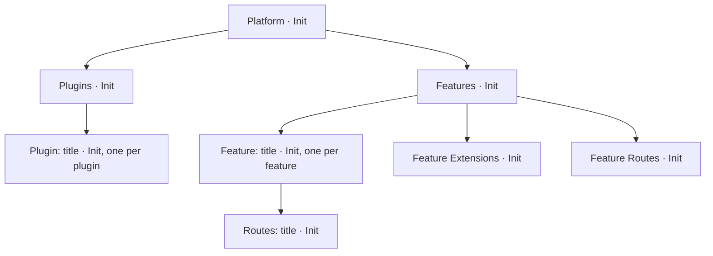

# Telemetry and logging

`TelemetryPlugin` is the one place where your app reports errors, writes log messages and measures how long things take, and it sends all of that to whichever providers the app picks.

| | |
| --- | --- |
| **Contract** | [`TelemetryPlugin`](/api/vyuh-core#telemetryplugin), which forwards to [`TelemetryProvider`](/api/vyuh-core#telemetryprovider) objects |
| **Default** | `TelemetryPlugin(providers: [NoOpTelemetryProvider()])`: nothing is recorded |
| **Accessor** | `vyuh.telemetry` and `vyuh.log` (never null), or `VyuhBinding.instance.telemetry` / `.log` in widget mode |
| **Slot** | `PluginDescriptor(telemetry: ...)` |
| **Implementations** | [`NoOpTelemetryProvider`](/api/vyuh-core#nooptelemetryprovider) in `vyuh_core`; [`ConsoleLoggerTelemetryProvider`](/framework/console-telemetry) in `vyuh_plugin_telemetry_provider_console` |

## How it fits together

`TelemetryPlugin` is a final class. You don't subclass it. You give it a list of **providers**, and it sends every report to all of them. A provider that fails is skipped; the others still get the report.



The plugin mixes in `PreloadedPlugin` and `InitOncePlugin`. It is initialized before the platform starts, so the framework can trace and report startup itself.

## Set up

Add the console provider for development logs:

```bash
flutter pub add vyuh_plugin_telemetry_provider_console
```

Then pass a `TelemetryPlugin` in the `telemetry` slot. You can list several providers.

```dart
import 'package:vyuh_core/vyuh_core.dart';
import 'package:vyuh_plugin_telemetry_provider_console/vyuh_plugin_telemetry_provider_console.dart';

void main() {
  runApp(
    features: () => [/* your features */],
    plugins: PluginDescriptor(
      telemetry: TelemetryPlugin(
        providers: [
          ConsoleLoggerTelemetryProvider(),
          // SentryTelemetryProvider(), a provider you write
        ],
      ),
    ),
  );
}
```

If you leave the slot empty, the app uses `NoOpTelemetryProvider`, which drops everything. Don't put a `TelemetryPlugin` in `others`: `PluginDescriptor` throws an `ArgumentError` for system plugins there.

## Use it

### Log messages with `vyuh.log`

`vyuh.log` is a small logger. Each method calls `reportMessage` on the telemetry plugin with a matching `LogLevel`.

```dart
import 'package:vyuh_core/vyuh_core.dart';

void loadCatalog() {
  vyuh.log.debug('Loading catalog');
  vyuh.log.info('Catalog loaded: 42 items');
  vyuh.log.warn('Catalog image missing for item 7');
  vyuh.log.error('Catalog request failed');
}
```

| Method | `LogLevel` sent |
| --- | --- |
| `trace(message)` | `LogLevel.trace` |
| `debug(message)` | `LogLevel.debug` |
| `info(message)` | `LogLevel.info` |
| `warn(message)` | `LogLevel.warning` |
| `error(message, {error})` | `LogLevel.error` |
| `fatal(message, {error, stackTrace})` | `LogLevel.fatal` |

Three things to know:

- Pass a `String` as the message. The parameter is typed `dynamic`, but it is handed to `reportMessage(String message, ...)`, so any other type fails at runtime. Use string interpolation: `vyuh.log.info('count: $count')`.
- `error()` and `fatal()` accept `error` and `stackTrace` arguments but **do not forward them**; only the message is reported. To report an exception with its stack trace, call `vyuh.telemetry.reportError` instead.
- The logger reads the telemetry plugin from `VyuhBinding`, so it works once `runApp` (or widget mode) has started.

`LogLevel` has these values, in this declared order: `debug`, `info`, `trace`, `warning`, `error`, `fatal`. Note that `trace` comes after `info`, so don't compare levels by their `index` to filter by severity.

### Report errors

Catch the error, then report it with its stack trace:

```dart
try {
  await vyuh.network.get(Uri.parse('https://api.example.com/catalog'));
} catch (error, stackTrace) {
  await vyuh.telemetry.reportError(
    error,
    stackTrace: stackTrace,
    params: {'screen': 'catalog'},
  );
}
```

The reporting methods are:

| Method | Use it for |
| --- | --- |
| `reportError(exception, {stackTrace, params, fatal = false})` | Any caught exception or error. |
| `reportFlutterError(details, {fatal = false})` | A `FlutterErrorDetails`, as Flutter gives to `FlutterError.onError`. |
| `reportMessage(message, {params, level = LogLevel.info})` | A plain message. `vyuh.log` uses this. |

Keep passwords, tokens and personal data out of `params` and messages.

### Time operations with traces

A trace measures one operation. You can attach attributes and metrics, start child traces, and stop it when done.

The easiest way is `trace()`. It starts the trace, runs your function, reports any error it throws, and always stops the trace:

```dart
final items = await vyuh.telemetry.trace<List<String>>(
  name: 'Catalog',
  operation: 'Load',
  fn: (trace) async {
    trace?.setAttributes({'source': 'network'});
    final result = await fetchCatalog();
    trace?.setMetric('count', result.length);
    return result;
  },
);
```

`trace()` takes:

| Parameter | Meaning |
| --- | --- |
| `name` (required) | What you are measuring, such as `'Catalog'`. |
| `operation` (required) | What kind of work it is, such as `'Load'` or `'Init'`. |
| `fn` (required) | `FutureOr<T?> Function(Trace? trace)`. It receives the trace it runs in, so it can start child traces. |
| `parentTrace` | When given, the new trace is started as a child of this one. |
| `level` | A `LogLevel`, `LogLevel.info` by default. |

It returns `Future<T?>`. If `fn` throws, `trace()` reports the error with `reportError` and then rethrows it, so you still handle it.

Nest traces by passing the trace you received as `parentTrace`:

```dart
await vyuh.telemetry.trace<void>(
  name: 'Checkout',
  operation: 'Submit',
  fn: (parent) async {
    await vyuh.telemetry.trace<void>(
      name: 'Validate cart',
      operation: 'Check',
      parentTrace: parent,
      fn: (_) => validateCart(),
    );
    await vyuh.telemetry.trace<void>(
      name: 'Payment',
      operation: 'Charge',
      parentTrace: parent,
      fn: (_) => chargeCard(),
    );
  },
);
```

You can also manage a trace yourself with `startTrace`. Always stop it, even when the work fails:

```dart
final trace = await vyuh.telemetry.startTrace('Search', 'Query');
try {
  final child = await trace.startChild('Search', 'Rank');
  await rankResults();
  await child.stop();
} finally {
  await trace.stop();
}
```

A `Trace` has these members: `stop()`, `setMetric(name, value)`, `getMetric(name)`, `setAttributes(map)`, `getAttributes()` and `startChild(name, operation, {level})`. Attribute values are strings and metric values are integers.

The plugin's `startTrace` asks every provider for a trace and wraps them in one combined trace. Setting an attribute or metric, stopping and starting a child all apply to every provider's trace. `getAttributes()` and `getMetric()` read from the first provider's trace.

### What the platform traces for you

The framework uses `trace()` during startup, so a provider with real traces shows where startup time goes:



Each extension builder also gets an `Extension: <title> · Init` trace. These are started without a parent, so they appear as separate top-level traces rather than under `Feature Extensions`. If startup fails, the error is reported with `reportError` before the failure screen appears.

## Uncaught errors

`runApp` has a `captureErrors` option, which is `true` by default. When it is on, the platform:

- sets `FlutterError.onError` so build, layout and paint errors go to `reportFlutterError`, then calls the handler that was there before (or `FlutterError.presentError`);
- sets `PlatformDispatcher.instance.onError` so uncaught async errors go to `reportError`, then calls the previous handler;
- in release builds only, sets `ErrorWidget.builder` to show a themed placeholder instead of the red error box.

The handlers are installed once per process. They are **not** installed under `flutter test`, because the test framework owns those handlers. Turn it off if another tool (for example a crash reporter's own zone) already installs them:

```dart
runApp(
  features: () => [/* ... */],
  captureErrors: false,
);
```

## Behaviour and lifecycle

- **Telemetry never crashes the app.** `reportError`, `reportFlutterError` and `reportMessage` call each provider separately. If a provider throws, synchronously or by returning a failed `Future`, the plugin prints `Vyuh: telemetry provider <Type> failed: <error>` with `debugPrint` and moves on. The other providers still get the report, and the `Future` you awaited completes normally.
- **Only the report methods are guarded.** `startTrace`, `init` and `dispose` are not wrapped this way. A provider that throws there makes the call fail, so keep those methods safe.
- **Startup.** As a preloaded plugin, it is initialized before the platform. `init()` runs every provider's `init()` at the same time. It is not re-initialized when the platform restarts.
- **Init once.** Concurrent `init()` calls share one run. A failed `init()` can be retried.
- **Dispose.** `vyuh.dispose()` calls each provider's `dispose()`.

### The built-in providers

`NoOpTelemetryProvider` does nothing. Its `startTrace` returns a `NoOpTrace`, whose metrics read `0`, whose attributes are empty and whose `startChild` returns another `NoOpTrace`. Use it in tests or prototypes, not in production.

`ConsoleLoggerTelemetryProvider` prints to the console with the `logger` package:

- `reportMessage` prints at the matching level (fatal, error, warning, info, debug, trace).
- `reportError` and `reportFlutterError` print the error and stack trace.
- `params` and `fatal` are ignored.
- **Traces are no-ops.** Its `startTrace` returns a `NoOpTrace`, so you won't see trace timing in the console.

See the [console telemetry package page](/framework/console-telemetry) for details.

## Testing

A recording provider lets you check what was reported. You can test the plugin directly:

```dart
import 'package:flutter/widgets.dart';
import 'package:flutter_test/flutter_test.dart';
import 'package:vyuh_core/vyuh_core.dart';

final class RecordingTelemetry implements TelemetryProvider {
  final messages = <(LogLevel?, String)>[];
  final errors = <Object?>[];
  bool broken = false;

  @override
  String get name => 'test.telemetry';

  @override
  String get title => 'Recording Telemetry';

  @override
  String get description => 'Records reports';

  @override
  Future<void> init() async {}

  @override
  Future<void> dispose() async {}

  @override
  Future<void> reportError(
    exception, {
    StackTrace? stackTrace,
    Map<String, dynamic>? params,
    bool fatal = false,
  }) async {
    if (broken) throw StateError('provider is down');
    errors.add(exception);
  }

  @override
  Future<void> reportFlutterError(
    FlutterErrorDetails details, {
    bool fatal = false,
  }) async {}

  @override
  Future<void> reportMessage(
    String message, {
    Map<String, dynamic>? params,
    LogLevel? level = LogLevel.info,
  }) async => messages.add((level, message));

  @override
  Future<Trace> startTrace(
    String name,
    String operation, {
    LogLevel? level = LogLevel.info,
  }) async => NoOpTrace();
}

void main() {
  test('a broken provider does not stop the others', () async {
    final broken = RecordingTelemetry()..broken = true;
    final healthy = RecordingTelemetry();
    final telemetry = TelemetryPlugin(providers: [broken, healthy]);

    await telemetry.reportError(StateError('boom'));

    expect(healthy.errors, hasLength(1));
  });
}
```

To test `vyuh.log` or startup traces, start an app in a widget test and wait for it:

```dart
import 'package:vyuh_test/vyuh_test.dart';

// homeFeature() returns a FeatureDescriptor with a '/' route.
testWidgets('logs at the right level', (tester) async {
  final recorder = RecordingTelemetry();
  runApp(
    features: () => [homeFeature()],
    plugins: PluginDescriptor(
      telemetry: TelemetryPlugin(providers: [recorder]),
    ),
  );
  await vyuh.getReady(tester);
  recorder.messages.clear();

  vyuh.log.warn('careful');

  expect(recorder.messages, [(LogLevel.warning, 'careful')]);
  await vyuh.dispose();
});
```

Remember that `captureErrors` does nothing under `flutter test`, so test your error reporting by calling the report methods directly.

## Write your own

A provider implements every member of `TelemetryProvider`:

```dart
abstract interface class TelemetryProvider {
  String get name;
  String get title;
  String get description;

  Future<void> init();
  Future<void> dispose();

  Future<void> reportError(
    dynamic exception, {
    StackTrace? stackTrace,
    Map<String, dynamic>? params,
    bool fatal = false,
  });

  Future<void> reportFlutterError(FlutterErrorDetails details, {bool fatal = false});

  Future<void> reportMessage(
    String message, {
    Map<String, dynamic>? params,
    LogLevel? level = LogLevel.info,
  });

  Future<Trace> startTrace(String name, String operation, {LogLevel? level = LogLevel.info});
}
```

If your backend supports performance traces, extend `Trace` too. This sketch measures time with a `Stopwatch` and sends it when the trace stops. The `_send` function stands in for your vendor SDK.

```dart
import 'package:flutter/widgets.dart';
import 'package:vyuh_core/vyuh_core.dart';

Future<void> _send(String kind, Map<String, Object?> data) async {
  // Call your crash or monitoring SDK here.
}

final class TimingTrace extends Trace {
  TimingTrace(this.name, this.operation) : _watch = Stopwatch()..start();

  final String name;
  final String operation;
  final Stopwatch _watch;
  final _attributes = <String, String>{};
  final _metrics = <String, int>{};

  @override
  void setAttributes(Map<String, String> attributes) =>
      _attributes.addAll(attributes);

  @override
  Map<String, String> getAttributes() => Map.of(_attributes);

  @override
  void setMetric(String name, int value) => _metrics[name] = value;

  @override
  int getMetric(String name) => _metrics[name] ?? 0;

  @override
  Future<Trace> startChild(
    String name,
    String operation, {
    LogLevel? level = LogLevel.info,
  }) async => TimingTrace('${this.name}/$name', operation);

  @override
  Future<void> stop() async {
    _watch.stop();
    await _send('trace', {
      'name': name,
      'operation': operation,
      'ms': _watch.elapsedMilliseconds,
      ..._attributes,
      ..._metrics,
    });
  }
}

final class CrashReporterTelemetryProvider implements TelemetryProvider {
  @override
  String get name => 'app.telemetry.crash-reporter';

  @override
  String get title => 'Crash Reporter';

  @override
  String get description => 'Sends errors and traces to our crash reporter';

  @override
  Future<void> init() async {
    // Start the SDK. Keep this fast: telemetry is preloaded.
  }

  @override
  Future<void> dispose() async {
    // Flush anything still queued.
  }

  @override
  Future<void> reportError(
    exception, {
    StackTrace? stackTrace,
    Map<String, dynamic>? params,
    bool fatal = false,
  }) => _send('error', {
    'error': '$exception',
    'stack': '$stackTrace',
    'fatal': fatal,
    ...?params,
  });

  @override
  Future<void> reportFlutterError(
    FlutterErrorDetails details, {
    bool fatal = false,
  }) => reportError(details.exception, stackTrace: details.stack, fatal: fatal);

  @override
  Future<void> reportMessage(
    String message, {
    Map<String, dynamic>? params,
    LogLevel? level = LogLevel.info,
  }) async {
    // Most crash reporters only want warnings and above.
    if (level == LogLevel.warning ||
        level == LogLevel.error ||
        level == LogLevel.fatal) {
      await _send('message', {'message': message, 'level': level?.name});
    }
  }

  @override
  Future<Trace> startTrace(
    String name,
    String operation, {
    LogLevel? level = LogLevel.info,
  }) async => TimingTrace(name, operation);
}
```

Tips:

- The report methods may throw; the plugin contains it. Still, avoid throwing from `startTrace`, `init` and `dispose`, which are not contained.
- Don't call `vyuh.log` or `vyuh.telemetry` from inside your own provider. That reports back into the plugin and can loop.
- If you have nothing to trace, return `NoOpTrace()` from `startTrace`, like the console provider does.

See also [plugins overview](/plugins/), [analytics](/plugins/analytics), and [runtime lifecycle](/concepts/runtime-lifecycle).
